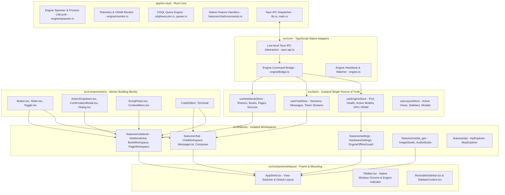
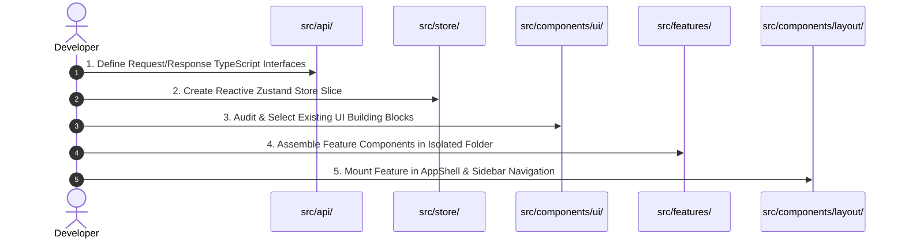

# Cluaiz Application Architecture & Directory Engineering Manual

> **Document Classification:** Engineering Master Specification & Architectural Constitution  
> **Target Workspace:** `c:\Users\Aryan\my\Cluaiz-workspace\Cluaiz-Technologies\cluaiz-app`  
> **Source Baseline:** [Files.md](file:///c:/Users/Aryan/my/Cluaiz-workspace/Cluaiz-Technologies/cluaiz-app/Files.md)  
> **Language & Governance:** Pure English Technical Specification | Khichdi-Zero Doctrine | Strict DRY Enforcement  

---

## 1. System Topology & Data Flow Overview

Cluaiz App is a hybrid high-performance desktop application powered by **Tauri v2 (Rust)** on the native backend and **React 19, TypeScript, Vite, and Tailwind CSS** on the presentation layer.

---

## 2. The 6-Layer Architecture Invariants (Khichdi-Zero)

Code cleanliness and system modularity depend on non-negotiable layer boundaries. Under no circumstance may any module bypass its adjacent layer.

| Layer Number | Workspace Path | Core Responsibility | Forbidden Patterns (Strictly Banned) |
|---|---|---|---|
| **Layer 1: Native Rust Core** | `app/src-tauri/` | Process orchestration, binary execution, direct filesystem queries, hardware sensors, OS capability security. | ❌ Storing UI layout state or rendering HTML/JSX. ❌ Exposing raw unsanitized shell commands. |
| **Layer 2: Core Bridge** | `src/core/` | Type-safe IPC invoke wrappers, stream events, connection retry loops, platform fallback handling. | ❌ React UI elements, JSX tags, Tailwind classes, or feature business decisions. |
| **Layer 3: State Sovereignty** | `src/store/` | Centralized Zustand reactive stores. In-memory single source of truth, persistent storage hydration. | ❌ Direct DOM mutations, inline styles, or modal component trees. |
| **Layer 4: Atomic UI Primitives** | `src/components/ui/` | Pure, uncoupled, presentation-only components (`Button`, `Dialog`, `Dropdown`, `Input`). | ❌ Direct feature store imports (`useChatStore`, `useNotebookStore`). Must be 100% driven by props. |
| **Layer 5: Domain Features** | `src/features/` | Self-contained domain workspaces (`chat/`, `notebook/`, `settings/`, `media_gen/`). | ❌ Cross-importing private files from another feature domain. Must communicate only through stores or shared UI. |
| **Layer 6: Presentation Shell** | `src/components/layout/` | Global application frame, window controls, resizable splitters, top-level routing. | ❌ Heavy domain computation or duplicate state storage. Acts strictly as an assembly shell. |

---

## 3. Directory-by-Directory Deep Technical Breakdown

Derived directly from the verified file tree in [Files.md](file:///c:/Users/Aryan/my/Cluaiz-workspace/Cluaiz-Technologies/cluaiz-app/Files.md).

---

### 3.1. `app/src-tauri/` — Native Rust Core Runtime

* **Role & Purpose:** Provides low-level operating system bindings, manages native inference processes (e.g. Llama engine, CDQL), provides sandboxed filesystem access, and exposes secure Tauri IPC commands.
* **Internal Structure & Files:**
  * `src/core/cdql/`:
    * `parser.rs`: AST parser for Cluaiz Database Query Language (CDQL).
    * `executor.rs`: Execution planner and memory-mapped record retrieval.
    * `wasm_runtime.rs`: Sandboxed WebAssembly isolation environment for executing untrusted query scripts.
  * `src/core/engine/`:
    * `spawner.rs`: Subprocess spawner for backend inference engine instances. Manages environment variables, process IDs, and CLI flags.
    * `monitor.rs`: Live hardware performance monitoring (GPU VRAM allocation, CPU thread utilization, memory pressure checks).
    * `state.rs`: Shared thread-safe runtime state (`Arc<Mutex<EngineState>>`).
  * `src/features/chat/`:
    * `commands.rs`: Native Tauri command endpoints invoked by frontend (`send_chat_message`, `cancel_inference`).
    * `history.rs`: SQLite/flat-file chat serialization.
    * `storage.rs`: Chunked disk persistence for multi-turn sessions.
  * `src/features/code_editor/` & `src/features/media_gen/`: Native extensions for code formatting and local audio/image asset pipeline.
  * `src/lib.rs` & `src/main.rs`: Entry point registering plugin handlers, system tray icons, and IPC invocation handlers.
  * `tauri.conf.json`: Security capabilities, window definitions, CSP policies, and plugin configurations.
* **Permitted:** Heavy multi-threaded computations, safe FFI bindings, asynchronous process pipelines.
* **Strictly Banned:** Mixing frontend UI concerns, hardcoding static model filesystem paths.

---

### 3.2. `src/core/` — TypeScript Runtime Bridge

* **Role & Purpose:** Acts as the sole gatekeeper between Tauri's Rust IPC and the frontend React application. Exposes safe, strongly-typed async functions.
* **Internal Structure & Files:**
  * `tauri-api.ts`: Wraps `@tauri-apps/api/core` with error handling, timeout guards, and browser mock fallbacks when running in pure web mode (`npm run dev:web`).
  * `engineBridge.ts`: Typed invoke wrapper for starting/stopping the AI engine, loading weights, querying health, and fetching dynamic ports.
  * `engine.ts`: Runtime supervisor maintaining engine heartbeat probes and dispatching reconnection events.
* **Permitted:** Raw async promises, stream transformers, connection status probes.
* **Strictly Banned:** React components, JSX hooks, presentation styles.

---

### 3.3. `src/api/` — Typed RPC Contracts & Endpoint Specs

* **Role & Purpose:** Central repository of all network request definitions, IPC parameter structures, and response schemas.
* **Internal Structure & Files:**
  * `client/`:
    * `client.ts`: Unified API client managing request lifecycle.
    * `http.ts`: Standard HTTP fetch wrapper with interceptors.
    * `ipc.ts`: IPC transport bridge.
    * `sse.ts`: Server-Sent Events (SSE) streaming parser decoding real-time token chunks for LLM responses.
  * `engine/`: Domain-specific endpoint contracts:
    * `audio/`: Text-to-speech (TTS) and speech-to-text (STT) parameters (`audio.api.ts`, `speechRequest.ts`).
    * `chat/`: Chat completions and prompt streaming (`chat.api.ts`, `chat.types.ts`).
    * `chat-memory/`: Vector context recall and conversation compression contracts.
    * `control/`: Engine restart, dynamic model unloader, temperature adjustments.
    * `fs/`: Sandboxed filesystem operations.
    * `inference/`: Raw tensor and completion interfaces.
    * `llm-optimization/`: KV-cache quantization, context shift parameters.
    * `models/`: Available models catalog, GGUF metadata parsing.
    * `permission/`: Access control and sandboxing rights.
    * `storage/`: Cold storage snapshot queries.
    * `system/`: System diagnostics, memory budgets, hardware audits.
    * `tools/`: MCP tools, external plugins, and session-scoped function calling endpoints.
  * `app/`:
    * `dialog/`: Native OS file chooser dialogs.
    * `native/`: Native window management and display settings.
* **Permitted:** TypeScript interfaces, endpoint URLs, zod/typebox validation schemas, query parameter builders.
* **Strictly Banned:** UI rendering, internal application stores.

---

### 3.4. `src/store/` — State Sovereignty (Zustand)

* **Role & Purpose:** Holds the entire reactive state of the frontend. All state mutations must occur inside store actions.
* **Internal Structure & Files:**
  * `chat/useChatStore.ts`:
    * Manages conversation threads (`sessions`), currently active thread (`activeSessionId`), streaming response buffer, token throughput counters, and prompt history.
  * `notebook/useNotebookStore.ts`:
    * Complete hierarchical store for notebooks:
      * Shelves (root items where `parentId === null`).
      * Books (containers holding sub-books and document pages).
      * Sub-Books (nested hierarchical groups).
      * Document Pages (rich text markdown documents).
      * Sources (attached files, URLs, audio transcripts associated with notebooks).
      * Inline draft card states and update/delete actions.
  * `engine/useEngineStore.ts`:
    * Engine connectivity state, active port, selected model metadata, GPU VRAM allocation, RAM safety buffers.
  * `ui/useLayoutStore.ts`:
    * Sidebar expansion state (`isSidebarOpen`), active tab selection (`chat` | `notebook` | `settings` | `media_gen`), active modals.
  * `ui/useThemeStore.ts`, `ui/useNotificationStore.ts`, `ui/useShortcutStore.ts`:
    * User preferences, toast notifications, keyboard shortcut registries.
  * `workspace/useProjectStore.ts`:
    * Active workspace directory, project metadata.
* **Permitted:** Immutable Zustand updates (`set((state) => ({ ... }))`), local storage sync, selectors.
* **Strictly Banned:** React JSX templates, DOM selectors, direct API network calls inside simple state setters (use async actions).

---

### 3.5. `src/components/ui/` — Shared Reusable Building Blocks

* **Role & Purpose:** Generic, domain-agnostic UI primitives used across all features. Every component here must be reusable and uncoupled from business logic.
* **Internal Structure & Files:**
  * `Button.tsx`: Universal button with variants (`primary`, `outline`, `ghost`, `danger`) and size tokens.
  * `Dialog.tsx`: Radix-based accessible modal container for heavy focused overlays.
  * `dropdown/ActionDropdown.tsx`:
    * Smart floating popover using `createPortal(..., document.body)` with `floating={true}`.
    * Automatically calculates viewport bounds and opens directly anchored to the trigger button without clipping or black modal overlays.
  * `modal/ConfirmationModal.tsx`:
    * Standardized destructive/affirmative modal dialog with clean buttons and title/message props.
  * `context-menu/EmojiPicker.tsx`:
    * Categorized, searchable emoji selector with fast tabs and localized storage for recent emojis.
  * `CodeEditor/`:
    * High-performance code view/editor wrapper integrating Monaco and syntax highlighters.
  * `Terminal/`:
    * Interactive Xterm.js terminal emulator component for CLI output and interactive shells.
  * `Input.tsx`, `Slider.tsx`, `Toggle.tsx`, `Tooltip.tsx`:
    * Atomic form primitives adhering to system theme CSS variables.
* **Permitted:** Clean TypeScript interfaces extending standard HTML attributes (`onClick`, `className`, `children`, `disabled`), Framer Motion transitions.
* **Strictly Banned:** Direct imports of `useChatStore` or `useNotebookStore`. Passing hardcoded domain logic into UI primitives is an architectural violation.

---

### 3.6. `src/components/layout/` — App Shell & Frame

* **Role & Purpose:** Top-level layout container organizing screen real estate, title bar controls, and view routing.
* **Internal Structure & Files:**
  * `AppShell.tsx`:
    * Master layout switch reading `activeView` from `useLayoutStore` and mounting the appropriate feature (`ChatWorkspace`, `NotebookHub`, `SettingsOverlay`, etc.).
  * `TitleBar.tsx`:
    * Drag region, window minimize/maximize/close actions, active engine status pill.
  * `ResizableSidebar.tsx`:
    * Split-pane draggable left navigation bar with collapse support.
  * `SidebarContent.tsx`:
    * Navigation icons, project switcher, session list shortcuts, theme toggle.
  * `BubbleLauncher.tsx`:
    * Floating quick-action trigger for AI prompt overlay.
* **Permitted:** View switching, sidebar width calculations, global keyboard listeners.
* **Strictly Banned:** Complex feature-specific forms or chat message processing.

---

### 3.7. `src/components/preview/` — Universal File Preview Dispatcher

* **Role & Purpose:** Dynamically inspects file extensions/MIME-types and renders an appropriate media player or document viewer.
* **Internal Structure & Files:**
  * `FilePreviewDispatcher.tsx`: Router component matching MIME-types to viewer components.
  * `AudioPreview.tsx`: Waveform and playback controls for audio files.
  * `ImagePreview.tsx`: Zoomable, pan-enabled image viewport.
  * `PdfPreview.tsx`: Multi-page PDF renderer.
  * `VideoPreview.tsx`: HTML5 hardware-accelerated video player.
  * `MarkdownPreview.tsx`: Prose-styled markdown renderer with code block syntax highlighting.
  * `BinaryFileCard.tsx`: Fallback summary card for unrecognized or binary formats.
* **Permitted:** Media stream decoding, blob URL instantiation, zoom/pan transforms.
* **Strictly Banned:** Modifying original filesystem files without user save confirmation.

---

### 3.8. `src/features/` — Domain Feature Modules

Each sub-directory in `features/` represents an isolated functional application domain.

#### 1. `features/chat/` — Conversational AI Workspace
* **Files:**
  * `ChatWorkspace.tsx`: Main chat canvas assembling message history and prompt input.
  * `ChatMessageList.tsx`: Virtualized list rendering user prompts, AI replies, thoughts/reasoning blocks, and code copy widgets.
  * `ChatInputArea.tsx`: Multi-line prompt composer with attachment badges, model picker, and submit handler.
  * `ChatAttachments.tsx`: Attached context chips (files, images, document snippets).
  * `hooks/`: Specialized chat hooks (`useChatSend.ts`, `useChatScroll.ts`).

#### 2. `features/notebook/` — Hierarchical Knowledge Base & Document Studio
* **Files:**
  * `NotebookHub.tsx`: Top-level shelf grid showing root notebooks and pages, search input, sort filter, and inline creation card trigger.
  * `components/NotebookCard.tsx`:
    * Reusable shelf card component.
    * Supports both view mode and inline draft creation/editing.
    * Pure standalone big emoji (no square container box, no clipping).
    * Transparent unpadded typography inputs for title and description.
    * Anchored `ActionDropdown` popover for emoji selection without dark backdrop overlays.
  * `components/BookWorkspace.tsx`:
    * Inside notebook container workspace.
    * Hero cover banner with standalone big emoji (`text-5xl sm:text-6xl`) placed outside `overflow-hidden` to guarantee zero clipping.
    * Sub-tabs: `Contents` (nested sub-books and document pages), `Sources` (linked files/URLs), `Chats` (embedded notebook chat threads).
  * `components/PageWorkspace.tsx`: Full-screen document editor using TipTap/ProseMirror with slash commands and rich formatting.
  * `components/SourceInspector.tsx`: Inspector modal/drawer analyzing attached knowledge files.

#### 3. `features/settings/` — Hardware & Engine Optimization
* **Files:**
  * `SettingsOverlay.tsx`: Settings dialog with tabs for Models, Storage, Engine, Shortcuts.
  * `EngineOfflineGuard.tsx`: Safe fallback screen when the native engine process is offline.
  * `HardwareSettings.tsx`: Dynamic sliders for VRAM allocation, CPU thread binding, and RAM safety buffers.

#### 4. `features/media_gen/` — Image & Audio Studio
* **Files:** Canvas and parameter controls for generating images and synthesizing custom speech.

#### 5. `features/api/` — API Explorer
* **Files:** Real-time testing console for verifying inference routes, model endpoints, and MCP tool execution contracts.

---

### 3.9. `src/services/` — Background Workers & Storage Runners

* **Role & Purpose:** Runs non-visual background processes, disk cleanup, and audio stream routing.
* **Key Files:**
  * `storage/ChatStorageManager.ts`: IndexedDB and filesystem serializer saving conversations to disk.
  * `storage/chatRetentionRunner.ts`: Automatic cleanup service pruning sessions exceeding user retention limits.

---

### 3.10. `src/utils/` — Pure Stateless Utilities

* **Role & Purpose:** Pure helper functions with zero React hooks and zero JSX.
* **Key Files:**
  * `filePath.ts`: Cross-platform path normalization (handling Windows `\` vs Unix `/`).
  * `mediaResolver.ts`: Converts local paths into Tauri `asset://` URLs.
  * `mimeSniffer.ts`: Maps file headers and extensions to standard MIME strings.
  * `topicProber.ts`: Token analyzer extracting keywords for auto-naming chat sessions.

---

### 3.11. `public/` — Static Assets & Data Registries

* **Role & Purpose:** Static runtime files served directly without bundling.
* **Structure:**
  * `data/`: JSON registries (`models.json`, `plugins.json`, `skills.json`, `tools.json`, `system.json`).
  * `emojis/`: Over 300 animated Lottie JSON emoji files consumed by `LottieEmoji.tsx`.
  * `assets/lottie/`: UI audio notification sound files (`.mp3`).
  * `fonts/`: Offline TrueType fonts (`Roboto`).

---

## 4. Reusability & DRY Guidelines (The Building Block Law)

### The "Search-Before-Write" Mandate
Before creating any new component, icon, helper function, modal, or dropdown:
1. **Search `src/components/ui/`:** Check if a generic primitive already exists.
2. **Reuse `ActionDropdown`:** Never write custom floating menus or full-screen dialogs for small anchored popovers.
3. **Reuse `ConfirmationModal`:** Never recreate ad-hoc delete confirmation dialogs.
4. **Reuse `Button`:** Never write inline `<button className="...">` with custom styles if standard variants (`primary`, `outline`, `ghost`, `danger`) satisfy the design.
5. **Abstract Repeat Logic:** If a block of code appears in two different features, extract it immediately to `src/components/ui/` (if UI) or `src/utils/` (if logic).

---

## 5. Standard Developer Recipe: "How to Build a New Feature"

To implement any new page, feature, or tool, execute this standardized 5-step sequence:

1. **Step 1: Define API & Data Contracts (`src/api/` or `types.ts`):**  
   Define interfaces first. Never code UI without a strictly typed data model.
2. **Step 2: Create or Extend Store (`src/store/`):**  
   Add reactive state, getters, and immutable actions.
3. **Step 3: Audit UI Primitives (`src/components/ui/`):**  
   Identify buttons, inputs, dropdowns, and modals needed for the feature.
4. **Step 5: Assemble Feature (`src/features/<feature_name>/`):**  
   Create the feature directory. Keep private sub-components strictly inside this folder.
5. **Step 5: Mount in Layout (`src/components/layout/`):**  
   Add navigation entry in `SidebarContent.tsx` and route view in `AppShell.tsx`.

---

## 6. Strict Banned Anti-Patterns (Zero-Tolerance)

1. ❌ **No Full-Screen Dialogs for Small Pickers:**  
   Wrapping small pickers (like `EmojiPicker`) in `<Dialog>` creates an artificial dark backdrop overlay that obscures the workspace. Always use anchored floating portals (`ActionDropdown` with `floating={true}`).
2. ❌ **No Artificial Input Borders on Clean Cards:**  
   Inline editing on cards must look 100% visually identical to saved cards. Use borderless, unpadded transparent inputs (`bg-transparent border-none outline-none p-0 focus:ring-0`).
3. ❌ **No Parent `overflow-hidden` Clipping on Header Badges:**  
   Elevated badges or large floating icons must never be nested inside banners with `overflow-hidden` and negative margins. Place them outside the overflow boundary so they are never clipped.
4. ❌ **No Hardcoded Platform Paths or Static Magic Constants:**  
   Never hardcode local machine paths (`C:\Users\...`) or static hardware buffers in core code. Use dynamic probing through `tauri-api` or environment stores.
5. ❌ **No Direct Cross-Feature Private Imports:**  
   Never import components directly across `features/` boundaries (e.g. `features/chat` must never import from `features/notebook/components/`). Move shared requirements to `components/ui/` or `store/`.

---
*Maintained under the Cluaiz Engineering Sovereignty Protocol. Consult this manual before modifying or adding files to the Cluaiz application.*
