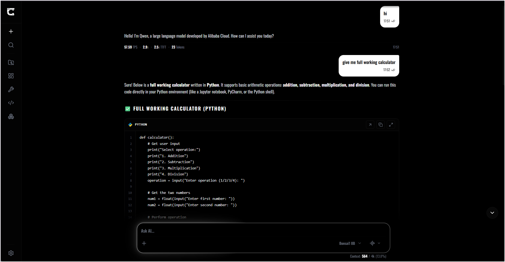
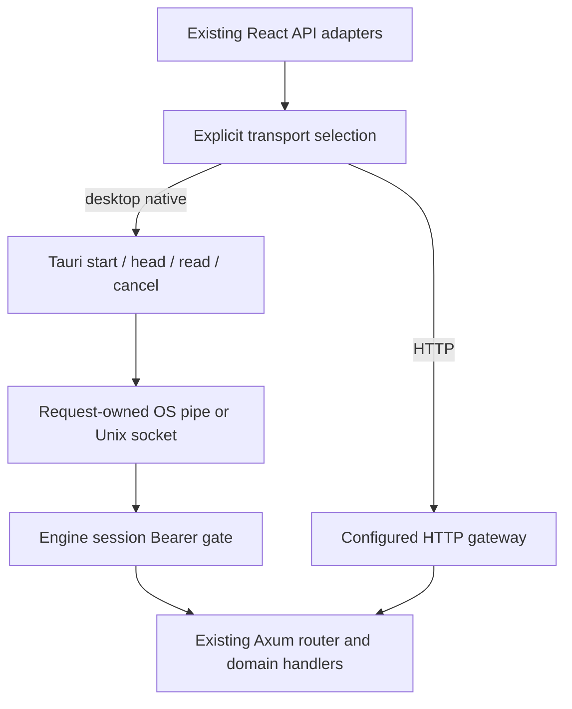

This is the Tauri-based frontend application for the cluaiz engine, directly connected via Native IPC. 

---

## App workspace extension foundation

Notebook and Library use a shared bundled workspace host, with a private versioned manifest/SDK, owned state and request disposal. Existing routes and screen data remain in place. Local author tooling uses `@cluaiz/extension-sdk` and `@cluaiz/extension-devkit`. Toolkit accepts explicitly approved local UI packages through the isolated browser/native document host, with install, manual update, permissions, enable/disable and uninstall. These unsigned packages are limited to on-demand full workspaces. See [local packages](src/extensions/packages/README.md) for usage and remaining trust/platform boundaries.

## 🚀 CORE USER FEATURES & FUNCTIONALITIES

Installed workspace extensions also offer Open floating in Toolkit: a separate
native guest window on desktop, or an App panel in the browser. Their sessions
survive main-screen navigation while the App runs. Close/Stop, disable and
uninstall release the matching session. In the desktop App, General Settings →
Run in background makes main-window close hide to the tray; Show restores the same
window and Quit Cluaiz exits. With the setting off, normal close exits. Browser
tabs cannot use this native feature. Headless/background runtime profiles, native
workers, publisher signing and other OS acceptance
remain separate work. See [floating lifetime and limits](src/extensions/README.md).

The Visual Matrix is a highly customizable, feature-rich interface giving users absolute control over their local AI and chat environment.

### 1. 💬 Rich Conversational Interface
- **New Chat & History:** Seamlessly spin up new conversations or browse through historical interactions directly within the workspace.
- **Emoji & Formatting Support:** Full rendering of emojis, markdown, and formatted text directly inside the message bubbles.
- **Fully Customizable:** Users can personalize their experience by dynamically changing UI themes and chat fonts (`ChatsSettings.tsx`).

### 2. ⚙️ Engine & System Management
- **Booster Settings:** Direct access to granular engine booster settings right from the interface (`EngineSettings.tsx`).
- **Permission Control:** Hardened security features allowing users to toggle what native permissions the engine has access to.
- **API & Server Control:** Spin up the API, manage the native backend server, and monitor engine status straight from the GUI.

### 3. 🔒 Advanced Settings & Shortcuts
- Comprehensive `SettingsOverlay` covering General, Security, Notifications, and Keyboard Shortcuts.
- Granular control over the system without needing to touch a single configuration file.

---

## Native Engine connection

Desktop Native IPC uses a request-owned Windows named pipe or Unix socket. The Engine runs with `serve --native-endpoint <path>` and dispatches the same API paths through its existing authenticated router. Browser and explicitly selected HTTP connections keep the HTTP gateway. The persisted `ffi` setting is a compatibility identifier; this is not in-process FFI or shared memory.

The launcher at `app/src-tauri/src/core/engine/spawner.rs` requires an authenticated health reply before reporting readiness. Failed/cancelled startup cleans its owned child. Each request owns its cancellation and bounded response queue; incomplete bodies return errors. Windows job handles preserve owned process-tree cleanup when assignment succeeds. There is no automatic native-to-HTTP fallback or CDQL recovery claim.

A matching Engine build is required; an older installed binary without the new CLI option cannot serve native mode. This change does not replace a user's installed Engine automatically. See [transport ownership and limits](src/api/client/README.md) and [native connector](app/src-tauri/src/core/engine/native/README.md). Windows transport/CLI evidence is recorded in the foundation plan; Linux/macOS desktop acceptance remains separate. Local UI package execution uses App-side mediation; direct per-extension Engine authority and publisher signing remain pending.
