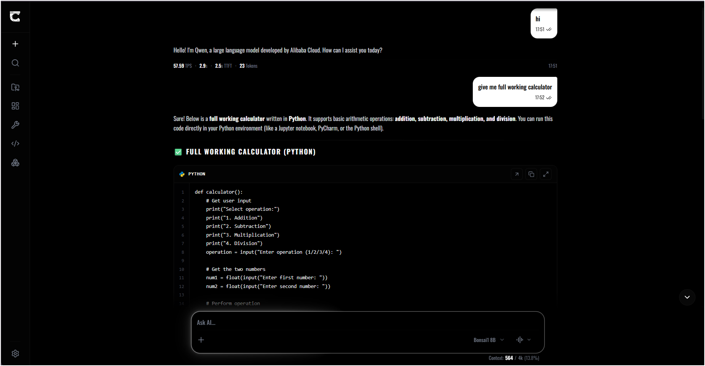
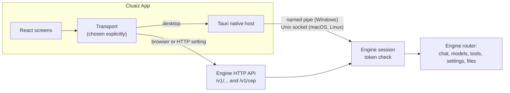

<p align="center">
  
</p>

<h3 align="center">
The desktop app for Cluaiz: chat with your models, manage models and tools, explore the API and keep your notes, in one window</h3>

</br>
<p align="center">
  
  
  
  
</p>

<p align="center">
  <a href="https://cluaiz.com"><b>Website</b></a> &nbsp;|&nbsp;
  <a href="https://github.com/cluaiz/cluaiz"><b>Engine</b></a> &nbsp;|&nbsp;
  <a href="https://github.com/cluaiz/cluaiz-tools"><b>Tools</b></a> &nbsp;|&nbsp;
  <a href="https://discord.gg/mab8kBURz"><b>Discord</b></a>
</p>

> [!WARNING]
> **In development, not released yet.** The App is released after the Engine's pre-release ends. Until then there
> is no installer: you can build it from source as shown below to try it, but screens, settings and file layout
> change often. To use Cluaiz today, use the [Engine](https://github.com/cluaiz/cluaiz) and its terminal and API.

## About the Cluaiz App

[Cluaiz](https://github.com/cluaiz/cluaiz) is one system for working with AI, for personal use and for business
use. The **Engine** runs and serves the models. The **App** is the window you use them from: no terminal and no
configuration files needed.

The App does not run models itself. It talks to a running Cluaiz Engine, so a model is loaded once and shared by the
App, the terminal and your own programs at the same time.

## What you can do

| Area | What it does |
| :--- | :--- |
| **Chat** | Conversations with any installed model: streaming answers, thinking, images and files, tool calls with approvals, chat history, and memory of earlier messages that no longer fit the context |
| **Models** | Browse the model catalogue with a recommendation for your hardware, download a model and its quantization, and load or unload it |
| **Toolkit** | Install and manage skills, plugins and MCP servers from [Cluaiz Tools](https://github.com/cluaiz/cluaiz-tools), and their settings |
| **API** | An explorer for every Engine route and CEP method, with examples you can run, and an interactive architecture view |
| **Notebook and Library** | Notes and documents kept next to your chats |
| **Settings** | Engine settings, hardware, permissions and API tokens, themes and shortcuts |
| **Extensions** | Experimental: local UI packages that you approve, in an isolated workspace. See [local packages](src/extensions/packages/README.md) |

## How the App reaches the Engine



- **Desktop:** the App starts the Engine (`cluaiz serve --native-endpoint <path>`) and waits for an authenticated
  health reply before it says the Engine is ready. Each request has its own pipe or socket and can be cancelled.
- **Browser or HTTP:** the App uses the Engine's HTTP API with its session token, like any other client.
- Both paths reach the same Engine router, with the same permissions and approvals. There is no silent fallback
  from one to the other.

Details: [transport](src/api/client/README.md) and [native connector](app/src-tauri/src/core/engine/native/README.md).

## Run it from source

You need **Node.js 20 or newer**, **Rust** (stable), the
[Tauri prerequisites](https://v2.tauri.app/start/prerequisites/) for your OS, and the
[Cluaiz Engine](https://github.com/cluaiz/cluaiz#quick-start) installed. The App needs an Engine build that
supports `--native-endpoint`.

```bash
git clone https://github.com/cluaiz/cluaiz-app
cd cluaiz-app
npm install

npm run dev:desktop     # the desktop App, with hot reload
npm run dev:web         # the same screens in a browser, over HTTP
npm run build:desktop   # an installer for this OS
```

## Architecture

| Layer | Path | Responsibility |
| :--- | :--- | :--- |
| Native core (Rust, Tauri v2) | [`app/src-tauri/`](app/src-tauri/) | Window, Engine start and stop, native pipe transport, file access |
| Runtime bridge | [`src/core/`](src/core/) | Calls into the native core, Engine health |
| API contracts | [`src/api/`](src/api/) | Typed adapters for the Engine's HTTP routes and CEP methods |
| State | [`src/store/`](src/store/) | Zustand stores: chats, models, engine, layout |
| UI building blocks | [`src/components/`](src/components/) | Shared components, the app shell, file previews |
| Features | [`src/features/`](src/features/) | Chat, toolkit and catalogue, API explorer, notebook, library, settings, extensions |
| Extension SDK | [`packages/`](packages/) | `@cluaiz/extension-sdk` and `@cluaiz/extension-devkit` for local UI packages |

The full guide, with the rules every change follows, is [ARCHITECTURE_GUIDE.md](ARCHITECTURE_GUIDE.md). Every file
is listed in [Files.md](Files.md).

## Community

- **Found a bug, or something is missing?** [Open an issue](https://github.com/cluaiz/cluaiz-app/issues/new/choose).
- **Want to talk or help?** Join the [Discord](https://discord.gg/mab8kBURz).
- **Found a security problem?** Report it privately, as [SECURITY.md](SECURITY.md) describes.

Until it is released, the App takes issues and feedback but not pull requests. See [CONTRIBUTING.md](CONTRIBUTING.md).
What Cluaiz is building toward: [VISION.md](VISION.md).

## License

The Cluaiz App is released under the [Apache License 2.0](LICENSE).
