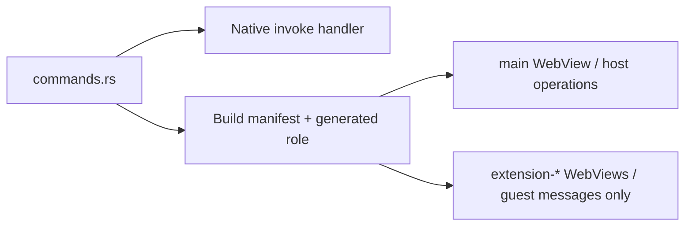

# Application command permissions

`../commands.rs` is the single inventory of host and guest commands. `../build.rs`
uses it to generate the application ACL and a `main-app-commands` role in OUT_DIR.
The main capability selects the `main` WebView explicitly: a child sharing the
same native window must not inherit host access. The extension capability grants
only the caller-bound guest message operation to native-created extension labels.

Tauri's per-command descriptors under autogenerated/ are build outputs. Do not
maintain a second command list here. A new privileged operation belongs to the
main group; broad window grants or a guest raw-Engine command are not required.
