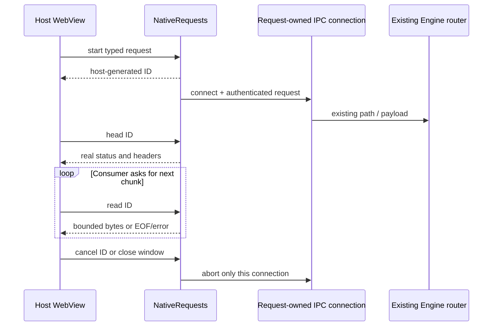

# Component: Native Engine request owner

## Technical specification

- **Purpose:** serve the existing App API adapters through request-owned OS connections, without a local TCP proxy.
- **Platform:** Windows named-pipe client; Unix socket client behind `cfg(unix)`; unsupported platforms return an error. Windows tests execute actual pipe I/O. Unix desktop behavior requires its own acceptance run.
- **Trust:** main App WebView only. Host-owned endpoint and token; request IDs are random and bound to the invoking WebView. This is not the future per-extension Engine principal/sandbox.
- **Dependencies:** existing Tokio/Serde plus direct Hyper, hyper-util, http-body-util and UUID features already present transitively in the App lockfile.

## Architectural flow

## Interface and ownership

`mod.rs` registers `engine_native_start`, `engine_native_head`, `engine_native_read` and `engine_native_cancel`. Tauri supplies the actual calling `Webview`; it is not a caller-supplied identity field. Only WebView label `main` is admitted. A parent containing an extension child cannot be converted into a `WebviewWindow`, so these commands must not require that single-WebView wrapper. Guest children do not inherit their shared parent's transport ownership. `EngineState.native_config` supplies the endpoint and selected home; the host reads `session.token` there for each request.

`client.rs` builds origin-form API requests, removes caller-selected auth/host/hop-by-hop framing and adds the host's session bearer. It connects only through the selected local named pipe or Unix socket. There is no TCP connector/fallback. Hyper drives HTTP/1 framing on this I/O; a connection guard aborts its driver when the response owner ends.

`requests.rs` owns a maximum of 32 response slots. Each holds one queued chunk, at most 64 KiB, with request-specific headers and cancellation. A read/header operation keeps its slot active while waiting. Idle unread responses are eligible for cleanup after 120 seconds; requests have a one-hour lifetime ceiling. These are transport budgets, not model context or input-media settings. The bridge input ceiling is 128 MiB; encoded/numeric WebView arrays involve additional allocations.

Slots retain terminal cancellation/expiry errors so interrupted reads cannot become clean EOF. Normal EOF releases the slot without replacing success with cancellation. Cross-window head/read/cancel is refused. Destroying a window aborts its owned workers even when another command still holds an Arc to a slot. Start/head failures, truncated bodies and provider errors propagate instead of returning empty successful data.

## Launcher and recovery

The parent `spawner.rs` starts `serve --native-endpoint <private endpoint>` with the selected `CLUAIZ_HOME`. An explicit missing home executable is an error. Spawn/readiness is serialized. The child is registered before awaiting readiness; `PendingEngine` in `core/state.rs` kills and reaps it if boot fails or its future is dropped. Windows owned job handles preserve process-tree cleanup. App exit kills only the child it owns.

Old raw pipe text commands are not compatible with this protocol. Existing chat/SSE adapters use the shared transport. Legacy native history/delete command names delegate to the existing chat storage owner; CDQL refuses unsupported execution. The unauthenticated folder-picker TCP bridge is removed; folder dialogs use their existing direct native command.

Full Engine adoption across separate App instances, detached/background lifetime, per-mini-app authority and package activation remain later slices. Native GUI acceptance and other OS runs are not implied by a Rust compile.

## Verification

Use `cargo check --offline --manifest-path app/src-tauri/Cargo.toml` from the App repo. The test-only `test/native-transport/` crate compiles these exact source modules without Tauri/models and executes real local I/O plus startup ownership tests. Engine listener tests remain with its API owner. The foundation plan records actual output and limitations.
