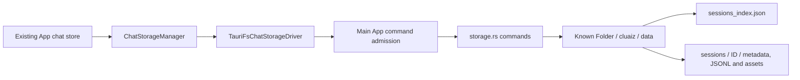

# Component: Native chat storage

## Technical specification
- **Purpose:** Existing desktop JSON/JSONL history and asset commands used by
  TauriFsChatStorageDriver. Extension-owned chats use the same driver contract;
  this module does not implement a separate extension database or inference.
- **Platform:** The data location follows dirs::data_dir(), with home fallback,
  then cluaiz/data. Windows tests exercise the commands below in an owned temp
  directory. Other OS runtime behavior is not certified by those tests.
- **Ownership:** Main App commands are admitted by the existing native command
  permissions. A developer guest does not receive these commands directly.

## Architectural flow


## API contract and files
- **storage.rs:** Catalog load/save, session metadata load/save, messages
  load/append/replace, session deletion and binary asset save/path resolution.
  Session IDs are checked before constructing a session directory. Callers pass
  serialized JSON/JSONL; the frontend owns chat message schemas.
- **commands.rs:** Legacy history/delete names delegate to this storage owner.
  Legacy raw-pipe chat send returns an unsupported error; normal chat generation
  belongs to the existing API/native transport.
- **history.rs:** Contains an earlier unused save_history placeholder; it is not
  the persistence implementation and is not evidence of a SQLite database.
- **mod.rs:** Module exports. No new route, model runner or database here.

## Failure and recovery
- **Catalog:** A missing or malformed catalog is rebuilt from session metadata.
- **Messages:** Invalid JSONL lines are skipped; offset/limit apply to valid rows.
- **Writes:** Catalog/metadata/full-history replacement use temp files and rename;
  append flushes the completed message. Filesystem errors are returned to callers.
  These tests do not certify crash durability or concurrent catalog writers.
- **Assets:** Existing filename/path rules remain unchanged. No claim of complete
  symlink/reparse-point confinement follows from the session-ID negative test.

## Isolated command tests
Run from the App repository:
```powershell
cargo test --offline --locked --manifest-path app/src-tauri/Cargo.toml --lib features::chat::storage::tests -- --nocapture
```
- **Test root:** A cfg(test)-only Tokio task-local root runs these actual commands
  against a UUID temp directory. No environment override or App configuration is
  added. Outside that scope the real Known Folder path remains the same.
- **Checks:** Save/reload/replace/delete, metadata/catalog replacement, binary
  assets, corrupt catalog/tail recovery, pagination, invalid session IDs and the
  ordinary data-location choice. Cleanup checks the canonical temp parent first.
- **Limit:** This is command-level filesystem proof, separate from the real
  developer WebView chat test that deliberately uses EngineFs storage. It is not
  a full GUI acceptance against the user's default desktop catalog.
