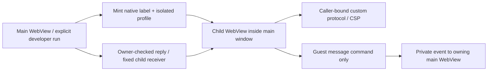

# Native extension surfaces and UI package persistence

- **Owner:** App-only native WebView lifetime and caller routing; no Engine
  installer, inference backend or package registry is replaced.
- **Dependency:** existing Tauri version with the founder-approved experimental
  multi-WebView feature. Desktop-only APIs are cfg guarded; mobile returns errors.
- **Input:** one bounded immutable HTML snapshot and trusted host bootstrap;
  no package filesystem root or guest-provided native sender identity.

## Module reference

| File | Responsibility |
| --- | --- |
| mod.rs | Configure managed surface state/protocol; platform availability |
| surfaces.rs | Bounds, document/message limits and owner records |
| native.rs | Open/resize/close, dedicated incognito data directories, guarded profile cleanup |
| protocol.rs | Serve only the caller's immutable HTML, reject other paths, attach CSP/no-store headers |
| bridge.rs | Route bounded JSON from actual native caller to its host, and owner-checked replies back |
| packages.rs | Main-only App data receipt/HTML storage, OS file lock, revision checks and atomic catalog replacement |

The command inventory in ../../../commands.rs feeds both dispatch and permission
generation. Main operations target the main WebView specifically. Selecting the
main *window* would also grant its extension children those operations; this is
why the capability uses webviews. Extension labels receive only the guest-message
permission. SDK grants/handle/job checks still run in the existing host bridge.

The custom protocol resolves no local filesystem path. CSP allows its compiled
data scripts/styles and native IPC, with direct network/frames/workers disabled.
Navigation outside the exact document, new windows and downloads are refused.
Dedicated profiles prevent sharing the main browser profile in the tested setup;
storage continues through the host SDK, not that disposable profile.

## Limits and failure behavior

- At most four active native developer surfaces; HTML up to 16 MiB, trusted
  bootstrap up to 64 KiB and native JSON message up to 3 MiB.
- Frontend queues and the existing protocol impose their own smaller semantic
  bounds, stream credits, job ownership and cancellation.
- Failed creation removes its reservation. A native close failure returns an
  error instead of reporting success. Parent-window teardown closes its surfaces.
- Profile cleanup checks the resolved parent and exact owned label before a
  recursive delete. Locked renderer files receive bounded retries; a remaining
  lock is logged as deferred cleanup, not successful deletion.
- These guards are not an OS process/CPU sandbox, publisher authentication,
  Engine-side authority, or a guarantee for modified WebView host environments.
- Actual Windows results are in the ignored extension-finish evidence directory.
  Other OS execution, signed packages and native-worker profiles remain unverified.

## App-owned package commands

Only main can list/read/commit UI packages. Arguments carry an ID, expected revision
and bounded receipt/document, never a user-selected output path. Files live in App
data under extension-packages: catalog.json, catalog.lock and hash-named HTML in
documents/. Blocking filesystem/lock operations run in spawn_blocking. Corrupt,
busy or unavailable storage returns an error; a failed catalog replacement keeps
the previous catalog authoritative. Cleanup touches only unreferenced generated
hash filenames and can defer a locked file. Existing chat/preferences are untouched.

Archive, metadata/profile and grant admission belongs to the shared host frontend;
Rust independently validates receipt shape, ID/path constraints, byte limits and
HTML digest. This is not a general archive extractor or publisher signature service.
Both main-only permission generation and actual caller label checks apply. Guest
WebViews receive none of these commands. See the frontend packages README.

## Independent floating window

extension_surface_open accepts optional main-host floating/title arguments. With
floating=false it retains the existing embedded child path. With floating=true
it creates a WebviewWindow using the same minted extension label, custom document,
incognito profile, bootstrap and navigation/new-window/download restrictions.
No additional guest permission is granted; extension-* still has only its bridge.

Surface records retain the presentation kind so host Stop closes the whole native
window. window_destroyed retires a user-closed floating window and notifies main;
host close and destruction share idempotent receipt/profile cleanup. Destroying
main still closes all surfaces it owns. Main's existing Engine shutdown policy is
unchanged. Profile locks may defer cleanup, as above.

The frontend does not apply main-page resize/scroll bounds to a floating window.
Main's existing window-close permission can exercise the same native close-request
path in acceptance; the guest cannot obtain it. No transparent/always-on-top,
native-worker profile is enabled by this option itself. The separate App-owned
desktop_lifecycle supervisor now implements main close-to-tray when enabled and
tray-ready. That path hides main rather than calling window_destroyed; the same
broker/guests remain alive. Explicit Quit closes owned surfaces/requests and keeps
the existing Engine Exit cleanup. Guests receive none of its four main-only
policy/status/Show/Quit commands. This is not headless/background activation.
