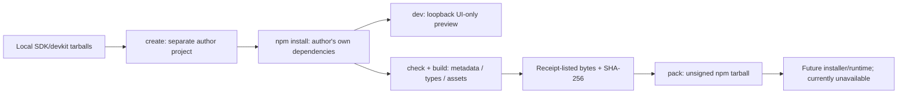

# Extension devkit — private author alpha

- **Purpose:** create, typecheck, preview, build and package an independent web UI project.
- **Platform:** Node matching `engines` in package.json; browser preview. No native worker.
- **Boundary:** UI-only author tools; no Engine connection, end-user install or public npm release.



## Local author workflow

The maintainer builds and packs both workspaces using `npm run build:extensions`
and `npm pack --workspace <package-name> --ignore-scripts --pack-destination
<existing-output-folder>`. These packages have not been published; there is no
working public `npm create` command to recommend yet.

With the workspaces installed, run the CLI from the App checkout:

```powershell
node packages/extension-devkit/src/cli.mjs create C:/work/my-notes --id author.notes --name "My Notes" --sdk C:/packages/cluaiz-extension-sdk-0.1.0-alpha.1.tgz --devkit C:/packages/cluaiz-extension-devkit-0.1.0-alpha.1.tgz
```

The target must be new and its parent must exist. No automatic dependency install
occurs. The generated project can be opened separately in VS Code; the SDK/devkit
tarballs contain what it needs, without the App checkout. In that project run:

```text
npm install
npm run dev
npm run check
npm run build
npm run pack
```

`dev` binds loopback on an available port and prints the URL. `--port` can select
a port explicitly. Its banner says UI-only; model/chat/audio are not connected.
Existing ThemeProvider/theme settings power preview themes. Source changes use
Vite's development reload; no native App rebuild is required. This is a developer
server, not the production extension communication transport.

The preview theme control reuses the SDK's existing CustomDropdown and THEMES
metadata; it is not a native select or a separately maintained theme list. Toolkit
→ UI components & SDK is the shared component reference and author guide. In a
development App, Toolkit → Extensions → Developer preview opens the existing
manual built-HTML/grants/run workflow. General end-user install/update remains
unavailable; this navigation does not bypass that boundary.

`check` validates `package.json.app` using the existing extension schema and checks
the project's TypeScript. This devkit builds only on-demand `webview` packages
with `dist/index.html` as entry. `build` uses explicit Vite settings, does not load
author Vite config or .env files, and writes emitted assets plus
`.cluaiz/build.json`. The entry embeds compiled JS/CSS as data resources and the
validated manifest as inert JSON. It has a 16 MiB limit and can be opened unchanged
by Web/native developer surfaces. Non-inline/external JavaScript outputs fail the
build. Only receipt-listed assets enter `pack`; stale files are
not deleted or copied. Development preview controls are removed from production
output. The installed runtime must supply its own approved theme/services bridge.

`pack` runs through the generated npm script, using npm's supplied CLI path and
`--ignore-scripts`. It verifies file sizes/hashes, stages minimal metadata/assets
and `inventory.json`, and creates `artifacts/<npm-name>-<version>.tgz`. It refuses
to overwrite an existing artifact. Source, .env and node_modules are not staged.
The tarball uses npm's `package/` prefix; this is a private author artifact format,
not a claim of compatibility with the current Engine installer. SHA-256 detects
changed bytes; no signature/publisher authenticity is established.

## Module ownership and failure handling

- `cli.mjs`: arguments, command selection and owned dev-server lifetime.
- `scaffold.mjs`: validated metadata and new-folder template creation; no overwrite.
- `project.mjs`: shared JSON/hash helpers, metadata/type checks and generated-path
  containment. Reuses the SDK's existing package-entry validator; refuses output
  symlinks/junctions. It does not sandbox author source or its npm dependencies.
- `build.mjs`: compilation, receipt verification and archive assembly. Staging
  cleanup checks its resolved absolute temporary parent before recursive removal.
- `preview.tsx`: build source reusing the real App ThemeProvider. Published local
  consumption uses `dist/preview.js` plus `src/preview.d.ts`, not App-relative imports.

Disk/type/metadata/hash/npm failures return nonzero status. A failed build may
leave generated assets, but the previous receipt is invalidated before compilation
so a failed rebuild cannot package older output as the new build. No global App
profile, other user's chat or native process is started.

The bundled registry still rejects downloaded executable loaders. Local on-demand
workspace UI tarballs have a separate App-owned path: Toolkit → Extensions → Choose
package → review identity/permissions → approve installation. A new version follows
the same review as a manual update. Bad admission/update preserves the old receipt.
Engine Tools/MCP/Skills installation, native binaries and publisher signing are
separate; this UI package does not use that Engine installer.

## Optional private guest connection

Generated Workspace accepts optional GuestExtensionSDK; mountWorkspace accepts an
ExtensionConnection. bootstrapExtension receives the App-issued private port in
an actual developer surface; standalone startup receives null and remains UI-only.
No Engine URL/token or arbitrary native invoke is supplied to the author API.

ExtensionPreview accepts optional connection. When present it binds the host theme
and labels a developer connection, without mounting another ThemeProvider or
overwriting host settings. Without it, local theme controls and UI-only banner
remain. An author bootstrap must retain the mount cleanup function.

The SDK guest entry shares Web/Desktop service semantics with async storage and
scoped jobs/handles. The dev command itself does not discover/authenticate a running
App. Build, then open /extensions/developer.preview/main in the App's development
build, select dist/index.html, review the unsigned identity/capabilities and choose
Run extension. Only full workspace/on-demand WebView documents are accepted.
For a persistent local install, pack the project and choose its `.tgz` in Toolkit.
Other runtime/layout profiles remain separate; no automatic App discovery or
marketplace publication is supplied by dev/build/pack.
