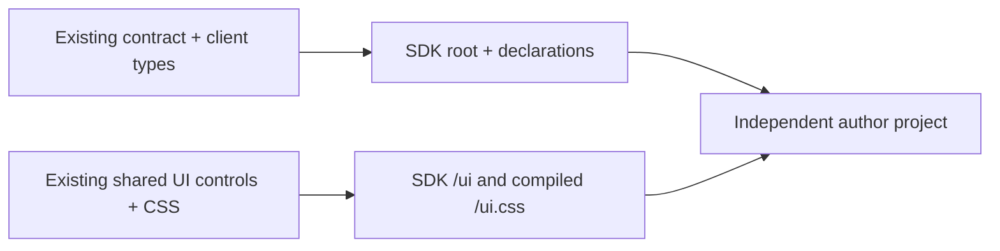

# Extension SDK — private author alpha

- **Purpose:** installable metadata/types/UI package built from existing Cluaiz App sources.
- **Scope:** local npm tarballs; not published and not a stable external runtime API.
- **Owners:** `src/extensions/client.ts` owns SDK types; existing `contract.ts` and
  `validation.ts` own manifest/path checks; existing UI controls/CSS own rendering.



## Imports

```tsx
import type { ExtensionSDK, ExtensionContract } from '@cluaiz/extension-sdk';
import { validateExtensionContract } from '@cluaiz/extension-sdk';
import { Button, Input, Card, themeTokens } from '@cluaiz/extension-sdk/ui';
import '@cluaiz/extension-sdk/ui.css';
```

The UI entry also exports Badge, Tag, ToggleSwitch, AlertBanner, CustomDropdown
and Tooltip, with their owning public props types. React and ReactDOM 19 are
peer dependencies; the package does not embed a second React renderer. Card's
header/title/description/content/footer exports remain available.

Open /components or Toolkit → UI components & SDK for live examples, imports,
props/defaults and CSS setup. Only entries labelled SDK export are standalone
package imports. App-connected and source-reference entries are not advertised
as independently available controls. Import ui.css once; custom author utility
classes need the author's own CSS/build. Connected documents receive host theme
variables through the existing bridge; standalone preview uses the existing
ThemeProvider and is UI-only.

`ExtensionSDK` describes the current host-issued bundled service object. Importing
that type does not create a connection, obtain credentials or grant permissions.
The root entry exports no Engine fetch client or global App store. Metadata
validation does not certify host runtime compatibility or publisher identity.

The UI subpath exports the same components as `src/extensions/ui.ts`; React is a
peer, not embedded into the UI library bundle. An independent web UI bundles its
own runtime dependency. It cannot import the privileged App's live React context.
Compiled CSS includes public control utilities and the existing semantic classes;
authors do not need Tailwind. Existing variables such as `--bg-primary`,
`--text-primary`, `--border-color`, `--radius-card` and `--font-family` remain the
theme contract. The devkit supplies a disconnected preview provider. The guest
entry can receive host theme updates through an explicitly supplied private
connection; installed guest execution is still a later phase.

## Portable guest connection (private alpha)

Import connectExtension, messagePortTransport, bindExtensionTheme and ExtensionError
from `@cluaiz/extension-sdk/guest`. This exports author-side code only; host
dispatch/stores/credentials are absent.

Pass a transport supplied by a reviewed host adapter to connectExtension. It returns
a Promise of `{sdk, close}`. The same GuestExtensionSDK covers Web/Desktop descriptors;
choosing a descriptor does not implement native execution. No automatic
window/global discovery or Engine connection is performed.

Guest models/AI/audio/chat use the existing job API. Guest storage is asynchronous:
await host acknowledgement. Old bundled ExtensionSDK storage stays synchronous
and source compatible. Public chat handles are opaque; copied objects fail.

Use bindExtensionTheme(connection.sdk.theme, document.documentElement), retaining
its cleanup. Existing semantic variables/classes update without another palette
or theme store. The view owner must close its connection. Check grants and handle
unavailable services.

bootstrapExtension() returns null in a standalone document. Inside a reviewed
App developer surface it waits for the private source-bound port and returns an
ExtensionConnection. Retain its close method and the theme cleanup. The generated
author entry uses this automatically; it never discovers an Engine URL/token.

The DEV-only App route /extensions/developer.preview/main opens the devkit-built
dist/index.html after showing its declared capabilities. Browser and Windows
adapters reuse this guest API; this manual developer run is not package
installation or authenticated publisher identity. Run your own unsigned output.
The App guest/surface READMEs document protocol/resource limits and platform proof.

## Files and build

- `src/index.ts`: pure metadata validation and type exports only.
- `src/ui.ts`: direct shared UI entry; `src/guest.ts`: author connection entry.
- Generated `dist`: ESM, compiled CSS and the complete declaration dependency
  graph, so consumers need no App source checkout. Do not hand-edit generated files.
- From the App repo run `npm run build:extensions`, then `npm pack --workspace
  @cluaiz/extension-sdk --ignore-scripts --pack-destination <existing-output-folder>`.
  `private: true` prevents accidental publication; local pack/install is allowed.

Failures from the existing validator propagate as errors. There is no fake SDK.
Services require a real supplied host connection. External installation and
publisher verification are not provided by this tarball. Importing SDK types
does not grant a capability or establish a native/OS sandbox.
