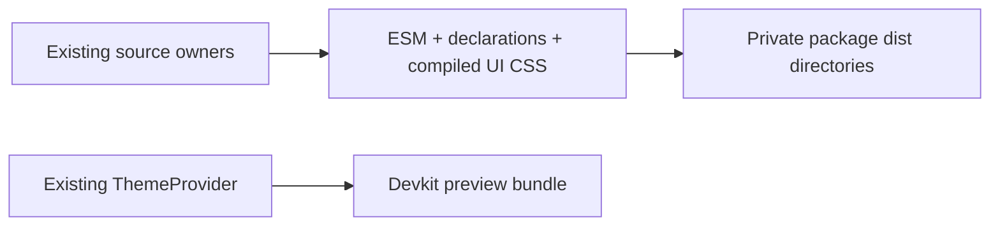

# Author package build scripts

## API documentation catalog

`sync-api-docs.mjs` is the build-time Markdown parser for API Explorer. It reads
the sibling Engine's `docs/registry.json` and API pages, or the directory selected
by `CLUAIZ_ENGINE_SOURCE`, and generates ignored `public/data/api-catalog.json`.
Use `npm run sync:api`, `npm run check:api`, and `npm run test:api-docs`. App
predev/prebuild also sync. The packaged App needs only the generated data. See
[`src/features/api/README.md`](../src/features/api/README.md) for identity,
payload-example extraction, the source dependency and scope.

- **Owner:** developer tooling only; not imported into App runtime.
- **Entry:** `build-extension-packages.mjs`, invoked by `npm run build:extensions`.
- **Dependencies:** installed esbuild, App TypeScript/Vite and Tailwind plugin.

The script bundles SDK metadata/UI/guest entries with React and ReactDOM external, emits the declaration
graph using the TypeScript compiler, compiles `src/styles/extension.css` from existing
CSS/control sources, and builds the dev-only preview using the existing provider.
The guest entry includes author-side client/protocol/theme code, not host dispatch
or service credentials. The declaration graph must stay free of privileged
implementation imports. It writes only package `dist` files. It does not publish, download models, start
the Engine or enable external execution. Compiler errors are fatal; generated
files are ignored by Git and must not be hand-maintained as another source owner.

The UI entry re-exports existing Button/Input/Card, Badge, Tag, ToggleSwitch,
AlertBanner, CustomDropdown and Tooltip implementations. Its Tailwind source
list includes those owners and Input used by the dropdown, while shared tokens
and component CSS retain their original source. The reference test inspects the
actual bundle graph for accidental App-store/API imports. Independent displayed
examples are checked through the existing author-artifact test's
--component-reference option, not a second package builder.
