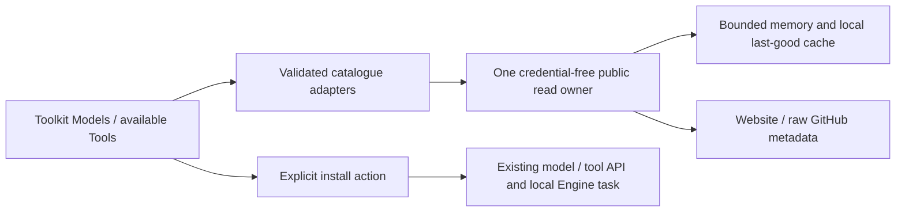

# Component: public catalogue metadata

## Technical specification

- **Purpose:** website model browsing and official tools-repository discovery. Public catalogue metadata is separate from installed inventory, execution and downloading.
- **Platform:** browser fetch in web/desktop WebView. Public sources must support cross-origin reads; packaged-desktop acceptance remains separate.
- **Authority:** only this API owner makes public HTTPS GET requests. It never imports the authenticated Engine client, sends Engine Bearer credentials, performs auth refresh or issues a website mutation.
- **Sources:** official Cluaiz website model-family endpoint and the official cluaiz/cluaiz-tools raw GitHub root/family/package pointers. Remote repository pointers remain untrusted metadata.

## Architectural flow

## Public read contract

- **Function:** readPublicCatalogue(url, parse, refresh?) returns validated data, actual saved timestamp and optional warning. Search, filtering, pagination and ordinary remounts do not dispatch their own requests. Pending same-URL reads share a promise.
- **Cache:** validated local data is fresh for24 hours. Explicit refresh has a60-second minimum interval;429 honors numeric/date Retry-After bounded from that minimum to24 hours. This reduces ordinary App requests; it is not a server security control.
- **Resources:**15-second network/body budget,8 MiB response bound,64 memory entries and an approximate8 Mi-character serialized memory budget. Persistent snapshots remain subject to browser storage quota; storage/privacy failure preserves current-session results. No background refresh loop or extra database.
- **Failures:** invalid/oversized/error responses cannot replace validated last-good data. Stale fallback is visibly labelled. Without a valid snapshot, error is explicit. Cached payloads are revalidated; corruption does not trap future reads. Failed requests keep a cooldown rather than retry automatically.
- **Sources:** approved HTTPS metadata hosts only, no embedded credentials/custom port/query/fragment; redirects refused. Repository pointer components reject traversal and hostile paths. Features never accept an arbitrary metadata URL from user text.
- **Credentials:** credentials:omit, no Engine authorization header or client-secret invention; no website download counters/analytics writes. Local cache writes are local, not website database writes.

## Domain adapters

- **models.ts:** validates families, distinct model/variant identities, repository coordinates, format/bytes and package metadata. Runtime support notes remain source data. modelInstallReference emits catalogue-id:quant only when the package quantization is unambiguous. Incomplete, unknown or duplicated quant selections fail instead of guessing a file. The Engine currently accepts a reference, not an explicit file/format/revision selector; it owns source resolution and installation. A reference does not cryptographically pin upstream bytes.
- **tools.ts:** root/category/package metadata, current object pointers and published legacy string pointers. Old souls routing maps to extension metadata, without execution authority. Missing families produce an explicit warning while valid families remain available; all-family failure remains an error. Package manifests load only when deliberately opened and must match the selected id/type. Legacy soul is accepted only as extension metadata.
- **Installed actions:** existing models.list/tools.list/download/install adapters remain authoritative. No downloader, shell command, fake installation result or parallel authenticated transport is added.

## UI and trust boundary

The existing App ThemeProvider, Cards, Buttons, Inputs, Tabs and CustomDropdowns
render catalogue text. No HTML/SVG injection, JavaScript evaluation, npm script
execution or automatic permission grant comes from a manifest. Listing a package
does not prove runtime compatibility or publisher identity. Unsupported legacy
TypeScript extensions are shown with an explanatory refusal; compatible built
UI packages still use the existing Extensions import/admission path.

## Server-side security boundary

Open-source native Apps are public clients. Shared binary secrets, User-Agent and
marker headers cannot prove an unmodified App; see
[RFC8252 section8.5](https://www.rfc-editor.org/rfc/rfc8252#section-8.5).
Quota/rate limits belong at the website/gateway. Client cache/cooldown can be
removed by a modified client and are never advertised as unbypassable security.
Website source inspection found a separate model-resolution guard; its public
catalogue route has cache headers without that direct guard. Live edge coverage
was not verified and no Cloudflare/origin/website/Engine configuration changed.

## Verification and remaining work

node --test test/catalogue.test.cjs covers credential-free requests, shared reads,
cache/cooldown/reload, source/path refusal, response bounds, schema/identity,
variant ambiguity and legacy/partial registry behavior. Actual themed React UI
checks use controlled metadata/Engine boundaries; real public metadata reads are
recorded separately in the integration proof. Neither is a real large download.
Live published sources can lag local repository data; missing routes remain
warnings rather than synthetic packages. Catalogue task receipts now reattach to
the same selected Engine task, display its actual progress and support cooperative
cancel through the shared CEP owner. Missing totals remain unknown. A lost initial
task id, Engine expiry/restart, packaged WebView, real large downloads and other OS
acceptance remain separate. Leaving a view stops observation, not accepted work.
