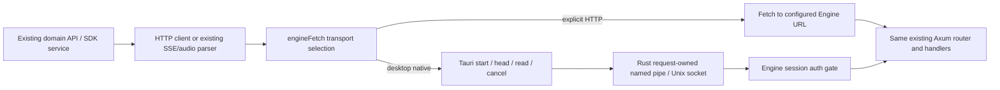

# Component: Engine API transport

## Technical specification

- **Purpose:** keep one set of Engine domain adapters and parsers while selecting an explicit HTTP service or a local desktop IPC connection.
- **Ownership:** `HttpClient` keeps request/auth/retry/error handling; `transport.ts` selects the byte transport. Chat/audio/model/filesystem/ingest/storage/tool adapters retain their existing payloads and endpoint ownership.
- **Platform:** browser HTTP; desktop native connector implemented for Windows named pipes and Unix sockets. Windows execution evidence is in the foundation plan. Linux/macOS desktop acceptance is separate.
- **Compatibility:** the persisted connection identifier `ffi` now selects native IPC. It does not mean an in-process pointer/FFI or shared-memory implementation. The Settings label is Native IPC.

## Architectural flow

HTTP/1 syntax is reused **inside the OS IPC connection**. Native-only mode does not open a TCP listener or route through localhost. It still serializes/copies data; no low-memory, zero-copy or speed benchmark claim follows from changing transport.

## Interface and behavior

- `cep.ts` validates JSON-RPC identity and preserves Engine domain errors through the existing authenticated client. `cepTask.ts` starts task methods once and waits for their actual result; it does not treat the initial task descriptor as success. Install callers share it. Aborting stops observation, not server work or package changes. Task state is Engine memory and may disappear after restart/expiry; that error propagates.

- `engineFetch(input, init)` returns a normal `Response`. JSON, binary and existing SSE parsers consume the same body stream.
- `createNativeFetch(invoke, engineBaseUrl)` accepts root-relative paths or URLs matching the configured Engine origin. Foreign origins, embedded credentials, fragments and ambiguous URL input reject before invocation.
- The native host selects its endpoint and reads its Engine session token. Frontend headers cannot override native auth, host or transfer framing. No arbitrary socket/remote connector is exposed to the WebView.
- `engine_native_start({request:{method,path,headers,body}})` returns a host-generated request ID after registering owned work. `head({id})` waits for status/headers. `read({id})` returns `{data,done}`. `cancel({id})` releases that request. Every command checks the host window; reads/cancellation also check ownership.
- A request body is limited to 128 MiB by this bridge. Engine operation/media limits still apply and may be lower. JSON/Base64 and numeric IPC arrays can use substantially more RAM than the source bytes; large artifact transfer needs its later owner.
- Response reads follow consumer demand. Each native chunk is at most 64 KiB; the Rust channel holds one queued chunk. Existing parsers cancel their readers when returning early, including an SSE completion marker.
- Aborting before start dispatches nothing. Aborting while start is pending rejects promptly and cancels the ID if it arrives later. Aborting head/body or cancelling a consumer releases only that connection. Native failure never retries over HTTP.

## File map

| File | Responsibility |
| --- | --- |
| `client.ts` | Existing typed get/post/request facade |
| `http.ts` | Request construction, token retry, API errors; calls selected transport |
| `sse.ts` | Existing chat SSE events and completion/error handling |
| `transport.ts` | Explicit connection-mode dispatch; browser native selection refuses |
| `nativeFetch.ts` | Request body encoding, native request lifetime, pull-based Response |
| `ipc.ts` | Existing Tauri command/event/window wrapper |
| `errors.ts`, `status.ts`, `types.ts` | Shared API types and error/status values |

## Failure and recovery

An older Engine without `serve --native-endpoint` cannot satisfy native readiness. Install a compatible Engine or explicitly select HTTP; there is no automatic downgrade. The desktop launcher uses a private endpoint, passes the selected `CLUAIZ_HOME`, observes child exit and requires an authenticated health reply. Cancellation during startup cleans the owned pending child. Window close releases that window's responses.

This is the trusted desktop host transport. Per-extension Engine principals, scoped grants, detached surfaces and downloaded executable isolation remain P8 and later. The current native commands are restricted to the main host window and are not an external extension SDK.

## Logical request, auth retry and cancellation

For calls through `HttpClient`, one logical request owns its target, serialized JSON
payload, request options and observation lifetime. An HTTP 401 may retry once on that
same connection. The retry does not reserialize a caller object that changed while
authentication was pending, and it does not switch to a newly selected transport or
Engine. Network failures, 5xx responses and unknown outcomes are never replayed.

The client tracks connection generations, including A→B→A changes. Changing the
selected protocol/host/port ends active observations. A late response or auth result
cannot update that old request or send its retry to the new target. This is not a
rollback: work already accepted by an Engine may continue.

The request-owned controller combines caller cancellation, connection invalidation
and timeout. A caller signal no longer replaces the timeout signal. The async budget
covers headers, body consumption and auth waiting; `timeoutMs: 0` disables the timeout,
not caller cancellation or connection guards. Discarded response bodies are released,
and timers/listeners are removed on completion. Native IPC still owns its request ID
and cancellation commands; there is no fallback from native to HTTP.

Local errors distinguish `STALE_CONNECTION`, `CANCELLED` and `TIMEOUT`. Actual HTTP
errors retain their status and decoded error body; CEP errors remain the owning
domain caller's responsibility. Empty204 and non-JSON text behavior stay supported.

Concurrent 401 calls can share in-flight auth synchronization for the same connection,
credential and callback registration. A manual `setToken`, cleared credential,
replaced callback or different connection takes precedence over an old result. An
obsolete synchronization cannot block a different connection. The built-in native
auth callback returns its key; the client applies it only after freshness checks.
Custom auth callbacks should also return the key rather than mutate client state.

This repair does not introduce per-Engine credential profiles or change the existing
configured-key storage behavior for a new user-initiated request. Direct SSE/audio
users of `engineFetch` retain their own stream-lifetime handling; this section does
not claim a new shared retry policy for those parsers.

### Request-scope validation

`test/transport_scope.test.cjs` exercises the actual client, transport selector and
native adapter at controlled network/IPC boundaries: stale/ABA connections, exact
retry payload, manual/auth changes, cancellation, response-body timeout, concurrent
requests and native handle release. `test/cep_permission.test.cjs` checks that native
auth synchronization returns a key without bypassing the request owner.

An isolated two-server loopback proof also checks real HTTP routing, identical retry
bytes, late auth and socket cancellation. It uses fake fixture data, no user Engine
or credentials. Passing these tests is not packaged WebView/native-Rust acceptance
or evidence that a client abort terminates server work.

## Native connector evidence

`test/native_transport.test.ts` uses the actual TS adapter with an injected invoke boundary. `test/native-transport/` compiles the actual Rust connector/ownership modules and runs OS pipe fixtures. Engine `api/tests/native_contract.rs` exercises the real native gateway and shared router. A successful module test does not establish native WebView UI acceptance or model inference quality. Executed commands/results are recorded in `.agent/plan/extension-foundation-implementation_plan.md`.
