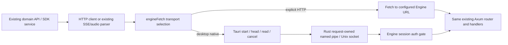

# Component: Engine API transport

## Technical specification

- **Purpose:** keep one set of Engine domain adapters and parsers while selecting an explicit HTTP service or a local desktop IPC connection.
- **Ownership:** `HttpClient` keeps request/auth/retry/error handling; `transport.ts` selects the byte transport. Chat/audio/model/filesystem/ingest/storage/tool adapters retain their existing payloads and endpoint ownership.
- **Platform:** browser HTTP; desktop native connector implemented for Windows named pipes and Unix sockets. Windows execution evidence is in the foundation plan. Linux/macOS desktop acceptance is separate.
- **Compatibility:** the persisted connection identifier `ffi` now selects native IPC. It does not mean an in-process pointer/FFI or shared-memory implementation. The Settings label is Native IPC.

## Architectural flow

HTTP/1 syntax is reused **inside the OS IPC connection**. Native-only mode does not open a TCP listener or route through localhost. It still serializes/copies data; no low-memory, zero-copy or speed benchmark claim follows from changing transport.

## Interface and behavior

- `engineFetch(input, init)` returns a normal `Response`. JSON, binary and existing SSE parsers consume the same body stream.
- `createNativeFetch(invoke, engineBaseUrl)` accepts root-relative paths or URLs matching the configured Engine origin. Foreign origins, embedded credentials, fragments and ambiguous URL input reject before invocation.
- The native host selects its endpoint and reads its Engine session token. Frontend headers cannot override native auth, host or transfer framing. No arbitrary socket/remote connector is exposed to the WebView.
- `engine_native_start({request:{method,path,headers,body}})` returns a host-generated request ID after registering owned work. `head({id})` waits for status/headers. `read({id})` returns `{data,done}`. `cancel({id})` releases that request. Every command checks the host window; reads/cancellation also check ownership.
- A request body is limited to 128 MiB by this bridge. Engine operation/media limits still apply and may be lower. JSON/Base64 and numeric IPC arrays can use substantially more RAM than the source bytes; large artifact transfer needs its later owner.
- Response reads follow consumer demand. Each native chunk is at most 64 KiB; the Rust channel holds one queued chunk. Existing parsers cancel their readers when returning early, including an SSE completion marker.
- Aborting before start dispatches nothing. Aborting while start is pending rejects promptly and cancels the ID if it arrives later. Aborting head/body or cancelling a consumer releases only that connection. Native failure never retries over HTTP.

## File map

| File | Responsibility |
| --- | --- |
| `client.ts` | Existing typed get/post/request facade |
| `http.ts` | Request construction, token retry, API errors; calls selected transport |
| `sse.ts` | Existing chat SSE events and completion/error handling |
| `transport.ts` | Explicit connection-mode dispatch; browser native selection refuses |
| `nativeFetch.ts` | Request body encoding, native request lifetime, pull-based Response |
| `ipc.ts` | Existing Tauri command/event/window wrapper |
| `errors.ts`, `status.ts`, `types.ts` | Shared API types and error/status values |

## Failure and recovery

An older Engine without `serve --native-endpoint` cannot satisfy native readiness. Install a compatible Engine or explicitly select HTTP; there is no automatic downgrade. The desktop launcher uses a private endpoint, passes the selected `CLUAIZ_HOME`, observes child exit and requires an authenticated health reply. Cancellation during startup cleans the owned pending child. Window close releases that window's responses.

This is the trusted desktop host transport. Per-extension Engine principals, scoped grants, detached surfaces and downloaded executable isolation remain P8 and later. The current native commands are restricted to the main host window and are not an external extension SDK.

## Evidence boundaries

`test/native_transport.test.ts` uses the actual TS adapter with an injected invoke boundary. `test/native-transport/` compiles the actual Rust connector/ownership modules and runs OS pipe fixtures. Engine `api/tests/native_contract.rs` exercises the real native gateway and shared router. A successful module test does not establish native WebView UI acceptance or model inference quality. Executed commands/results are recorded in `.agent/plan/extension-foundation-implementation_plan.md`.
