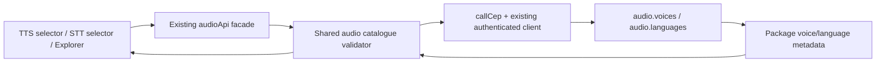

# Speech catalogue adapters

`audioApi.voiceCatalog/voices/languages` serve the normal voice/language settings
and API Explorer. Their shared owner, `audioCatalog.ts`, calls the existing
authenticated CEP client; no browser URL/query construction is needed in UI.



## Discovery contracts

- `voiceCatalog(model?, signal?)` returns the Engine's model ID, actual voice IDs
  and capabilities. `voices` returns the same catalogue's data array.
- `languages(model?, signal?)` returns the STT package's ordered language codes.
  It does not use the TTS voice list to guess transcription support.
- Omitting model sends empty params so the Engine chooses its configured/default
  package. Explicit model IDs are checked against the returned package identity.
- `language_control`, `voice_mode`, `coherent_input` and declared languages are
  preserved. No preset/reference mode or languages are invented when metadata is
  missing. The adapter reports malformed/incompatible responses as errors.
- A valid empty array stays empty. HTTP auth errors and CEP code/data errors
  propagate through the existing client; discovery never loads synthesis weights
  itself or invokes generation as a fallback.
- Selectors abort the prior query and clear old package choices when changing
  models. Their existing ownership guards ignore a late result from an old query.
  Per-model TTS preferences and speaker-language settings keep their current owners.

## Execution and remaining migration

Direct speech and transcription retain `/v1/audio/speech` and
`/v1/audio/transcriptions`. This change does not replace their stream parsers,
audio playback, microphone handling, request-body format or native transport.
Hardware/optimization, token/approval controls and other App APIs are separate
migration slices. Catalogue availability does not prove synthesis/transcription
quality or compatibility for every model package.

Focused checks:

```text
node --test test/cep_models.test.cjs test/api_explorer.test.cjs test/api_docs.test.mjs
```

These tests exercise actual discovery adapters with controlled transport inputs.
The integration proof records separate real installed-package HTTP discovery and
isolated browser selector lifecycle checks, rather than calling fixtures inference.
