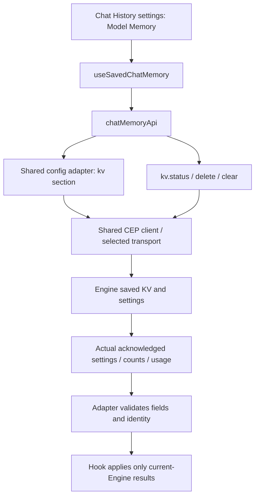

# Saved chat model memory

This adapter owns saved Engine KV-cache operations and their result validation.
It does not own App chat messages, archives, retention or the Engine event ledger.
Removing saved KV is different from deleting a chat and its history.

## Ownership and flow

| File | Responsibility |
|---|---|
| `chatMemory.api.ts` | Request/result contract, settings/record validation, deletion identity and counts |
| `chatMemory.types.ts` | Settings, saved record and joined status DTOs |
| `index.ts` | Existing public facade exports |
| `../../../features/settings/useSavedChatMemory.ts` | Scoped UI read/mutation lifecycle and truthful errors |

## API reference

Every method uses the existing authenticated CEP/config client. Optional AbortSignal
is passed to that client; it is not server-side cancellation or rollback.

| Method | Engine calls | Returned data |
|---|---|---|
| `getStatus(signal?)` | `config.get {section:"kv"}` and `kv.status {}` | Saved settings, directory, total bytes and actual saved records |
| `updateSettings(patch, signal?)` | `config.set {section:"kv",patch}` | `{settings}` from the write acknowledgment; no hidden usage read |
| `deleteChat(chatId, signal?)` | `kv.delete {chat_id}` | Matching chat_id and actual deleted boolean; false is valid |
| `clear(signal?)` | `kv.clear {}` | Actual deleted count, including zero |

Settings contain enabled, max_disk_gb and max_age_days. Input patches accept only
those fields with valid boolean/finite nonnegative numeric values; age uses the
Engine's u32 range. The adapter applies the returned values rather than assuming
the Engine saved the submitted values unchanged.

Usage validates directory, safe nonnegative integer counts, unique chat ids and
record fields. A record retains model/key, tokens/positions/bytes and Unix-second
saved_at/last_used values. Malformed responses throw; they are not empty success.
Usage and settings are separate read snapshots, not an atomic transaction.

## Settings screen lifecycle

The hook scopes all work to the selected protocol/host/port and serializes local
operations. Connection changes and unmounting abort observation and ignore old
responses. An old confirmation callback cannot dispatch against a different Engine;
the existing screen also closes its confirmation when the connection changes.

A write acknowledgment and a subsequent usage refresh have different outcomes.
Acknowledged settings remain applied if the read fails, and the UI says that the
settings were saved but usage could not be refreshed. After an acknowledged clear,
usage is unavailable until a real read returns; the App does not invent a zero-byte
snapshot. Clear failure retains previous data and displays the actual error instead
of treating every failure as offline. Refresh offers an explicit recovery path;
stale/busy mutation controls stay disabled. No failed/unknown mutation is replayed.

## Validation and limits

`test/cep_saved_memory.test.cjs` covers actual adapter contracts, zero values,
signals, rejected patches, bad records, matching deletion identity, actual clear
counts and preserved CEP errors. Browser acceptance uses the real hook and Settings
screen with controlled transport; actual release-Engine checks use an isolated home
with an empty cache and separate settings roundtrips.

This repair does not prove reuse/eviction of a real model-generated cache, packaged
native/other OS acceptance, chat-deletion orchestration or retention persistence.
The Engine owns cache compatibility, storage effects and policy. An aborted client
write may already have been applied, and another client may change usage concurrently.
