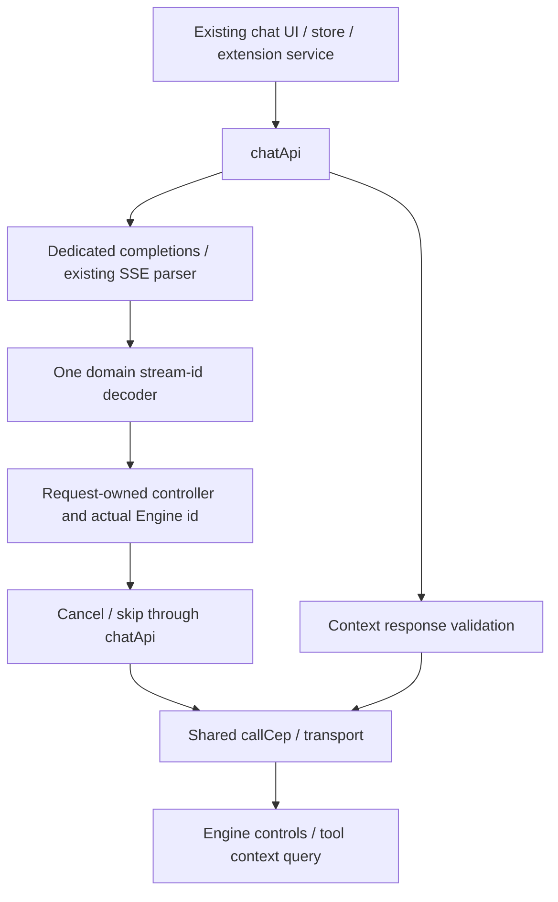

# Component: chat generation, controls and context

## Technical specification

- **Purpose:** one chat-domain adapter for existing App/extension consumers, sharing transport and SSE parser owners.
- **Generation:** POST /v1/chat/completions retains its dedicated JSON/SSE API; it is not moved into CEP.
- **Controls/context:** chat.cancel, chat.skip_reasoning and chat.telemetry use authenticated callCep. Features do not construct envelopes or retired URLs.
- **Transport:** explicit HTTP or desktop native IPC remains below this module. No speed, shared-memory or packaged-desktop claim follows from migration.

## Architectural flow



## API contract

| App call | Contract |
|---|---|
| createCompletion / streamCompletion | Existing messages/request; stream false/true on dedicated route |
| streamCompletion.onStreamId | Actual SSE id/stream_id; one decoder serves core and domain store |
| cancelStream | chat.cancel; validate matching id and cancelled acknowledgement |
| skipReasoning | chat.skip_reasoning; matching id/skip_requested, or real refusal |
| getContextTelemetry | chat.telemetry; App session_id maps once to chat_id; optional model/signal |

- **Identity:** no active Engine id until one arrives. Earlier cancellation only aborts its owned local request; no timestamp-generated id is sent.
- **Ownership:** superseded domain-store callbacks/finalizers cannot replace newer stream content/id/controller. Core uses the same decoder.
- **Cancellation:** local abort is immediate; Engine acknowledgement is separate. stream_not_found may mean completion raced the control. Other domain-store failures remain visible. Acknowledgement is not a native cancellation-latency benchmark.
- **Reasoning:** native reasoning control must be enabled/supported. Thinking-off/unsupported streams return reasoning_unavailable; no fake skipped success.

## Context and async boundaries

- **Shared types:** context/item/group DTOs live in chat.types.ts and are re-exported by the UI hook for existing imports, not duplicated in both layers.
- **Validation:** model/chat/session identity, nested telemetry, integer counts, percentages, groups/items and byte measurement are checked. Invalid data does not become plausible empty success. Wire item names supply the existing UI id.
- **Zero:** zero context/tokens remain zero; touched paths no longer invent4096/32 fallbacks or flatten results into retired max_context/current_usage fields.
- **Measurements:** chat.telemetry computes tool context without supplied prompt/history. Its message counts are not a measured transcript. Existing local text-length estimates remain estimates; explicit later SSE totals are retained over an older query.
- **Lifecycle:** new reads abort predecessors; session/model/connection and snapshot versions guard late replies. Unmount aborts its read. Catalog enrichment uses the shared components API.

## Files, failure and remaining work

- **chat.api.ts:** shared control validation, context projection and stream-id callback; original code/data errors propagate.
- **chat.endpoints.ts:** dedicated generation URL only; retired control/context URLs removed.
- **chat.store.ts:** domain stream/context state. Core/send hooks retain their existing session/message responsibilities; no new persistence system is introduced.
- **Remaining:** session tool binding, model/permission/task lifecycle and full Engine history/grants integration. Pre-existing presentation heuristics/local estimates are not certified as exact tokenization. Not every App API is migrated by this change.

## Verification

```text
node --test test/cep_chat.test.cjs test/cep_tools.test.cjs
```

Actual adapters/store tests cover dedicated generation, real ids, control acknowledgement/refusal, malformed/zero context, abort and supersession. Existing chat/send/extension-stream/native-transport regressions run through the documented test bundling workflow. An isolated browser exercises the real React hook with controlled transport.

Live proof uses one bounded temporary request, no saved chat id/config writes, and controls only the id returned for its own stream. It verifies cancellation acknowledgement and unsupported-reasoning refusal, not all models, another OS, cancellation latency or packaged native UI acceptance.
