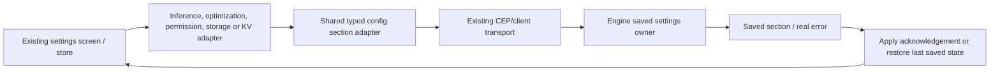

# Saved Engine settings

`config.api.ts` is the shared owner for App `config.get` and `config.set` calls.
It uses the existing authenticated CEP client and returns the requested saved
section, rather than a JSON-RPC envelope or resolved planner defaults.



| Section | App owner |
|---|---|
| gguf, onnx | inferenceApi / existing inference settings store |
| optimization | optimizationApi / existing optimization controls |
| engine | permissionApi, including active model slots |
| storage | storageApi / General settings |
| kv | chatMemoryApi / Chat History settings |
| context | Typed shared helper; separate memory/context UI migration |

## Value and save semantics

- Read returns a section object. Missing/null/array section responses are errors.
  HTTP and CEP failures preserve the existing client semantics.
- Null, zero and false remain distinct values. The client does not turn automatic
  settings into the active planner's selected numbers.
- Patches must be objects; the Engine owns allowed keys and value validation.
  A success container in an existing App facade is produced only after an actual
  saved-section response. It is not an Engine wire success/message wrapper.
- Merge rules differ by section. A supplied GGUF sampler object replaces its
  sampler configuration on the Engine, so the inference adapter reads/merges
  omitted sampler fields first. Explicit sampler nulls still reset those fields.
- Engine active_slots also replaces the slots object. The model-selection adapter
  preserves other slots. Neither read/modify/write operation is atomic against
  another independent settings writer; the current API has no revision token.
- Inference/optimization/storage stores use returned saved values. A late reply
  does not replace a newer draft. Debounced inference saves retain their last
  acknowledged snapshot so failure can restore it instead of the failed draft.
  This does not promise serialization across independent clients.

## Storage and saved KV

`storage.status/clean` return real file/byte counts. Stores and General settings
refresh remaining usage after cleanup; they do not assume it must be zero.
Storage cleanup deletes temporary media, not model weights.

`chatMemoryApi` joins `config.get(kv)` with `kv.status` for its existing settings
screen. Updates use config.set(kv), then read usage after enforced limits. Delete
and clear call kv.delete/kv.clear with explicit chat ids. They remove saved KV,
not the conversation event log. Existing destructive confirmation UI remains.
These multi-call operations are not transactions; a read can fail after a save.

## Verification and remaining work

```text
node --test test/cep_settings.test.cjs test/cep_models.test.cjs test/api_explorer.test.cjs test/api_docs.test.mjs
```

Separate integration evidence covers read-only requests to the user's running
Engine, real settings roundtrips/cleanup only in a disposable Engine home, and an
isolated browser rendering the existing inference settings screen. No user cache
or chat is deleted by those integration checks. Native desktop/other-platform and
whole-release acceptance remain separate; known root type errors are not hidden.
