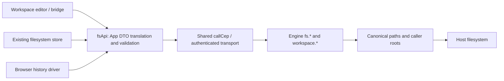

# Component: filesystem and workspace adapter

## Technical specification

- **Purpose:** connect existing App file/workspace consumers to CEP without duplicating the Engine's filesystem or authorization logic.
- **Transport:** the existing authenticated `callCep` client; explicit HTTP or desktop native IPC is selected below this module.
- **Platform boundary:** paths are interpreted by the Engine OS, not the browser OS. Canonicalization, symbolic links and allowed roots remain Engine responsibilities. Windows live acceptance is recorded in the integration proof; other-platform execution is separate.
- **Consumers:** workspace bridge/editor, filesystem store and browser chat-history driver. Native desktop chat storage has a separate existing owner.

## Architectural flow



## API contract

| Existing App call | CEP method | Translation |
|---|---|---|
| readFile | fs.read | is_binary → binary; text/data_base64 → content |
| writeFile | fs.write | content → exactly one of text/data_base64 |
| listDir | fs.list | dir_path/root_path → path/root; size/is_folder → length/isFolder |
| deletePath / createDir | fs.delete / fs.mkdir | path; validate returned path |
| renamePath / copyPath | fs.rename / fs.copy | old_path/new_path or src_path/dest_path → from/to |
| getWorkspace / setWorkspace | workspace.get / workspace.set | saved path → workspace; workspace → path |
| pickFolder | fs.pick_folder | returned path or null; existing client timeout is disabled for the dialog |

- **Result semantics:** the existing App `status: success` projection is created after a validated CEP result. It is not an extra Engine wire envelope. Empty files, empty listings and zero bytes are valid; missing or malformed fields are errors.
- **Authority:** old caller/approval_id request flags are rejected before transport. The real authenticated principal, CEP scopes/roots and approval system remain authoritative. No permission bypass or automatic approval is added.
- **Partial listing:** truncated/skipped are retained in the DTO and filesystem store. Items that the Engine could read are kept. Existing project-tree consumers do not gain a new partial-list badge in this repair.
- **Picker:** the Engine already selects the chosen workspace. The store updates its local workspace and refreshes listing without a second workspace.set. Cancel leaves the current workspace intact; listing errors are not replaced by picker success.

## File ownership

- **fs.api.ts:** explicit wire mapping, shape validation and existing App facade. Transfer/path acknowledgement validation is shared inside this owner.
- **fs.types.ts:** current App-facing request/result types, including optional acknowledged paths/bytes and listing completeness metadata.
- **fs.store.ts:** existing loading/error/file state and workspace selection. A failed request does not erase the prior listing; the error remains available.
- **index.ts:** public exports. The retired REST endpoint table was removed; consumers should not construct old URLs.

## Failure and recovery

- **CEP/HTTP failure:** propagated with its existing code/data/status. Pending approvals, root refusal and OS access denial do not become empty success.
- **Invalid result:** INVALID_FS_RESPONSE; no invented file contents, counts or mutation success.
- **Invalid path:** checked by the Engine. Client path helpers are not a replacement for the host's canonicalization or roots checks.
- **Writes:** use the current Engine fs.write semantics; no atomic replacement, compare-and-swap or cross-client append transaction is promised.
- **Remaining work:** App approval UI and terminal migration are separate. Native file watching is unchanged. OS picker UI and packaged desktop acceptance were not exercised by the disposable-home smoke check.

## Verification

```text
node --test test/cep_fs.test.cjs test/cep_history.test.cjs
```

These tests execute the actual adapters/shared CEP caller with a controlled transport. The separate release-Engine proof uses only owned disposable home/workspace fixtures for writes, copies and deletion; no real user workspace is selected or modified.
