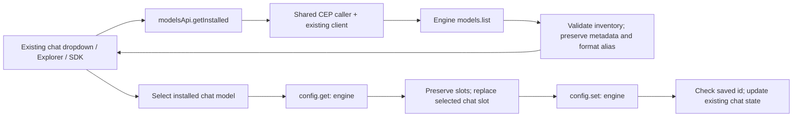

# Installed models and chat selection

`models.api.ts` owns the installed inventory for the normal App, the extension
services and API Explorer. `getInstalled(signal?)` uses CEP `models.list` through
the shared [CEP caller](../../client/cep.ts). HTTP/native choice, authentication,
token retry and request cancellation remain with the existing client.

## Contracts and failures

- Wire inventory: raw array of registry entries. The adapter provides the existing
  App `installed`, `models` and `count` container. `format` is also available as
  `format_type`; model IDs, capabilities, files and metadata are retained.
- Empty inventory is valid. Missing IDs, malformed tasks/formats, invalid JSON-RPC
  envelopes and HTTP/domain failures are errors; they are not an empty success.
- CEP requires matching response ID and exactly one result/error. `CepError`
  preserves code/data, including approval details. HTTP401 remains HTTP401.
  This helper does not approve or automatically repeat a write.
- `permissionApi.getPermission/updatePermission` now adapt `config.get/set` for
  the engine section. Their existing App container remains; the saved chat slot
  projects into `chat_models.text` for current controls/request builders.
- `selectChatModel` reads the latest slots, replaces only chat_slot and checks
  the returned saved ID. Other slots and unrelated settings are retained.
  This read/modify/write is not atomic against another concurrent settings writer;
  Engine config currently replaces the slots object and has no revision token.
- The chat hook aborts stale discovery/selection, clears empty/refused inventories,
  serializes selection, and updates existing EngineStore permissions only after
  acknowledgement. The normal chat request keeps using its existing model option.
- A failed inventory sets the models store to error and retains previous data,
  rather than reporting success with an empty list. The chat picker clears its
  stale choices and offers retry. No model is invented from a display label.

## Scope and verification

`node --test test/cep_models.test.cjs test/api_explorer.test.cjs test/api_docs.test.mjs`
checks the actual caller/domain adapters with an injected transport boundary and
the existing Explorer contracts. Separate browser evidence uses the actual React
hook and chat adapter with controlled HTTP responses; it is not model inference.

This slice does not migrate hardware telemetry, optimization, voices/languages,
token/approval controls, model load/remove/inspect/download or every settings page.
Those methods in the endpoints table remain pending. It does not add an Engine
backend, model, downloader, native connector or new design system.
