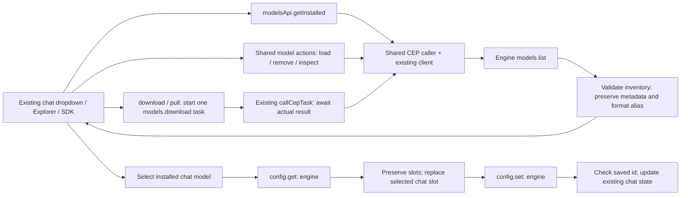

# Installed models and chat selection

`models.api.ts` owns the installed inventory for the normal App, the extension
services and API Explorer. `getInstalled(signal?)` uses CEP `models.list` through
the shared [CEP caller](../../client/cep.ts). HTTP/native choice, authentication,
token retry and request cancellation remain with the existing client.

## Contracts and failures

- Wire inventory: raw array of registry entries. The adapter provides the existing
  App `installed`, `models` and `count` container. `format` is also available as
  `format_type`; model IDs, capabilities, files and metadata are retained.
- Empty inventory is valid. Missing IDs, malformed tasks/formats, invalid JSON-RPC
  envelopes and HTTP/domain failures are errors; they are not an empty success.
- CEP requires matching response ID and exactly one result/error. `CepError`
  preserves code/data, including approval details. HTTP401 remains HTTP401.
  This helper does not approve or automatically repeat a write.
- `permissionApi.getPermission/updatePermission` now adapt `config.get/set` for
  the engine section. Their existing App container remains; the saved chat slot
  projects into `chat_models.text` for current controls/request builders.
- `selectChatModel` reads the latest slots, replaces only chat_slot and checks
  the returned saved ID. Other slots and unrelated settings are retained.
  This read/modify/write is not atomic against another concurrent settings writer;
  Engine config currently replaces the slots object and has no revision token.
- The chat hook aborts stale discovery/selection, clears empty/refused inventories,
  serializes selection, and updates existing EngineStore permissions only after
  acknowledgement. The normal chat request keeps using its existing model option.
- A failed inventory sets the models store to error and retains previous data,
  rather than reporting success with an empty list. The chat picker clears its
  stale choices and offers retry. No model is invented from a display label.
- `actions.ts` owns CEP models.load/remove/inspect/download. Installed model ids
  are not repo URLs or paths. Optional header files use the same relative-package
  path validator as tool files, moved into the existing filePath utility.
- Load/remove require matching model identity and actual timing/directory fields
  before an App success. These potentially long operations have no fixed client
  deadline; an optional signal aborts observation, not a promise of server rollback.
- Raw header inspection returns the real model/file/metadata/int_arrays/languages/
  tensors shape. Current Engine probes GGUF; an ONNX probe error is preserved.
  ONNX explicit load is unsupported by current models.load; ONNX still loads on
  its first inference request. This repair does not add an ONNX loader/prober.
- Download/pull share one models.download task start and the existing CEP task
  waiter. The final installed id can differ from the requested catalog/HF id.
  A cached result with downloaded:false and path:null is valid. A task handle,
  malformed final reply or failed/cancelled task is not download success.
- Download payload retains model_id as the App field, translated to model on
  the wire. Catalog ids and HF owner/name[:QUANT] or supported URLs go to Engine
  resolution. Unknown extra payload fields fail rather than being discarded.
- Standard /v1/models and /api/tags compatibility reads remain direct and valid.
  getAvailable refuses before dispatch because current Engine exposes no model
  recommendation method; it does not invent a suggested roster.

## Scope and verification

`node --test test/cep_models.test.cjs test/api_explorer.test.cjs test/api_docs.test.mjs`
checks the actual caller/domain adapters with an injected transport boundary and
the existing Explorer contracts. Separate browser evidence uses the actual React
hook and chat adapter with controlled HTTP responses; it is not model inference.

Hardware now delegates to the shared [system owner](../system/README.md), and
voice/language discovery has its separate [audio owner](../audio/README.md).
Token/approval controls, model Inspector metadata/stale-request integration and
store action feedback still have separate work. Remaining model endpoint constants
are only supported compatibility reads. This does not add an Engine backend, model,
downloader, native connector or new design system. Actual third-party model support,
native loads and public model downloads are not certified by adapter tests.
