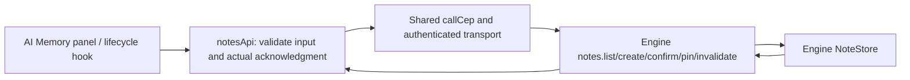

# Component: durable Engine notes

## Technical specification

- **Purpose:** typed App access to the existing five `notes.*` CEP methods. Durable
  facts/preferences are separate from UI notebooks, conversation events and KV.
- **Owner:** Engine NoteStore; this adapter does not write a local database or
  change a model prompt. Transport/authentication remain in the shared client.
- **Platform:** browser HTTP and existing native transport through `callCep`.

## Architectural flow

## Contract and files

- **notes.types.ts:** complete Note record, scope/status unions, list/create and
  change results. `superseded` is a nullable Note object in actual Engine replies,
  not the shortened array shown in some generated examples.
- **notes.api.ts:** list validates workspace, records and duplicate identities;
  create trims and checks 2000 UTF-8 bytes. Creation acknowledgment must be a
  matching confirmed user note. Confirm/invalidate/pin must acknowledge the exact
  requested id/state. Pinning a proposed record does not confirm it.
- **index.ts:** public exports through the existing Engine API barrel.

## State and failure handling

- A genuine empty list remains empty; malformed/RPC/transport failures reject.
  Metadata, scope owner, sources and validity times are retained.
- Every operation forwards AbortSignal. The adapter adds no mutation retry;
  shared transport's existing pre-execution 401 handling remains its owner.
- Workspace-scoped creation uses the Engine's current workspace. The UI must
  display/check that workspace and reject stale chat/connection results.
- Confirming or creating can supersede an older live note; both records remain.
  There is no text-edit or physical-delete operation in this API.
- Default durable notes and external chat memory events have different owners.
  This adapter does not import/persist external mode events or claim AI tool use.

## Evidence and limits

`node --test test/cep_notes.test.cjs` checks real adapters at an injected transport
boundary: malformed records, byte limits, scopes, acknowledgments and refusal.
Controlled responses are not live NoteStore persistence or model behavior proof.
