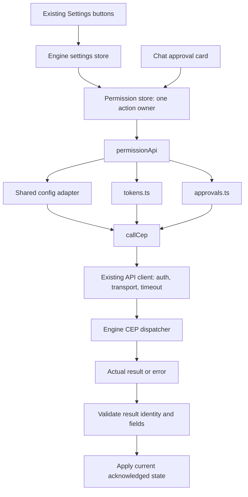

# Engine permissions, approvals and API keys

This folder owns the App's Engine settings, pending approvals and configurable API keys. It uses the existing authenticated client and selected HTTP/native transport. It does not implement an authorization policy or create a second approval registry.

## Request flow

## Files and ownership

| File | Responsibility |
|---|---|
| `permission.api.ts` | Existing App facade; delegates wire operations to their owner |
| `tokens.ts` | API-key list, creation and revocation contracts; never logs key-bearing replies |
| `approvals.ts` | Pending records and decision acknowledgment; translates `request_id` to `approval_id` |
| `permission.store.ts` | Current settings/pending state, token selection, action locks and stale-response guards |
| `permission.types.ts` | Engine key/approval results and existing App settings types |
| `index.ts` | Public exports; retired REST endpoint constants have been removed |

## API reference

All operations below use the shared `POST /v1/cep` caller. Features call the facade; they do not construct JSON-RPC bodies or Engine URLs.

| App call | CEP method | Params/result |
|---|---|---|
| `getPermission(signal?)` | `config.get` | `section: "engine"`; existing App `permission` container |
| `updatePermission(patch, signal?)` | `config.set` | Engine-section patch; saved settings |
| `listAuthTokens(signal?)` | `tokens.list` | `tokens: string[]`, `api_auth_required: boolean` |
| `generateAuthToken()` | `tokens.create` | Same fields plus `token`, which must occur in the returned list |
| `revokeAuthToken(token)` | `tokens.revoke` | Complete key from saved inventory; same fields plus matching `revoked_token` |
| `getPendingPermissions(signal?)` | `approvals.list` | `pending`, possibly empty; each record has id, principal, method, target, created_at, expires_at, status |
| `approvePermission(id, feedback?)` | `approvals.approve` | `approval_id`, optional feedback; matching `approval` with `approved` status |
| `rejectPermission(id, feedback?)` | `approvals.reject` | Same input; matching `approval` with `rejected` status |

Decision calls also accept the existing `{request_id, feedback?}` facade argument. The Engine timestamps stay RFC3339 strings; the App does not invent creation times. Decisions do not automatically retry the protected operation. A waiting chat call is resumed by the Engine; a generic CEP approval may require the original caller to retry with its approval metadata.

## API keys and the desktop session secret

Configurable API keys and the native desktop session secret are different credentials. The session secret is not a member of `tokens.list`. Removing an unrelated key must therefore preserve that secret. If the active credential is the exact revoked key, the store selects the first remaining configurable key, or clears it when none remain. Creation preserves an already-active credential.

The App applies the returned `api_auth_required` flag. In the current Engine, revoking the last configurable key turns API authentication off. Creating a key does not turn authentication on; that remains an Engine setting. The store must not guess either flag from list length. The Engine enforces its key limit; a refusal stays an error rather than returning an empty token and a success toast.

## Concurrency and errors

- Only one local key mutation runs at a time. Another simultaneous key action is refused before dispatch.
- Each approval id has its own in-flight lock. Different decisions may complete independently; one failure cannot restore another request that was already approved.
- Pending requests remain visible until the Engine acknowledges their exact id and requested status. A failed decision throws to the existing caller.
- Version guards prevent old polls/settings reads from overwriting newer results. Reset or connection changes invalidate pending work; the previous Engine's result cannot update the current store or credential.
- A stale-result refusal does not undo an operation already accepted by the previous Engine. Refresh that Engine to see its saved state.
- Malformed replies, wrong acknowledgment ids/statuses and missing required fields are errors. Empty real lists remain valid.
- Authentication/401 resynchronization remains in the existing HTTP client with the native session-token callback. No separate authentication client is added here.

## Validation and boundaries

`test/cep_permission.test.cjs` exercises the actual adapters/stores at the shared-client boundary: token limits/refusals, preserved session secrets, last-key auth state, pending/acknowledged decisions, stale polls, connection switches and Settings delegation.

Native packaged acceptance and real model-driven chat resumption need separate acceptance runs. These adapter checks do not prove that every App API group has migrated. Engine authorization, approval lifetimes, protected-call retry and persistence remain Engine-owned.
