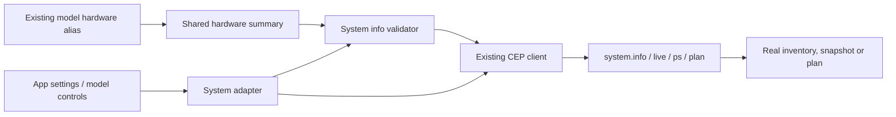

# Engine hardware and status

The system adapter keeps the existing App API entry points while using the
current CEP operations. Model inventory's hardware alias shares this owner.

| App call | Engine operation |
|---|---|
| getSystemInfo | system.info |
| getHardwareInfo / model hardware summary | system.info hardware |
| getLiveTelemetry | system.live |
| getProcesses | system.ps |
| planExecution / compareLatency | system.plan |
| getHealth | direct GET /health |

## Measurements and projections

- system.info returns Engine/version, hardware and LAN metadata. Hardware profile
  reads retain that raw hardware shape; the old invented info/silicon wrapper is
  not reconstructed from missing fields.
- The existing flat model hardware summary uses actual memory, CPU core count,
  GPU names and the sum of GPU VRAM bytes /1024^3. It describes inventory totals,
  not the residency of the active model. The full profile retains individual GPUs.
- EngineStore consumes that summary; fallback16GB RAM/8cores/4GB GPU estimates
  were removed. Failed hardware discovery leaves hardware unavailable.
- system.live returns only supplied process id, memory, CPU identity/frequency and
  GPU data. CPU utilization, per-core load, RSS and temperatures are not invented.
- system.ps describes the shared host plan, not every OS process or every ONNX
  resident. system.plan inspects an installed model without loading its weights.
  Request context/batch/buffer overrides remain per-request planning values.
- Plan DTOs use model_info/execution_plan; retired weights_gb/total_layers request
  fields and the obsolete fake latency-decision DTO are not offered by the adapter.

## Explicitly unavailable operations

The old database-only Brain Mode has no current Engine operation. Its existing UI
toggle is disabled and the compatibility methods reject with an unsupported error,
without pretending a config patch enabled it. The old HTTP calibration operation
also does not exist; the CLI calibrate command is separate from these App APIs.

Terminal system.exec/approval migration remains a separate task. This change does
not relax permissions, change the native transport or redesign settings screens.
See [shared settings ownership](../config/README.md) for saves, storage/KV and tests.
