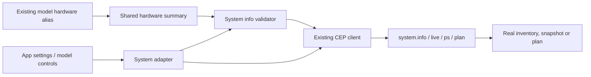
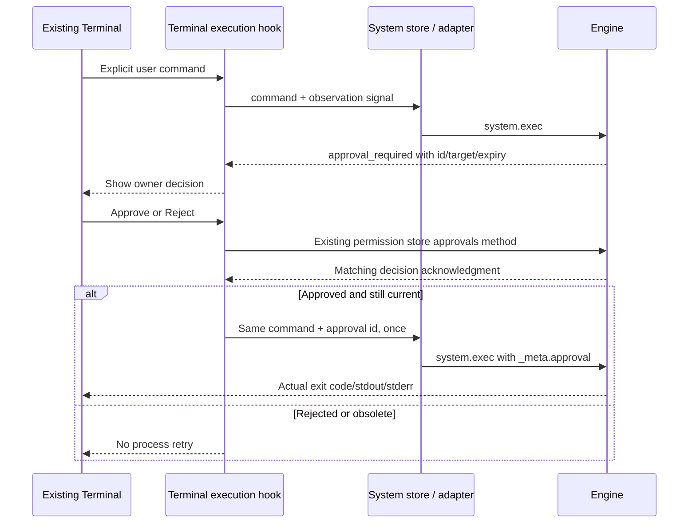

# Engine status and command execution

The system adapter keeps the existing App API entry points while using the
current CEP operations. Model inventory's hardware alias shares this owner.

| App call | Engine operation |
|---|---|
| getSystemInfo | system.info |
| getHardwareInfo / model hardware summary | system.info hardware |
| getLiveTelemetry | system.live |
| getProcesses | system.ps |
| planExecution / compareLatency | system.plan |
| getHealth | direct GET /health |
| executeCommand / executeProgram | system.exec |

## Measurements and projections

- system.info returns Engine/version, hardware and LAN metadata. Hardware profile
  reads retain that raw hardware shape; the old invented info/silicon wrapper is
  not reconstructed from missing fields.
- The existing flat model hardware summary uses actual memory, CPU core count,
  GPU names and the sum of GPU VRAM bytes /1024^3. It describes inventory totals,
  not the residency of the active model. The full profile retains individual GPUs.
- EngineStore consumes that summary; fallback16GB RAM/8cores/4GB GPU estimates
  were removed. Failed hardware discovery leaves hardware unavailable.
- system.live returns only supplied process id, memory, CPU identity/frequency and
  GPU data. CPU utilization, per-core load, RSS and temperatures are not invented.
- system.ps describes the shared host plan, not every OS process or every ONNX
  resident. system.plan inspects an installed model without loading its weights.
  Request context/batch/buffer overrides remain per-request planning values.
- Plan DTOs use model_info/execution_plan; retired weights_gb/total_layers request
  fields and the obsolete fake latency-decision DTO are not offered by the adapter.

## Explicitly unavailable operations

The old database-only Brain Mode has no current Engine operation. Its existing UI
toggle is disabled and the compatibility methods reject with an unsupported error,
without pretending a config patch enabled it. The old HTTP calibration operation
also does not exist; the CLI calibrate command is separate from these App APIs.

See [shared settings ownership](../config/README.md) for saves, storage/KV and tests.

## Command contracts and ownership

`execution.ts` is the single owner of `system.exec` params, acknowledgment validation
and approval metadata. `systemApi.executeCommand(line, timeoutMs?, options?)` sends
the Engine's shell form; `executeProgram(program, args?, options?)` sends structured
arguments. The App never translates a blocked shell line into a program invocation
to evade `exec.allow_shell`. Authentication stays in the shared client.

Options contain `approvalId`, `signal` and `timeoutMs`. The approval id becomes
`params._meta.approval`; it is not a command parameter. The default observation
timeout remains ten minutes. A timeout/abort stops waiting for a result; the Engine
process may continue, so callers must not automatically replay unknown outcomes.

The wire result is `{exit_code, stdout, stderr}`. Each field is checked; zero exit
means App status `success`, nonzero or null means `error`. Empty output is valid.
The compatibility `output` field joins the supplied streams, while the separate
fields remain available. Nonzero exits are returned as actual process results;
transport, policy and approval errors are thrown with their CEP code/data intact.

`commandApproval(error)` recognizes only a real `system.exec` approval-required
error with an id, target and expiry. The system store serializes active local
observations, records final status and ignores output after reset/connection change
or abort. An approval request is not logged as a completed or failed process.

## Acceptance and known limit

`test/cep_execution.test.cjs` covers actual command adapters, stores, refusals,
response validation, no automatic retry, stale history and path helpers. Workspace
UI ownership is described in [terminal hooks](../../../features/workspace/hooks/README.md).

Current Windows release-Engine acceptance is **PARTIAL**: approved structured
program execution returns real stdout/stderr/nonzero status, but a shell line with
a quoted cwd returns exit1 (`The filename, directory name, or volume label syntax
is incorrect.`). A separate comparison using the same owned folder and command
returns exit1 with ordinary Windows argument escaping and exit0 with raw arguments.
The current Engine shell launcher passes the command through ordinary `.args`.
Its source was left unchanged by this App-only repair. This limitation prevents a
claim that Windows Terminal shell execution is ready for release. It is not fixed
by enabling shell permissions, removing cwd quoting, or pretending a failure is success.

Actual proof artifacts and commands are recorded in the local integration proof
ledger. Packaged native/other OS command acceptance, PTY, interactive stdin, streaming
process output and server-side process cancellation are outside this repair.
