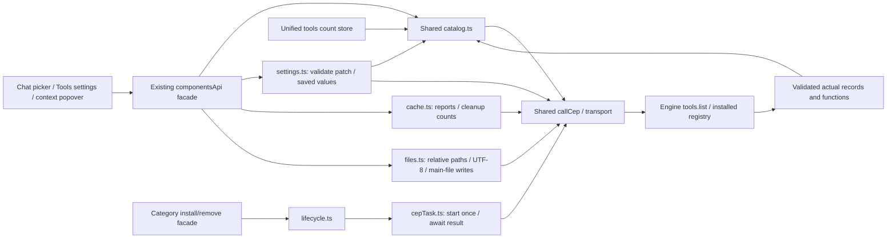

# Component: installed tool APIs

## Technical specification

- **Purpose:** shared owners for installed skill/plugin/MCP discovery, install/remove, settings, cache and package files. Execution has a separate contract.
- **Transport:** shared callCep and authenticated client, using the selected HTTP or desktop native IPC connection. Features do not construct tools.list envelopes or Engine URLs.
- **Wire:** tools.list accepts optional kind (skill/plugin/mcp), returning real registry entries and function metadata. These are protocol categories, not hardcoded package names.
- **Ownership:** catalog.ts validates records once; existing components/category APIs delegate. No second client, registry or global cache is added.

## Architectural flow



## API contract and projections

| App owner | Behavior |
|---|---|
| listTools(kind?, signal?) | Validated registry array; optional category filter sent to Engine |
| componentsApi.listComponents | Existing id arrays plus rich grouped records |
| skillsApi.listSkills | Existing status/skills container with actual entries |
| pluginsApi.listPlugins | Existing status/plugins container with actual entries |
| mcpApi.listMcp | Existing status/mcp_servers container with actual entries |
| useToolsStore.refreshAll | One catalog request; category counts and toolsCount from that reply |
| skillsApi.installSkill / pluginsApi.installPlugin / mcpApi.installMcp | Shared lifecycle.ts → tools.install once → cepTask.ts waits for tasks.result |
| Category remove methods | Shared tools.remove; validate returned kind/name before App success |
| componentsApi.getSettings / updateSettings | tools.get_settings/set_settings, explicit kind/id and strict patch |
| Category listCache / clearCache | tools.cache/clear_cache, all installed packages of that kind unless MCP name provided |
| componentsApi.getCache / clearCache | One explicit package; validated real usage/counts and explicit all-cache intent |
| componentsApi.getFiles / getFile / updateFile | tools.files/read_file/write_file through files.ts; retain actual UTF-8 text, bytes, cache and partial listing flags |

- **Metadata:** actual id/name, description, state, version and functions are retained. The touched ToolsSettings/ChatInput fallbacks that fabricated version1.0.0, display names or enabled state were removed.
- **Counts:** toolsCount means installed packages, not functions or tools bound to a chat. The unused sessionToolsCount name was corrected; no feature consumer was found. Per-chat binding uses chat.tools/set_tools, still pending in the old session adapter.
- **Validation:** malformed records/functions and wrong-category filtered replies fail. Empty arrays are valid. Unknown kinds, including model, fail before dispatch; models have their own catalog.
- **Failure:** real CEP/HTTP errors propagate. Count refresh preserves prior counts and sets error instead of converting failure into empty success. Inventory does not prove install/execution success.
- **Cancellation:** signals use the shared transport. Chat picker/context effects abort old discovery on connection change/unmount and reject late replies even if the boundary ignores abort.

## Files and remaining migration

- **catalog.ts:** one wire request/validator and existing components projection.
- **Category APIs:** thin discovery/lifecycle/cache delegates. Obsolete category endpoint tables are removed; components retains only the pending execution route.
- **lifecycle.ts:** validates package target and matching install/remove result. The existing status/message shape is an App projection after actual success, not a CEP envelope.
- **cepTask.ts (client):** starts once, validates method/task identity and waits in Engine-supported 30-second result windows with a 35-second transport timeout. Only CEP timeout errors trigger status inspection; failed/cancelled/approval/transport errors propagate. A terminal task whose own operation timed out is not polled forever. Waiting has no fixed total deadline, matching the previous install contract.
- **Abort semantics:** an optional signal stops client observation. This does not cancel or roll back installation on the Engine; its task may finish after disconnection. No automatic install retry or server cancellation is added.
- **settings.ts:** only enabled, execution_mode, security_mode and trust_annotations are writable. Unknown fields/enums, non-object patches and missing/wrong kinds fail before dispatch. Saved settings are validated and each requested value must be acknowledged before success. The existing settings UI can therefore apply its draft only after the Engine acknowledges it. Components store now requires an explicit kind; package type is not guessed from its id.
- **cache.ts:** tools.cache returns real entries and byte counts, retained as typed reports and the existing message projection. Zero/empty reports are valid; missing/malformed/wrong-package results are errors. Cleanup retains removed/freed_bytes. Omitted category name means every package of that kind; a literal MCP name all targets that actual package, never silently broadens to every MCP server.
- **Inspector cleanup:** current CEP clears the complete .cache contents, so the button says Clear Cache, sends explicit all:true and re-reads remaining usage after acknowledgment. Temp-only requests are refused rather than silently widened. A pending action disables repeat clicks; late replies cannot replace another tool's usage. Package uninstall remains separate.
- **files.ts:** validates relative package paths and actual list/read/write replies. Engine remains the authority for canonicalization, roots, symlinks and permissions. Read returns UTF-8 text, including empty strings. Write accepts only main-file content; Engine chooses SKILL.md or package.json. Arbitrary path fields fail rather than being ignored; returned bytes must match the UTF-8 payload. An App-level saved result requires the real acknowledgment.
- **Inspector reading:** existing source tree consumes tools.files with truncated/skipped flags, cache and actual paths. Listing failures are visible instead of an empty-folder success. File switching aborts previous reads and ignores late replies, including boundaries that ignore abort; switching tools/unmount also invalidates owned work. Optional icon loading does not hold up the listing or replace a subsequent selection. Partial listings remain partial. Existing styles are retained.
- **Limits:** tools.read_file is a UTF-8 reader, not a binary/image transfer API. Arbitrary-file writes and an additional editor UI were not introduced. Model manifest/DNA reads belong to model APIs, not tools.*; the old ModelInspector call with kind model is refused before dispatch and still needs its separate model migration.
- **tools.store.ts:** one read per count refresh. Separate feature consumers may each read; no cross-component cache is promised.
- **Features:** retain current visuals and consume real rich metadata through adapters.
- **Still pending:** dynamic execution, old session tools adapter, model metadata Inspector wiring and permission/task UI workflows. Adapter checks do not certify these other action buttons, every package, binary preview or native execution.

## Verification

```text
node --test test/cep_tools.test.cjs test/cep_tool_files.test.cjs test/cep_tool_settings.test.cjs test/cep_chat.test.cjs
```

Actual adapter/caller/store tests cover metadata, filtering, empty/malformed/error results, cancellation and single-request count refresh. Live discovery uses the running release Engine without registry/config writes. Browser proof exercises the actual context hook with controlled transport; packaged native UI and other-platform acceptance remain separate.
