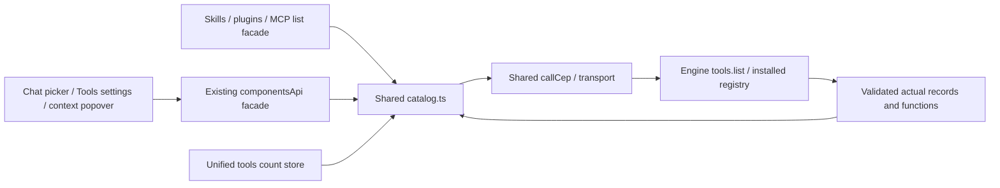

# Component: installed tool discovery

## Technical specification

- **Purpose:** one typed owner for installed skill/plugin/MCP discovery. Lifecycle, execution, settings and file operations have separate contracts.
- **Transport:** shared callCep and authenticated client, using the selected HTTP or desktop native IPC connection. Features do not construct tools.list envelopes or Engine URLs.
- **Wire:** tools.list accepts optional kind (skill/plugin/mcp), returning real registry entries and function metadata. These are protocol categories, not hardcoded package names.
- **Ownership:** catalog.ts validates records once; existing components/category APIs delegate. No second client, registry or global cache is added.

## Architectural flow



## API contract and projections

| App owner | Behavior |
|---|---|
| listTools(kind?, signal?) | Validated registry array; optional category filter sent to Engine |
| componentsApi.listComponents | Existing id arrays plus rich grouped records |
| skillsApi.listSkills | Existing status/skills container with actual entries |
| pluginsApi.listPlugins | Existing status/plugins container with actual entries |
| mcpApi.listMcp | Existing status/mcp_servers container with actual entries |
| useToolsStore.refreshAll | One catalog request; category counts and toolsCount from that reply |

- **Metadata:** actual id/name, description, state, version and functions are retained. The touched ToolsSettings/ChatInput fallbacks that fabricated version1.0.0, display names or enabled state were removed.
- **Counts:** toolsCount means installed packages, not functions or tools bound to a chat. The unused sessionToolsCount name was corrected; no feature consumer was found. Per-chat binding uses chat.tools/set_tools, still pending in the old session adapter.
- **Validation:** malformed records/functions and wrong-category filtered replies fail. Empty arrays are valid. Unknown kinds, including model, fail before dispatch; models have their own catalog.
- **Failure:** real CEP/HTTP errors propagate. Count refresh preserves prior counts and sets error instead of converting failure into empty success. Inventory does not prove install/execution success.
- **Cancellation:** signals use the shared transport. Chat picker/context effects abort old discovery on connection change/unmount and reject late replies even if the boundary ignores abort.

## Files and remaining migration

- **catalog.ts:** one wire request/validator and existing components projection.
- **Category APIs:** thin discovery delegates; their obsolete list URL constants were removed. Remaining old endpoint constants do not prove those operations work.
- **tools.store.ts:** one read per count refresh. Separate feature consumers may each read; no cross-component cache is promised.
- **Features:** retain current visuals and consume real rich metadata through adapters.
- **Still pending:** install/remove, settings/cache, inspector file editing, dynamic execution, old session tools adapter and permission/task workflows. The list can load; remaining action buttons are not certified by these discovery checks.

## Verification

```text
node --test test/cep_tools.test.cjs test/cep_chat.test.cjs
```

Actual adapter/caller/store tests cover metadata, filtering, empty/malformed/error results, cancellation and single-request count refresh. Live discovery uses the running release Engine without registry/config writes. Browser proof exercises the actual context hook with controlled transport; packaged native UI and other-platform acceptance remain separate.
