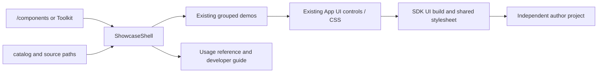

# Component: shared UI reference

## Technical specification
- **Purpose:** One component gallery and developer guide shared by /components
  and Toolkit → UI components & SDK. Existing controls and CSS remain their owners.
- **Runtime:** Shared React UI for browser/Tauri. Actual browser acceptance is
  separate from native OS acceptance; this folder adds no native command.
- **State:** state.tsx retains the gallery's existing interactive/theme/selection
  state in one mounted owner. Switching demos does not create another theme store.

## Architectural flow

## Files and contract
- **ComponentShowcase.tsx (parent directory):** Small public gallery entry.
- **catalog.ts / types.ts:** Existing groups and 30 component identities, labels,
  descriptions and source owners. Search, navigation and reference use this list.
- **ShowcaseShell.tsx / state.tsx:** Gallery layout and original interactive state.
  Clipboard writes report success only after resolving; failure leaves copyable
  source visible and explains the manual-copy fallback. The copy timer is cleaned
  up on unmount.
- **Foundation/Primitive/Dropdown/Overlay/Effect/Feedback/MediaDemos.tsx:** Moved
  existing demos, preserving their component owners. No control implementation
  was copied into this folder. No new app-wide design system was created.
- **reference.ts:** Nine current SDK UI entries, real imports, typed usage
  examples and prop/default notes. Other entries are explicitly identified as
  shared CSS tokens, App-connected controls or source references.
- **ComponentReference.tsx / DeveloperGuide.tsx:** Render reference and separate
  project workflow in the same gallery. The guide distinguishes local tarballs,
  UI-only preview, developer-connected execution and unavailable general install.

## Failure, testing and boundaries
- **Unsupported export:** No standalone import/example is offered for a control
  absent from the SDK. ContextChip/RichHoverCard require App context.
- **Copy failure:** Existing displayed text remains available; no false copied
  status or silent rejected promise.
- **Proof:** npm run test:component-reference checks catalog owners, availability,
  exact/hash routes, public exports, shared CSS and absence of host services in the
  UI dependency graph. Add -- --browser for actual gallery/dropdown/theme/copy/
  Toolkit checks on a unique loopback origin. Clipboard is a controlled provider.
- **Independent author:** npm run test:extension-artifact -- --component-reference
  checks/builds/packs the displayed examples using real local SDK/devkit tarballs.
- **Excluded:** Downloaded install/update, Engine permission authority, background
  execution and native worker support are not implemented by this reference UI.
