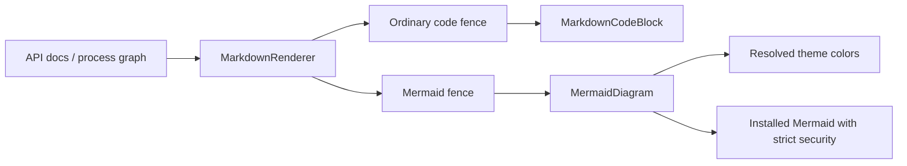

# Shared Markdown and diagrams

This folder provides shared App UI primitives. The rendering owners described
here are reused by ordinary Markdown, API documentation and graph process cards.

- `MarkdownRenderer.tsx` owns Markdown/GFM routing, links, tables and document
  presentation. Mermaid fences use MermaidDiagram; other fenced code uses the
  existing CodeBlock. Fenced blocks own their own container rather than nesting
  another pre around their full rendering.
- `MarkdownCodeBlock.tsx` is the existing ordinary code/project block extracted
  from MarkdownRenderer without changing its body or language mapping. It owns
  syntax highlighting, copy/expand and explicit workspace-open behavior.
- `MermaidDiagram.tsx` is the single Mermaid initialization/render owner. It uses
  the already installed package, strict security, unique render IDs and stale
  result guards. The browser resolves CSS variables/color-mix; a one-pixel canvas
  composites alpha against the App background and supplies hex to Mermaid's color
  parser. Probes are removed, and loading/errors remain visible.

API adapters reuse these components; do not create another Mermaid runtime,
fence parser or theme-color conversion in a feature. Diagram source remains data,
never a command to execute. Browser acceptance checks actual SVG under light/dark
themes and the reported rpc.discover color-mix case. Rendering is distinct from
executing the API described in that diagram.
