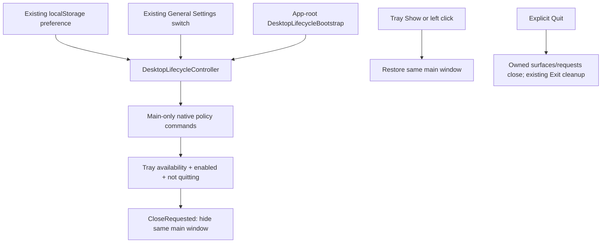

# App core and desktop lifetime

- **Purpose:** shared App entry infrastructure: routes, theme, existing Engine
  connection helpers and desktop window lifetime. Domain APIs and extension jobs
  retain their existing owners.
- **Desktop lifetime owner:** desktopLifecycle.ts synchronizes the existing
  cluaiz_run_background preference with main-only native commands. Its native
  counterpart is features/desktop_lifecycle.rs in the Tauri backend.
- **Platform:** browser has no close-to-tray capability. Desktop is cfg guarded;
  Windows runtime acceptance is recorded in the existing foundation report.

## Owners

| Module | Responsibility |
| --- | --- |
| router.ts | Existing route mapping/navigation; no new background route |
| ThemeProvider.tsx | Existing App variables/theme owner; not duplicated by tray |
| engine.ts, tauri-api.ts | Existing connection/window helpers; title-bar close reaches native CloseRequested |
| desktopLifecycle.ts | Four native operation adapters, observable effective state, existing preference synchronization, native acknowledgement and persistence rollback |
| DesktopLifecycleBootstrap.tsx | Once-per-mounted-root initialization and visible startup failure toast |

General Settings uses DesktopBackgroundSetting, the existing SettingItem,
AlertBanner and Button. There is no separate persisted native preference database.
Native defaults to ordinary close until initial synchronization succeeds. Browser
initialization performs no native call and the desktop-only switch is disabled.

## Preference and failure contract

The existing missing-preference default remains enabled, but takes effect only
after native acknowledgement. An unavailable tray cannot enable hide. Status,
storage and native failures remain errors; the control does not report saved or
flip effective state on a rejected operation. On native failure after preference
write the controller restores the previous raw preference; rollback failures are
also surfaced. Retry re-reads native status; tray setup failure may require restart.

Native Show/Quit actions are shared by tray callbacks and commands. Hiding main
retains its broker and SDK sessions. Closing a floating window remains its own
activity Close. Explicit Quit does not prevent exit; it reaches existing owned
Engine cleanup. This feature does not add OS startup registration, headless/native
workers, durable jobs/checkpoints, multi-instance leadership or after-Quit work.
Hidden windows/processes still consume resources; no power/RAM benchmark is claimed.

Tests: node test/extension_packages.mjs --desktop; App Rust library tests; actual
Windows two-phase test/extension_runtime_acceptance.mjs --background. See test
README for fixture isolation and the distinction from physical tray mouse review.
