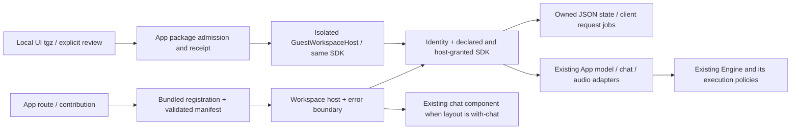
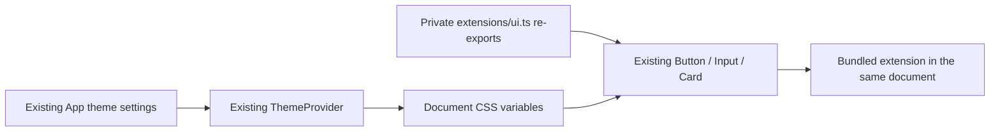

# App extension foundation

## Purpose and boundary

- **Owner:** App workspace contributions and their client-side lifetime. Engine `ToolsRegistry` remains owner of skills/plugins/MCP installation and execution; this is not another tools downloader.
- **Runtime:** reviewed bundled modules, plus explicitly approved local UI packages through the separate isolated document host. The bundled registry never imports downloaded JavaScript, raw TypeScript, remote modules or native binaries. [Local package lifecycle](packages/README.md) owns installed UI documents.
- **Compatibility:** private `host_api: 1` contract. This is not a published stable third-party SDK. Browser, Tauri and mobile use the same TS source; executed platform evidence is recorded separately.
- **Existing screens:** Notebook and Library mount through this owner and keep their current routes, design and existing data stores. They have not been turned into separately downloadable packages.



## Manifest and contribution contract

The existing bundled v0 manifest uses `hub_type: "extension"`, `id`, `name`, `version`, `host_api`, `capabilities` and `contributes.views`. P6 adds a separate [private schema-1 metadata contract](CONTRACT.md), an explicit bundled adapter and a pure catalogue inspector. Existing packages without runtime metadata return an incomplete-metadata error. Inspection never loads or installs code.

- ID: `publisher.app-name`, lowercase; display name is separate.
- Version: semantic `major.minor.patch`, optionally with prerelease and build metadata; padded numeric release/prerelease identifiers are rejected.
- Host API: must equal the supported integer API version.
- Views: distinct IDs, title, `slot: "workspace"`, optional `layout: "full" | "with-chat"`.
- Capabilities: recognized operations only. Invalid/incompatible identities, unknown capabilities, duplicate contributions and unrequested grants fail before loading.
- `registerBundled` receives a loader from compiled App composition code. There is no deserialized `trust: true` override. Registration contracts are copied and frozen.

Composition modules register a manifest plus `load(): Promise<ExtensionModule>`. The module supplies named view components and an optional `activate(sdk)` returning a cleanup function, synchronously or asynchronously. Existing registrations are in `bundled.ts`. Imported UI documents use `packages/` and never register a downloaded React loader.

## SDK contract

`createExtensionSession` supplies identity, frozen host availability and actual session grants, state methods, jobs and a constrained set of domain operations. Each session receives a new host-minted `instanceId`; jobs use it to separate two instances of the same package. This is client ownership metadata, not an Engine credential. The SDK never returns the raw API client, Engine bearer, generic arbitrary-URL request, native invoke or global chat cancellation.

| Capability | SDK method | Existing implementation owner |
| --- | --- | --- |
| `storage.read` | `storage.get(key)` | Web Storage adapter, encoded extension namespace |
| `storage.write` | `storage.set/remove` | Same adapter; real JSON/quota/storage errors propagate |
| `models.list` | `models.list()` | `modelsApi.getInstalled` |
| `ai.generate` | `ai.generate({model,input,maxTokens?})` | `chatApi.createCompletion`; temporary text request, tools omitted from execution selection |
| `ai.stream` | `ai.stream({model,input,maxTokens?}, onEvent)` | Existing `chatApi.streamCompletion` and SSE parser; same temporary text request policy |
| `audio.speech` | `audio.speech(request)` | `audioApi.speech` |
| `audio.transcribe` | `audio.transcribe(request)` | `audioApi.transcriptions`, non-streaming JSON result |
| `chat.sessions` | `chat.create(options?)`, `chat.open(savedId)`, `chat.read(handle)` | Existing chat store and ChatStorageManager; instance-issued handles |
| `chat.send` | `chat.send(handle, request, onEvent)` | Existing chat adapter/history builder and the same message persistence actions |

Permission must be requested in the manifest **and** granted by the host. Every operation checks before touching storage or invoking its adapter. These are API boundaries for trusted bundled code: same-context JavaScript could bypass them by importing other App internals. This is not a security certification for malicious third-party code, and an empty tools list is not proof of Engine-side isolation.

### Shared UI and theme (bundled views)

`src/extensions/ui.ts` is the private compiled import entry for `Button`, `Input`,
the `Card` compound components, their `ButtonProps`/`InputProps`/`CardProps` types,
and `themeTokens`. They directly re-export existing App components/classes; there
is no second stylesheet or theme store. This is not an npm package or `sdk.ui`.

For example, a bundled view at `src/features/example/Workspace.tsx` can use:

```tsx
import { Button, Input, Card, CardContent } from '../../extensions/ui';

export function Workspace() {
    return <Card><CardContent>
        <label>Search<Input name="query" /></label>
        <Button type="button" variant="outline">Search</Button>
    </CardContent></Card>;
}
```

The App loads `src/styles/index.css` and wraps workspace contributions in its
existing `ThemeProvider`. A bundled view must not mount another provider or copy
the App CSS. Theme changes update document variables without remounting the view;
its local draft/counter can stay intact. Drawing controls requires no model call
or theme capability. App settings own theme changes; this entry exports no theme
setters or raw store.

For custom layouts, consume the existing CSS variables:

| Purpose | Existing variable |
| --- | --- |
| Surfaces | `--bg-primary`, `--bg-secondary`, `--bg-tertiary` |
| Text | `--text-primary`, `--text-secondary`, `--text-muted` |
| Borders | `--border-color`, `--border-style` |
| Accent and contrast | `--accent-color`, `--accent-contrast` |
| Corners | `--radius-btn`, `--radius-card`, `--radius-modal` |
| Font | inherit the App font, or use `--font-family` |

Example: `style={{ background: 'var(--bg-secondary)', color: 'var(--text-primary)',
border: '1px solid var(--border-color)', borderStyle: 'var(--border-style)',
borderRadius: 'var(--radius-card)' }}`.
`themeTokens` holds semantic **class names**, not resolved colors. Combine
`themeTokens.button.root`, `.secondary` and `.md` to use the existing button CSS.
Custom hardcoded colors/overrides can diverge from the App theme.



This covers current same-document bundled views. Downloaded packages, isolated
webviews and detached native windows do not gain theme synchronization from these
exports; those runtimes require their own checked host contract.

### Independent author tooling (private alpha)

`packages/extension-sdk` now wraps the same metadata validator, pure client types
and UI entry as a local npm tarball. Authors use `@cluaiz/extension-sdk/ui` and
`@cluaiz/extension-sdk/ui.css` in a separate project; no App source checkout is needed
to consume the built package. `client.ts` owns the shared SDK/view/chat types;
`sdk.ts` implements the contract and retains the former type exports for callers.

`packages/extension-devkit` provides create/check/dev/build/pack. Its preview is
explicitly UI-only and reuses the existing ThemeProvider. It does not connect an
external guest to chat/model/audio services. Build receipts and SHA-256 inventories
support unsigned local author archives; they do not certify publisher identity,
safe execution or compatibility with the existing Engine installer. No npm
publication or change to `registerDownloaded` is made. See the package READMEs
for exact commands and limits.

### Portable guest connection (W1-W4)

The private SDK guest entry adds one async author API over an explicitly supplied
transport. The App-internal guest host delegates to a dedicated ExtensionSession;
it does not duplicate chat/storage/model owners. Storage awaits acknowledgement,
wire chat tokens retain original host objects and close disposes owned work.
Separate-document themes reuse existing root variables. See guest/README.md.

Installed local packages use the separate receipt-checked document surface. The developer surface adapters
bind one source/caller-owned endpoint before attaching services. Node descriptor
tests alone are not Tauri execution; separate actual browser/Windows acceptance
is documented in test/README.md and the ignored extension-finish evidence.

### Explicit developer documents (W5-W6)

The development-build route /extensions/developer.preview/main accepts the
author's own devkit-built dist/index.html. The devkit embeds compiled JS/CSS and
the existing manifest in one bounded HTML entry; receipt/inventory/pack remain
the same owners. Metadata and requested grants are checked before creating a
surface. This does not register a downloaded extension or verify its publisher.

Browser execution uses an opaque script-only sandbox/private MessagePort.
Desktop execution uses a native-created child WebView, dedicated profile,
caller-bound IPC and per-document resource policy. The same async guest SDK
reuses existing state, chat, models and audio adapters; no second Engine/database
is created. Main command permissions now select the main WebView, preventing a
child in the same native window from inheriting those host operations.

The manual developer document supports full workspace/on-demand WebViews.
Other metadata profiles remain declarations, not runtime support. Signing,
Engine-side per-extension authority and publisher authentication remain pending.
See [surface ownership and limits](surfaces/README.md).

### Streaming reference

`ai.stream` returns the existing owned job shape: `{id, result: Promise<void>, cancel()}`.
The listener receives a frozen `{type: 'text' | 'reasoning', text: string}` delta.
It is a synchronous listener; an exception fails the stream job. Completion resolves
`result` without assembling another full response in SDK memory. The caller chooses
whether to display or retain received deltas. HTTP/native transport and SSE framing
remain owned by the existing App adapters.

An Engine error event rejects the job even if a stream later sends `[DONE]`.
Connection/read errors and a stream ending before `[DONE]` also reject. A caller can
retain partial text and show the failed state; completion must not be inferred from
receiving some text. Cancellation rejects with `AbortError` and forwards the job's
signal. Closing the SDK session cancels its requests. Events after cancellation,
disposal or provider completion are ignored. This does not guarantee Engine compute
has stopped, and does not create a persistent chat session or background worker.

```ts
// The bundled registration must request and receive the ai.stream capability.
const job = sdk.ai.stream({ model: selectedModelId, input: text }, event => {
    if (event.type === 'text') appendVisibleText(event.text);
});
try {
    await job.result;
} catch (error) {
    showRequestFailure(error);
}
// A cancel action can call job.cancel() while the request is active.
```

`selectedModelId`, rendering and error display belong to the caller. This interface
does not expose arbitrary request headers, native invoke, Engine credentials, tool
execution, global chat cancellation or another session's jobs.

### App-owned chat sessions

`chat.create`, `open`, `read` and `send` each return the existing `{id,result,cancel}`
request-job shape. The host lazily loads the session adapter only when one of these
operations is called. `create({title?,incognito?})` creates an ordinary chat with
`activate:false`; it does not change the main selected chat or route. The same
session catalog, `meta.json`, `messages.jsonl`, drivers and history preferences are
used. There is no second database. Optional `extensionId` in catalog/metadata
records its owning package; ordinary chats retain an absent owner.

`open(savedId)` accepts only a saved chat belonging to this package. Its handle is
issued to the current SDK instance and checked by object identity; copying `{id}`
or passing another instance's handle fails. The owning package can explicitly
reopen its saved ID after a new activation/version. `read(handle)` loads history
without selecting the chat and returns a detached snapshot; mutation cannot edit
the store. Save the ID in the extension's existing state if it should be reopened.

`send` takes the same text request and synchronous delta listener as `ai.stream`.
It appends the user/assistant turn through existing store actions and builds context
with the existing history selector. Only this chat's history is sent; strict
temporary Engine policy and disabled tool selection remain. App history is saved,
but Engine KV persistence, tools, voice-session reuse and multimodal input methods
are not introduced by this interface. One chat answer at a time is retained from
the existing App policy; a busy chat returns an error before adding a turn.

Cancellation/disposal forwards the request signal, suppresses late deltas and
keeps partial history marked as failed. Failed turns remain visible but are omitted
from the next context. Finalization retains ownership until the existing storage
operation finishes. The existing manager's asynchronous save/fallback and error
semantics remain; job completion is not a new transactional/disk-durability promise.
Private chats use existing incognito behavior and are not persisted. Missing saved
history is refused before sending instead of treating an unavailable chat as empty.

```ts
const handle = await sdk.chat.create({ title: 'Assistant' }).result;
// handle.id can be saved in the extension's permitted state for later chat.open(id).
const job = sdk.chat.send(handle, { model: selectedModelId, input: text }, event => {
    if (event.type === 'text') appendVisibleText(event.text);
});
await job.result; // Handle errors/cancellation as with ai.stream.
const snapshot = await sdk.chat.read(handle).result;
```

These are bundled-host ownership checks, not an adversarial code sandbox. Existing App history may show the ordinary saved chats to the
user; package ownership restricts SDK access, not the user's own App access.

### Show a saved session in the shared UI

A `with-chat` view receives `showChat(handle)` alongside `sdk`. Create a session
with `sdk.chat.create()` or reopen a saved ID with `sdk.chat.open(id)`, then await
`showChat(handle)`. The host checks the handle and loads history before binding.
Merely mounting the view creates no chat and never displays the main chat. Both
`chat.sessions` and, for sending, `chat.send` still need explicit grants; layout
does not grant permissions. A `full` view receives no `showChat` callback.

The App reuses `ChatWorkspace`, its message list, input, theme and divider. Send
delegates to the existing SDK chat service; edits/reactions address the displayed
session. Stop cancels only the UI's current SDK job. Changing the binding or
closing the workspace cancels that job; saved sessions remain in the existing
chat storage. The extension decides whether to retain the saved ID in its granted
storage and reopen it later. No additional automatic chat-reference store exists.

This UI slice supports text, streamed text/reasoning and reply text. Files, tools,
reasoning controls and microphone input are disabled here because the owned chat
SDK does not accept those options yet. Existing manual read-aloud remains an App
UI action; global voice mode does not auto-start from a extension reply. The old
main-chat token listener and document navigation listeners are not mounted for a
bound extension. Independent programmatic SDK sends do not acquire the UI Stop
button. The existing single-answer admission rule still applies. Cancellation
does not certify that remote Engine computation stopped.

The current SDK does not expose arbitrary filesystem, terminal, browser/CDP, background recording, MCP RPC, tool installation or extension-to-extension messaging. Add those only through an audited capability owner with source handles and Engine-side scope enforcement. Browser Agent and Meeting Intelligence need such later adapters; the entire products are not implemented by this foundation.

## Data and jobs

- Small JSON state keys include extension ID and the encoded user key, not package version. Closing a view or updating App code does not delete that data. A value is limited to 1 MiB; browser storage quotas still apply across keys. Never store audio/video/base64 assets here.
- Existing Notebook/Library/chat stores remain their current persistence owners; this work performs no user-data migration or deletion.
- A session may own four running requests and retain 32 job snapshots. Completed history is evicted before running requests. Snapshots/subscriptions are private to that session.
- Jobs expose `id`, `result`, `cancel()`. Cancellation aborts the request signal and rejects the result promptly, even when a provider ignores abort. Late provider success cannot change the job to completed. Provider rejections remain observed.
- Cancellation is client request ownership, not proof that native inference already stopped. There is no global cancel call and no persistent scheduler/job restart guarantee.

## Mount, close and failure behavior

`ExtensionWorkspaceHost` resolves a registered view, creates its session and activates it in an effect. Unmount closes the session, aborts its jobs and calls the module cleanup. If an async activation finishes after unmount, its cleanup still runs. React StrictMode may activate separate short-lived sessions; no work begins during render.

Save state while the view is active. Module cleanup releases listeners/resources after the SDK session closes; it must not start new SDK calls or depend on saving through a disposed session.

Activation or view-render failure shows a workspace-specific error with a return-to-chat action. Unknown contributions do not silently become chat. This contains ordinary React/activation failures; it cannot isolate an infinite loop or native crash in trusted same-process code.

Routes `/notebook` and `/library` remain supported. `/extensions/<publisher.app-name>/<view>` opens the same contribution by identity; refresh, settings return and browser history must retain it. `openExtensionWorkspace` is the compiled App navigation entry. `with-chat` binds an explicitly supplied owned handle and uses the existing chat, split divider and theme; it creates no second chat store or AI loop.

## Module map

| File | Responsibility |
| --- | --- |
| `manifest.ts`, `validation.ts` | Existing bundled contract and shared field/path validation |
| `contract.ts` | Private schema-1 metadata and explicit bundled v0 adapter |
| `compatibility.ts` | Current host discovery and required/optional capability assessment |
| `catalogue.ts` | Exact release and explicit canonical identity mapping; no fetch/install |
| `identity.ts` | Host-created session instance identity |
| `registry.ts` | Bundled executable provenance, explicit aliases and declared-view resolution |
| `storage.ts` | Package-independent owned JSON namespace |
| `jobs.ts` | Bounded request state, cancellation and disposal |
| `sdk.ts` | Permission checks and typed context, injected services |
| `client.ts` | Pure shared SDK/view/request/chat types for host and author declarations |
| `ui.ts` | Existing UI component/class re-exports; wrapped by the local author package |
| `services.ts` | Existing model/chat/audio adapter delegation |
| `requests.ts` | Shared text payload policy and existing chat-stream callback mapping |
| `chat.ts` | Instance handles, saved package ownership, existing chat store/history access |
| `bundled.ts` | App-shipped Notebook/Library registrations |
| `routes.ts`, `navigation.ts` | Identity-based routes and internal navigation |
| `activities.ts` | Bounded App-root floating presentation requests, Stop and error state |

## Floating presentation while the App runs

Toolkit → Extensions → Open floating presents an installed on-demand workspace
separately. Desktop uses a real guest-only native window; browser uses a draggable,
resizable themed panel inside the App. Main-screen navigation does not own this
session: ExtensionActivities is mounted outside route selection. Saved data,
SDK, grants, theme and job ownership remain the existing owners.

At most three floating activities are requested; duplicate package/view requests
are refused. The native four-surface limit includes the ordinary embedded view.
Close/Stop disposes only that activity. Native window close uses the same retirement
path; disabled/uninstalled/bad receipts stop execution and display an error until
dismissed. Enable alone does not silently restart a stopped activity. An approved
update replaces that package's instance; another package's change does not restart
unrelated guests. Older unscoped change notifications conservatively re-verify.

This is a host presentation of an existing workspace package. It does not enable
manifest background/native-worker/floating execution profiles, automatic startup,
after-quit work, transparent desktop pets or always-on-top authority. Desktop main
close can now hide to the tray when the existing Run in background setting is
enabled; explicit Quit still ends the App. Closing a browser tab ends its session.
Extra views consume WebView
resources; this work provides no RAM/latency benchmark or durable-job guarantee.

Native desktop lifetime is owned by [the shared core controller](../core/README.md)
and the App's Tauri supervisor. Keeping the same main WebView hidden preserves its
existing extension broker; it does not start another Engine or reload the guest.
Tray Show restores the same window. With background disabled, main close retains
ordinary exit behavior. Missing tray/failed synchronization leaves hide unavailable.

## Remaining platform boundaries

Local UI packages have a separate App-owned admission/store and permission lifecycle; see packages/README.md. The existing Engine registry remains the Tools/MCP/Skills owner. Still separate: publisher-authenticated distribution, direct Engine principals/scopes, native workers, background/side-panel profiles, artifact/source handles and other OS acceptance. Floating host presentation does not implement the separate runtime/profile declarations.

Reference sources: [VS Code manifests](https://code.visualstudio.com/api/references/extension-manifest), [activation](https://code.visualstudio.com/api/references/activation-events), [Tauri boundaries](https://v2.tauri.app/security/). Scope and checks live in `.agent/plan/extension-foundation-implementation_plan.md` and `test/extension_foundation.test.ts`.
