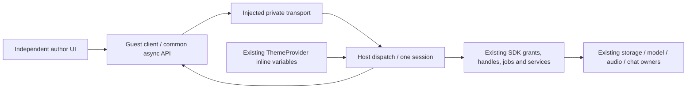

# Portable extension service connection

- **Purpose:** one async author-facing SDK over a host-issued private endpoint.
- **Scope:** shared guest connection and the developer Web/native surface adapters.
  Production package installation and Engine-enforced publisher authority remain separate.
- **Data owners:** existing ExtensionSession, ExtensionJobs, ExtensionState and
  App chat/model/audio adapters. No database or inference loop is created here.
- **Evidence boundary:** Node protocol tests plus actual browser/Windows developer
  runtime acceptance. A descriptor in a unit test alone is not platform proof.

## Entry points and trust

- **Author import:** @cluaiz/extension-sdk/guest exports bootstrapExtension, connectExtension,
  messagePortTransport, bindExtensionTheme, ExtensionError and public types.
- **Host import:** attachExtensionHost is internal and absent from the SDK tarball.
  Supply a dedicated createExtensionSession, implemented capabilities, host kind
  and optional theme source. A session can attach only once.
- **Bootstrap:** bootstrapExtension receives one private port from the actual
  parent window, or the reviewed native initializer in the same WebView. It
  returns null in standalone mode; no Engine discovery, bearer forwarding or
  generic fetch/invoke operation is exposed by the author API. Surface adapters
  own origin/caller checks; see ../surfaces/README.md for the exact developer limits.
- **Authority:** host-bound session identity wins. No request accepts a guest
  chosen package/instance ID, global job ID or arbitrary chat handle.
- **Revocation:** owner closes the bridge, disposing its session, cancelling its
  jobs, clearing handles and removing listeners. No durable permission database
  or permission-edit UI is introduced.

## API contract

The async API reuses existing request/response types. Models, generation,
streaming, speech and chat retain id, result Promise and cancel. The jobs view is
connection-local, using ExtensionJobs.

Storage get/set/remove return Promises. A save resolves only after the existing
host storage operation returns; quota/serialization failures reject. This is
acknowledgement, not a new crash-durability or cross-device persistence guarantee.
Await writes before reads.

Supported capabilities describe implemented adapters; grants intersect those with
the session's actual grants. Neither means a model is installed/loaded/reachable.
Host service errors use SERVICE_FAILED without exposing exception text/stacks.
DENIED, UNAVAILABLE, INVALID_REQUEST, PROTOCOL and CLOSED are other ExtensionError
codes. Existing job cancellation uses AbortError.

Chat create/open return frozen handles backed by a client WeakMap. Wire tokens
map to original host objects in a bounded per-instance table; copying the public
object fails. Reopen a saved owned ID through chat.open after a new connection.
There is no second chat writer, session catalog or database.

Speech returns a small Blob. Transcription accepts only bounded inline audio data
URIs here; OS paths/URLs are refused. File/source handles, pickers and large asset
transfer are later APIs. Speech streaming is explicitly unavailable in this bridge.

## Protocol and limits

- **Version:** protocol 1 hello/ready precedes operations.
- **Shape:** increasing request IDs; bounded JSON/Blob copy; no cycles, getters,
  callable values or unsafe keys. Undefined object properties are omitted like
  JSON; undefined array entries fail.
- **Work:** four outstanding requests on client and ingress; 32 job history
  entries. This does not certify native compute admission or preemption.
- **Bytes:** envelope at most 1 MiB + 64 KiB, including structure accounting;
  depth 32 and 24,000 nodes. Large assets are refused.
- **Streams:** sequential event/ack pairs; at most 32 unacknowledged events per
  request and 16 KiB UTF-8 per delta. Overflow cancels the request with UNAVAILABLE
  and keeps already delivered text. No silent dropping or false completion.
  The synchronous provider callback does not offer pausable backpressure.
- **Handles:** 32 distinct chats per connection. At the limit, create is refused
  before creating another chat. Reconnect to issue more.
- **Close:** pending calls reject, owned signals abort and late results are
  ignored. Actual remote compute stopping remains with the adapter/Engine.
- **Handshake:** 10 seconds by default; caller may supply handshakeMs or an
  AbortSignal. Long inference has no added timeout.

## Theme ownership

documentThemeSource reads existing ThemeProvider inline CSS variables, obtains
their computed values and watches root class/style mutations. No copied palette
or second theme store. Only bounded variables and theme-prefixed classes cross.

bindExtensionTheme updates the guest root, restoring its previous values/classes
on unsubscribe. It cannot edit host DOM. Author wrappers inherit font/background
through these variables. OS fonts/WebView rendering can differ.

## File map and failure handling

| File | Owner |
| --- | --- |
| contract.ts | Portable API, host discovery, public error codes |
| protocol.ts | Wire format, bounds, shape checks and method/capability map |
| transport.ts | Injected endpoint and single-owner MessagePort adapter |
| host.ts | Grants, explicit dispatch, original handles, owned cleanup |
| client.ts | Handshake, jobs, results/events and cancellation |
| theme.ts | Existing document token observation, application and cleanup |

Malformed/replayed ingress closes without running a service. Unknown methods,
missing grants and unavailable operations return explicit errors. A listener
exception cancels its stream. Send/decode failure closes owned work.

Browser MessagePort does not reliably report every peer navigation. The surface
owner must close on navigation/unmount/revocation. A host-kind string is not
authenticated identity. The native adapter in ../surfaces/native.ts binds its
bounded binary codec to backend-created WebView labels; Rust derives the sender
from the actual caller rather than trusting a guest-supplied identity.

## Validation and remaining work

test/extension_guest.test.ts uses actual ports with controlled service boundaries,
including raw messages that bypass the author client. The browser fixture at
test/fixtures/extensions/guest.html uses same-origin documents, real SDK controls,
ThemeProvider and test-owned memory storage. It proves channel/theme behavior,
not a sandbox or native runtime. It is absent from production navigation.

W5-W6 developer surfaces are owned by ../surfaces and GuestWorkspaceHost. The
separate runtime fixture uses the actual opaque browser document and main Tauri
App with the same prebuilt author HTML. See test/README.md for its command and
limits. registerDownloaded continues to refuse executable packages.
