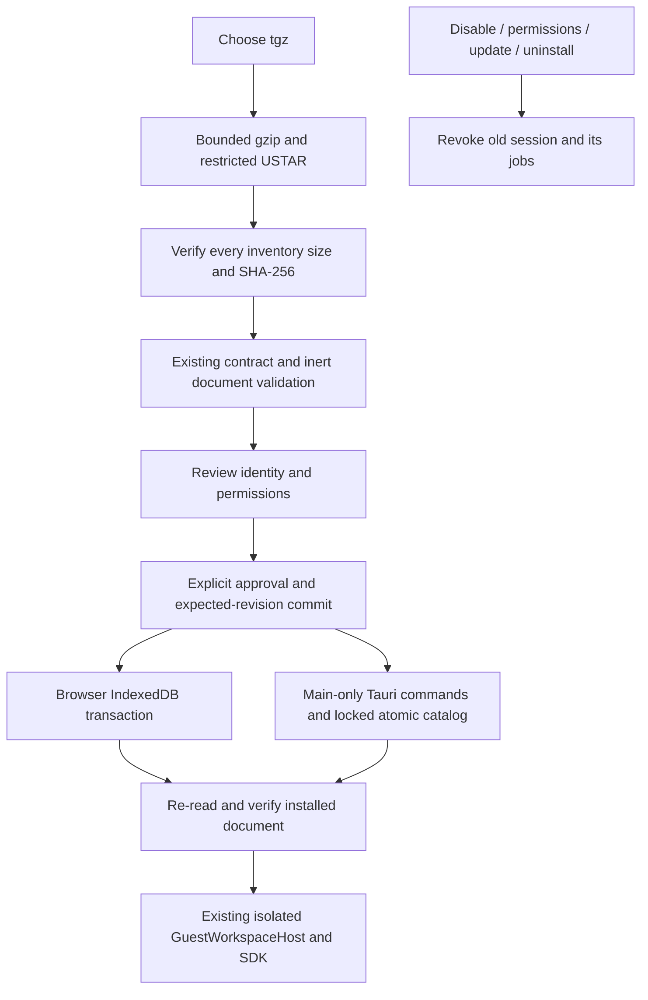

# Local extension packages

- **Owner:** App host admission and receipts for on-demand, full-workspace WebView
  UI packages. Existing Tools/MCP/Skills installation stays with its current owner.
- **Input:** a local `.tgz` produced by the extension devkit. No remote catalogue,
  npm dependency install, author lifecycle script or filesystem extraction runs.
- **Identity:** user-approved, unsigned `publisher.app-name`. SHA-256 detects byte
  changes; it does not establish who published the package.
- **Storage:** browser IndexedDB `cluaiz-extension-packages`; desktop App data
  `extension-packages/`. This contains receipts and HTML, not another chat database.

## Module reference

| File | Owns |
| --- | --- |
| archive.ts | Streaming gzip bounds, USTAR checks, regular entries; in-memory bytes only |
| admission.ts | Exact inventory, contract/version agreement and inert HTML validation |
| records.ts | Receipt fields and required/requested grant validation |
| browser.ts | Atomic IndexedDB receipt/document operations and stale-write conflicts |
| native.ts | Main-host native persistence adapter; no SDK export |
| store.ts | Install/configure/uninstall policy, activation integrity and change notifications |

## Install and update

Choose Toolkit → Extensions → Choose package. Review the unsigned identity,
version, digest and permissions, then approve installation or update. Required
permissions are mandatory for execution; optional permissions start off. A package
cannot replace a compiled bundled extension. Updating requires a different version
and a fresh review; it is manual replacement, not an automatic upgrade service.

The compressed limit is 20 MiB, expanded limit 32 MiB, at most 128 files and one
entry document up to 16 MiB. Inventory JSON/package metadata is bounded separately.
Links, special/PAX/GNU records, unsafe/duplicate paths, extra or changed files and
unsupported runtime profiles are refused. These are input bounds, not RAM or speed
benchmarks. Archives are never extracted into an author-controlled filesystem path.

Desktop stores immutable hash-named HTML and a schema-1 catalog. A cross-process
file lock protects the revision comparison and atomic catalog replacement. A busy
or corrupted store returns an error. Old catalog contents remain authoritative
until replacement succeeds. Cleanup removes only an unreferenced hash-named file;
locked leftovers can remain and are logged. Browser uses one read/write IndexedDB
transaction for the equivalent mutation. No in-memory success fallback exists.

## Lifecycle and limits

An installed route re-reads bytes, verifies the digest/metadata/grants and requires
an enabled receipt. Changes remove the old SDK session and remount only an admitted
replacement. Uninstall removes receipt/content and preserves the existing saved
preferences and chats. Browser storage can still be cleared/evicted by the browser.

No publisher signatures, automatic catalogue download/update, native binaries,
background/Wasm runtime profiles or direct Engine extension principals are supplied
here. A manually approved local package controls its declared ID's SDK namespace;
do not approve another publisher's identity based only on its spelling. Existing
host transport keeps Engine credentials out of the guest API. OS/process/CPU
isolation and all-platform acceptance are separate claims.

Toolkit can also request floating presentation of an admitted workspace package
while the App runs. Its installed receipt and permissions stay authoritative.
Package change notifications carry the changed ID, so another package's update or
uninstall does not restart this guest. Unknown older notifications re-verify
conservatively. This does not add autostart/background or native binary support.

Tests: `test/extension_packages.test.ts`, native `packages.rs` tests and
`test/extension_runtime_acceptance.mjs --packages`. See the test README and existing
foundation report for executed results; no model inference is performed by the
controlled runtime fixture.
