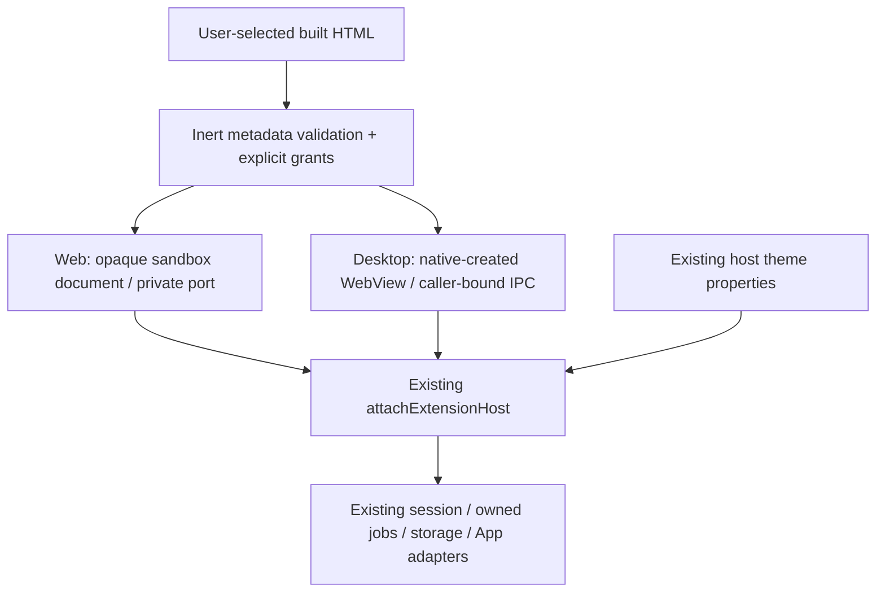

# Extension document surfaces

- **Purpose:** run one host-admitted immutable HTML document through the
  existing extension session/guest SDK, using the browser or native adapter.
  Admission comes from explicit developer preview or an installed package receipt.
- **Entry:** GuestWorkspaceHost supplies validated metadata, grants and existing
  service/state owners. This directory is not an installer or catalogue registry.
- **Supported document:** devkit-built self-contained HTML, on-demand WebView,
  full workspace layout, compatible host API and known required capabilities.
- **Limit:** 16 MiB UTF-8 HTML. This is an execution limit, not a RAM measurement.

## Ownership reference

| File | Responsibility |
| --- | --- |
| document.ts | Validate embedded package metadata before executing code; prepend browser resource policy |
| web.ts, browserShell.ts | Trusted opaque shell, child navigation policy, source-bound port handoff and cleanup |
| native.ts | Main-App routing/queues; embedded or floating native presentation and close notification |
| nativeWire.ts | One self-contained codec/bootstrap factory; preserve bounded Blob bytes across native JSON IPC |

The browser uses a trusted outer shell and a separate author iframe; neither has
same-origin permission. The shell's frame-src restricts child navigation before
an external request; the author's own CSP additionally denies nested frames.
Both policies allow the devkit's data scripts/styles and embedded media. The opaque
origin cannot share host DOM/storage. CSP denies direct fetch, nested frames,
workers, forms and objects; compiled scripts/styles are embedded data resources.
The exact child WindowProxy receives the transferred port once; wildcard target
origin is needed for the opaque recipient, not used to broadcast a credential.
The reserved frame name selects the SDK bootstrap path; it is a mode marker,
not authentication. The actual parent source and private port bind the channel.
The shell transfers the one private port to the exact author WindowProxy once;
it never executes author JavaScript. Subsequent allowed navigation closes that
connection. Actual self-navigation and fetch probes are exercised by package
acceptance; this is not exhaustive browser/network or CPU-isolation certification.

The native adapter requests a backend-minted label. Rust binds messages to the
actual calling WebView; guests never provide the accepted sender identity.
An initialization script built from the trusted nativeWire factory creates a
local MessageChannel and native IPC endpoint. It contains no Engine URL/token.
The factory must stay self-contained: the host serializes its compiled function;
author-supplied JavaScript is never evaluated in the host document.
The native codec tags ordinary objects as well as Blob values. Literal user JSON
with keys resembling a binary envelope remains JSON after a round trip.

Both adapters delegate to the existing host bridge. Closing disposes only that
session's work; it does not issue a global Engine stop. State keys remain owned
by ExtensionState and existing chat persistence; no database is added here.

## Trust and limits

This path accepts an explicitly approved unsigned local build. Its package ID is declared
by that build, not authenticated by a publisher signature. A granted storage
capability addresses that declared ID's existing SDK namespace. Do not treat this
manual approval as publisher-authenticated provenance.

Production registerDownloaded still refuses React/native-loader execution. The
separate packages/ owner admits installed immutable UI documents. Signing,
Engine-enforced identity, generic OS authority, background workers and other layouts
remain separate work. Browser/Windows acceptance uses the
same built author document; Linux/macOS/mobile execution is not certified.

## Floating host presentation

The same document/session can be hosted in the App's floating activity owner.
Browser uses the unchanged opaque shell inside its themed App panel. Desktop
passes a host-only floating option to create an independent native guest window.
The window has the same custom protocol, label-bound bridge, disposable profile,
navigation/download guards and guest-only ACL as an embedded document. It never
loads the main App frontend or receives its raw commands. Its window size is owned
by the OS/user; the main-page container observer does not resize it.

Native close notification closes the private transport and informs the active
host component. A disposed older component cannot close a replacement activity.
Parent destruction closes owned surfaces; main App quit semantics stay unchanged.
Floating presentation is not background activation or a new manifest runtime tier.
