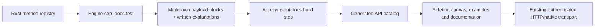
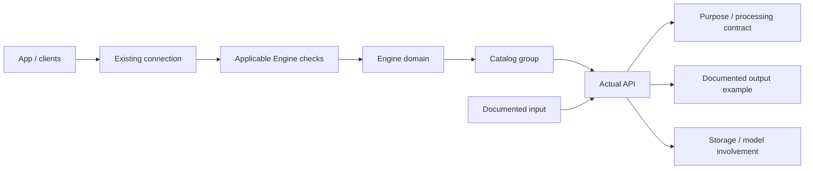

# API Explorer

The Explorer uses the Engine's documentation as its data source. Runtime code does
not keep a second list of methods or example payloads.

## Build and refresh

Keep the Engine checkout beside the App (`../cluaiz`), or set
`CLUAIZ_ENGINE_SOURCE` to its directory. This is a build-time source dependency;
the packaged web/desktop App does not read repository files or run a parser.

- Update Engine-generated blocks: from the Engine, run
  `CEP_DOCS_WRITE=1 cargo test --release -p cluaiz-api --test cep_docs`.
- Check those blocks: omit `CEP_DOCS_WRITE`.
- After editing Markdown: from the App, run `npm run sync:api`.
- Verify the generated App catalog: `npm run check:api`.
- Run parser and Explorer regressions: `npm run test:api-docs`.

`app`'s `predev` and `prebuild` hooks sync automatically. A standalone checkout or
CI build must supply the Engine docs directory explicitly. Parsing fails on
malformed metadata, missing method pages, duplicate requests and broken local
Markdown file links. `public/data/api-catalog.json` is generated and ignored; do
not edit it. The runtime loads that one file rather than the old static group
files. The unused group JSON and copied API Markdown have been removed. Old
unrelated App API clients are outside this Explorer migration.

## Owners and identity

- `scripts/sync-api-docs.mjs` parses YAML, preserves written documentation, and
  derives input choices from valid request-shaped JSON fences. Responses and
  calls for a different CEP method are excluded. Shortened prose examples stay
  in the documentation; sample paths/model IDs require actual installed inputs.
- `utils/catalogGroups.ts` gives the sidebar and architecture canvas the same
  five-category membership. Domain names merge case-insensitively, so direct
  chat completions and `chat.*` controls share one Chat card. TTS contains speech
  and voices; STT contains transcriptions and languages. Shared `audio.run` is
  shown once under TTS, matching its default text input; its transcription
  payload remains available. Endpoints and payloads are not copied or changed.
  Existing colors, controls and canvas behavior stay with their UI owners.
- `utils/requestPayload.ts` keeps the wire route separate from the selected
  request. `fs.read` and `fs.write` have distinct selection/storage keys; both
  send JSON-RPC to `/v1/cep`. Controls change `params`, retaining `method`, `id`
  and `jsonrpc`. HTTP inference requests keep their top-level fields.
- `services/catalogDiscovery.ts` uses the App's existing authenticated client
  for installed models and voices. It does not create a second model registry.
- `components/ApiDocumentation.tsx` keeps ordinary prose/code in the shared
  Markdown renderer and renders standalone Mermaid fences with the installed
  Mermaid library. Diagrams use strict sanitization and current theme tokens;
  a rendering failure retains the source/error rather than hiding the diagram.
  No chat renderer or API execution path is replaced.
- A task request shows its task handle. Use `tasks.get`/`tasks.result` examples
  to inspect progress/output; the Explorer does not silently auto-run them.

This catalog wiring does not certify all downloaded models, change Engine
permissions, migrate the rest of the App's API clients, or add a new native ABI.

## Interactive architecture overview

Open `/apis`, or click **API Explorer** in the existing sidebar to return from an
endpoint. The graph is an explanation/navigation surface, not a live trace.

Click a domain, group or method to navigate its children and open one process
diagram. Endpoints use their own documented Mermaid flow; components use an
explanatory flow for their responsibility. There are no five generic detail cards.
Click the same selected card again, or its process Close button, to fold that
branch and close its diagram. Reopening shows that level rather than automatically
opening every nested detail. Selecting another card shows its one process only.
Existing root and unrelated navigation cards
remain mounted at the same world coordinates as children are revealed ahead of
their parent. Previously opened branches stay present; unrelated branches dim but
remain clickable and readable on hover/focus. Explicit close folds descendants;
other selection and search preserve navigation context. The current overview mount retains
expansion history; a page reload can start a new overview.

Search and clearly named Examples controls sit on the right of the compact canvas
toolbar with inset spacing from its edge. Breadcrumbs remain on the left. Typing highlights matches and their owning paths in the existing scene;
Next/Previous match or Enter/Shift+Enter reveals a matching API and missing ancestors.
Clearing search or finding no matches never replaces the graph. Examples highlight
and reveal the relevant component, retaining prior explanation nodes. Missing
groups remain unavailable. There is no separate inspector sidebar or List view.

Ordinary selection, search and example steps preserve camera pan/zoom. Use the
explicit Focus selected control for an off-screen selected node/children, or Fit
to deliberately frame the expanded scene. Drag/pinch/wheel remain available;
keyboard focus minimally pans an off-screen card into view without changing scale.
A growing graph is a larger canvas, not an automatic refit into unreadable text.

### Owners

- `utils/architectureGraph.ts` projects the single existing catalog and produces
  cumulative component/group/API nodes and one selected process. Ordered reveal
  history, folded paths, selected detail, matches and dimming are separate.
  Placement reservations retain folded navigation anchors; inactive processes do
  not occupy layout space. Original endpoint objects
  and HTTP-method/logical-path identities remain intact. Shared CEP transport URLs
  do not merge methods. Unknown catalog groups remain reachable.
- `utils/architectureLayout.ts` owns deterministic geometry, bounds, directional
  edge paths and pure wheel/viewport math. Root anchors are seeded independently
  of expansion. New descendants search nearby free space on all four sides of
  their parent; obstacle boundaries provide candidates instead of a downward-only
  stack. Navigation anchors do not move on selection, expansion or folding.
  Only the visible process is placed, after navigation; historical process cards
  cannot force it into a distant column or invisible stack. Negative coordinates
  are included in bounds. Edge anchors support top/bottom as well as left/right.
  Explicit Fit uses actual expanded bounds. Layout does not mutate a render cache.
- `hooks/useArchitectureViewport.ts` owns transform refs, cursor anchoring,
  magnitude/unit-aware wheel input, bounded zoom and animation-frame painting.
  Zero movement does not zoom. Pointer drag paints directly; reduced motion skips
  interpolation. The graph does not rerender on every wheel animation frame.
  The first real loaded catalog receives one automatic Fit. Opening a process
  minimally pans its ready content into view without changing zoom. Search typing,
  content resizing and folding do not refit the graph. Deliberate pan/zoom stays on resize;
  Focus/Fit are explicit actions. Listeners/observers/frames are cleaned up.
- `components/ApiArchitectureCanvas.tsx` draws nodes/edges and compact controls,
  uses stable keys and real buttons, and reveals keyboard-focused off-screen nodes.
  The world has no persistent `will-change: transform` hint: Chromium must be able
  to rasterize text and SVG at the current zoom instead of enlarging a cached layer.
  Selected processes have no enclosing card or fixed-height scroll area. Their
  natural rendered height updates graph bounds; explicit Focus fits the whole
  process on wide and narrow screens. Process diagrams use nearby free space;
  their measured size cannot move navigation cards. Oversized process reveal keeps
  its heading visible without shrinking zoom. Diagram wheel input zooms
  the graph; buttons, summaries and links retain their own input.
- `components/ApiArchitectureInspector.tsx` renders one connected process. The
  endpoint's own Mermaid fence uses the existing documentation extractor and
  shared Markdown/Mermaid renderer. Missing diagrams show explicit status, not an
  invented flow. Module/group flowcharts are labelled explanations, not live traces.
  Optional original payload/response examples and Docs links remain in that block.
- `components/ApiArchitectureLanding.tsx` owns ordered reveal events, selected path,
  search/match navigation and example selection. Bottom Reset clears exploration state and remounts the canvas
  for its existing initial Fit. Catalog, connection and selected model are retained.
  Existing API/connection stores
  remain the data owners; no second
  catalog/model loader or client is added. Original endpoint objects go through
  the existing selectEndpoint/docs-tab actions. Browsing never sends the selected
  API's request; execution remains an explicit action in the original editor.

### Truth and limits

Displayed responses are labelled documented examples, not live success results.
Configured connection, selected model, inventory snapshot and measured loaded state
are different facts. Device/loaded context are unmeasured here; switching connection
hides metadata captured for the original scope. Group descriptions explain domain
responsibility, not a traced Rust call stack or proof of model capability.

This change does not build the AI Memory user controls, persist external memory
stream events, change Engine tool policy or validate every installed model/API.
The separate Notebook feature is unchanged. Browser tests do not certify packaged
native desktop or other operating systems.

Tests: `node --test test/api_architecture.test.cjs test/api_architecture_viewport.test.cjs`.

### Shared Markdown and Mermaid rendering

The installed Mermaid package is initialized/rendered only by
`src/components/ui/MermaidDiagram.tsx`. Shared MarkdownRenderer routes Mermaid
fences to it. Ordinary code fences use its existing CodeBlock, mechanically
extracted into MarkdownCodeBlock.tsx to keep modules below 800 lines. ApiDocumentation
and ApiDiagram adapt to the same shared rendering path. CSS Color 4 theme tokens
such as color-mix are resolved by the browser and composited to hex before Mermaid
initialization. Strict diagram security and visible loading/error states remain.
No new library was installed.
