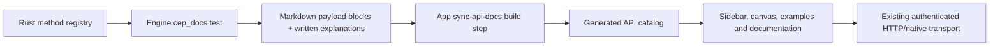
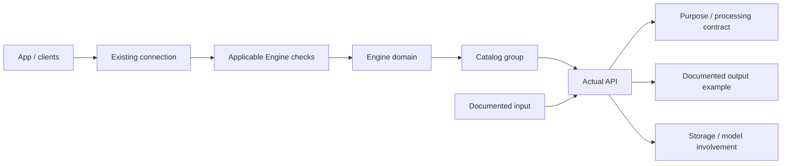

# API Explorer

The Explorer uses the Engine's documentation as its data source. Runtime code does
not keep a second list of methods or example payloads.

## Build and refresh

Keep the Engine checkout beside the App (`../cluaiz`), or set
`CLUAIZ_ENGINE_SOURCE` to its directory. This is a build-time source dependency;
the packaged web/desktop App does not read repository files or run a parser.

- Update Engine-generated blocks: from the Engine, run
  `CEP_DOCS_WRITE=1 cargo test --release -p cluaiz-api --test cep_docs`.
- Check those blocks: omit `CEP_DOCS_WRITE`.
- After editing Markdown: from the App, run `npm run sync:api`.
- Verify the generated App catalog: `npm run check:api`.
- Run parser and Explorer regressions: `npm run test:api-docs`.

`app`'s `predev` and `prebuild` hooks sync automatically. A standalone checkout or
CI build must supply the Engine docs directory explicitly. Parsing fails on
malformed metadata, missing method pages, duplicate requests and broken local
Markdown file links. `public/data/api-catalog.json` is generated and ignored; do
not edit it. The runtime loads that one file rather than the old static group
files. The unused group JSON and copied API Markdown have been removed. Old
unrelated App API clients are outside this Explorer migration.

## Owners and identity

- `scripts/sync-api-docs.mjs` parses YAML, preserves written documentation, and
  derives input choices from valid request-shaped JSON fences. Responses and
  calls for a different CEP method are excluded. Shortened prose examples stay
  in the documentation; sample paths/model IDs require actual installed inputs.
- `utils/catalogGroups.ts` gives the sidebar and architecture canvas the same
  five-category membership. Domain names merge case-insensitively, so direct
  chat completions and `chat.*` controls share one Chat card. TTS contains speech
  and voices; STT contains transcriptions and languages. Shared `audio.run` is
  shown once under TTS, matching its default text input; its transcription
  payload remains available. Endpoints and payloads are not copied or changed.
  Existing colors, controls and canvas behavior stay with their UI owners.
- `utils/requestPayload.ts` keeps the wire route separate from the selected
  request. `fs.read` and `fs.write` have distinct selection/storage keys; both
  send JSON-RPC to `/v1/cep`. Controls change `params`, retaining `method`, `id`
  and `jsonrpc`. HTTP inference requests keep their top-level fields.
- `services/catalogDiscovery.ts` uses the App's existing authenticated client
  for installed models and voices. It does not create a second model registry.
- `components/ApiDocumentation.tsx` keeps ordinary prose/code in the shared
  Markdown renderer and renders standalone Mermaid fences with the installed
  Mermaid library. Diagrams use strict sanitization and current theme tokens;
  a rendering failure retains the source/error rather than hiding the diagram.
  No chat renderer or API execution path is replaced.
- A task request shows its task handle. Use `tasks.get`/`tasks.result` examples
  to inspect progress/output; the Explorer does not silently auto-run them.

This catalog wiring does not certify all downloaded models, change Engine
permissions, migrate the rest of the App's API clients, or add a new native ABI.

## Interactive architecture overview

Open `/apis`, or click **API Explorer** in the existing sidebar to return from an
endpoint. The graph is an explanation/navigation surface, not a live trace.

Click a domain, then a group, then a method to reveal connected Input, Processing,
Output, Storage and Model nodes. For example, Memory & context -> notes ->
notes.create opens the real accepted fields and response example. Back, Escape and
breadcrumbs collapse the active branch. Only that branch expands deeply; the
viewer does not shrink every API into one unreadable global diagram. Drag to
explore it, zoom near the pointer, or deliberately Fit the visible graph.

The compact canvas toolbar owns search, breadcrumbs and example controls. Search
reveals matching API nodes connected to their domains; selecting one reveals its
original group/API path. Examples highlight the relevant component and explain the
step as a connected node. Missing groups remain unavailable. There is no separate
inspector sidebar or List view.

### Owners

- `utils/architectureGraph.ts` projects the single existing catalog and produces
  progressive visible component/group/API/detail nodes. It retains original endpoint
  objects and distinct HTTP-method/logical-path identities. Shared CEP transport
  URLs do not merge methods. Unknown catalog groups remain reachable.
- `utils/architectureLayout.ts` owns deterministic geometry, bounds, directional
  edge paths and pure wheel/viewport math. Only visible nodes enter layout.
- `hooks/useArchitectureViewport.ts` owns transform refs, cursor anchoring,
  magnitude/unit-aware wheel input, bounded zoom and animation-frame painting.
  Zero movement does not zoom. Pointer drag paints directly; reduced motion skips
  interpolation. The graph does not rerender on every wheel animation frame.
  Catalog bounds arriving after initial loading trigger reframing while the user
  has not moved the view. Navigation frames the new branch; deliberate movement
  is preserved during unrelated changes. Listeners/observers/frames are cleaned up.
- `components/ApiArchitectureCanvas.tsx` draws nodes/edges and compact controls,
  uses real buttons and reveals keyboard-focused off-screen nodes. Small screens
  frame a readable detail instead of shrinking the entire branch. Inner detail
  scrolling, buttons and links keep their own input rather than zooming the map.
- `components/ApiArchitectureInspector.tsx` now renders content *inside connected
  graph nodes*. It no longer owns an aside or separate endpoint list. Parameters,
  required flags, request variants and response examples come from the endpoint
  object. Large code previews are bounded; full language examples remain in Docs.
- `components/ApiArchitectureLanding.tsx` owns expanded path, search and example
  selection. Existing API/connection stores remain the data owners; no second
  catalog/model loader or client is added. Original endpoint objects go through
  the existing selectEndpoint/docs-tab actions. Browsing never sends the selected
  API's request; execution remains an explicit action in the original editor.

### Truth and limits

Displayed responses are labelled documented examples, not live success results.
Configured connection, selected model, inventory snapshot and measured loaded state
are different facts. Device/loaded context are unmeasured here; switching connection
hides metadata captured for the original scope. Group descriptions explain domain
responsibility, not a traced Rust call stack or proof of model capability.

This change does not build the AI Memory user controls, persist external memory
stream events, change Engine tool policy or validate every installed model/API.
The separate Notebook feature is unchanged. Browser tests do not certify packaged
native desktop or other operating systems.

Tests: `node --test test/api_architecture.test.cjs test/api_architecture_viewport.test.cjs`.
