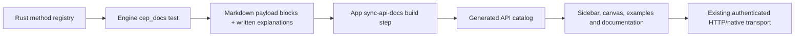

# API Explorer

The Explorer uses the Engine's documentation as its data source. Runtime code does
not keep a second list of methods or example payloads.

## Build and refresh

Keep the Engine checkout beside the App (`../cluaiz`), or set
`CLUAIZ_ENGINE_SOURCE` to its directory. This is a build-time source dependency;
the packaged web/desktop App does not read repository files or run a parser.

- Update Engine-generated blocks: from the Engine, run
  `CEP_DOCS_WRITE=1 cargo test --release -p cluaiz-api --test cep_docs`.
- Check those blocks: omit `CEP_DOCS_WRITE`.
- After editing Markdown: from the App, run `npm run sync:api`.
- Verify the generated App catalog: `npm run check:api`.
- Run parser and Explorer regressions: `npm run test:api-docs`.

`app`'s `predev` and `prebuild` hooks sync automatically. A standalone checkout or
CI build must supply the Engine docs directory explicitly. Parsing fails on
malformed metadata, missing method pages, duplicate requests and broken local
Markdown file links. `public/data/api-catalog.json` is generated and ignored; do
not edit it. The runtime loads that one file rather than the old static group
files. The unused group JSON and copied API Markdown have been removed. Old
unrelated App API clients are outside this Explorer migration.

## Owners and identity

- `scripts/sync-api-docs.mjs` parses YAML, preserves written documentation, and
  derives input choices from valid request-shaped JSON fences. Responses and
  calls for a different CEP method are excluded. Shortened prose examples stay
  in the documentation; sample paths/model IDs require actual installed inputs.
- `utils/catalogGroups.ts` gives the sidebar and architecture canvas the same
  five-category membership. Domain names merge case-insensitively, so direct
  chat completions and `chat.*` controls share one Chat card. TTS contains speech
  and voices; STT contains transcriptions and languages. Shared `audio.run` is
  shown once under TTS, matching its default text input; its transcription
  payload remains available. Endpoints and payloads are not copied or changed.
  Existing colors, controls and canvas behavior stay with their UI owners.
- `utils/requestPayload.ts` keeps the wire route separate from the selected
  request. `fs.read` and `fs.write` have distinct selection/storage keys; both
  send JSON-RPC to `/v1/cep`. Controls change `params`, retaining `method`, `id`
  and `jsonrpc`. HTTP inference requests keep their top-level fields.
- `services/catalogDiscovery.ts` uses the App's existing authenticated client
  for installed models and voices. It does not create a second model registry.
- `components/ApiDocumentation.tsx` keeps ordinary prose/code in the shared
  Markdown renderer and renders standalone Mermaid fences with the installed
  Mermaid library. Diagrams use strict sanitization and current theme tokens;
  a rendering failure retains the source/error rather than hiding the diagram.
  No chat renderer or API execution path is replaced.
- A task request shows its task handle. Use `tasks.get`/`tasks.result` examples
  to inspect progress/output; the Explorer does not silently auto-run them.

This catalog wiring does not certify all downloaded models, change Engine
permissions, migrate the rest of the App's API clients, or add a new native ABI.
