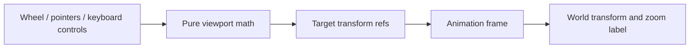

# Architecture viewport

`useArchitectureViewport` owns the architecture canvas transform and its input
lifecycle. The feature's existing stores own connection/catalog/model data; this
hook neither fetches it nor executes APIs.

Wheel magnitude and units are normalized by `architectureLayout.ts`. Zero and
non-finite input leave the viewport unchanged. Zoom preserves the pointer's
world-space anchor and stays bounded. Pointer drag paints directly; explicit
zoom/selection approaches its target over animation frames. Reduced motion skips
interpolation. Input does not update React state for every animation frame.

The hook observes canvas size, respects deliberate user movement, and supports
two-pointer pinch. Buttons, links and scrollable detail content keep their own
input. Unmount cancels the frame and removes observers/listeners. The canvas owns
node layout and keyboard focus; it calls `reveal` for an off-screen focused node.

Behavioral math tests live in `test/api_architecture_viewport.test.cjs`. Browser
acceptance must separately exercise actual pointer, wheel, focus and cleanup.
