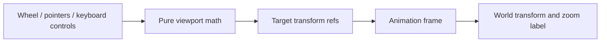

# Architecture viewport

`useArchitectureViewport` owns the architecture canvas transform and its input
lifecycle. The feature's existing stores own connection/catalog/model data; this
hook neither fetches it nor executes APIs.

Wheel magnitude and units are normalized by `architectureLayout.ts`. Zero and
non-finite input leave the viewport unchanged. Zoom preserves the pointer's
world-space anchor and stays bounded. Pointer drag paints directly; explicit
zoom/Focus/Fit approaches its target over animation frames. Reduced motion skips
interpolation. Input does not update React state for every animation frame.

The first real catalog is fitted once. Ordinary selection, search, example steps,
newly expanded bounds and resizing do not reset the camera. Explicit Focus/Fit use
current geometry, including a process diagram's measured natural height. The hook
supports two-pointer pinch; diagram wheel input zooms the graph while buttons,
links and expandable summaries keep their own input. Unmount cancels frames and removes observers
and listeners. The canvas owns node placement/keyboard focus; `reveal` minimally
translates an off-screen focused node into view while preserving scale. The hook
does not own a second graph or saved-layout database.

Behavioral math tests live in `test/api_architecture_viewport.test.cjs`. Browser
acceptance must separately exercise actual pointer, wheel, focus and cleanup.
