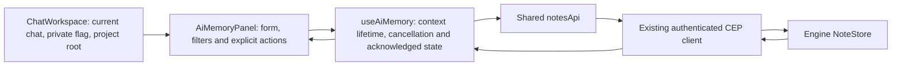

# Component: chat workspace and AI Memory controls

## Technical specification

- **Purpose:** existing chat conversations, streaming and workspace split view;
  the AI Memory dialog manages existing durable Engine facts/preferences.
- **Entry:** the AI Memory brain button in ChatWorkspace's existing top-right
  controls. The unused ChatHeader is not a second entry or state owner.
- **Platform:** web and desktop use the same React UI and shared API client.
  Packaged desktop acceptance is separate from browser/adapter evidence.

## Architectural flow

## Owners and lifecycle

- **ChatWorkspace.tsx:** keeps existing chat/message/history owners. Supplies real
  session id and active project root to the dialog. Private mode blocks durable
  notes reads/writes. Extension-bound chat surfaces do not expose this owner UI.
- **components/AiMemoryPanel.tsx:** theme-aware existing Dialog, Button, Input,
  Badge, AlertBanner and dropdown primitives; no notebook state or parallel store.
  Add in chat/workspace/global scope; list/search/filter; proposed confirmation;
  pin/unpin; explicit inactive confirmation; status/origin/time/source details.
  Search/filter typing is local, not polling. Escape closes; keyboard focus wraps
  and returns to the opener. Full note content renders as escaped text.
- **hooks/useAiMemory.ts:** read once on open and on chat/Engine/workspace change;
  explicit Refresh otherwise. Abort and context identity prevent late results
  replacing another scope. Closing releases visible note state. A busy reference
  serializes mutations, including rapid repeated submits.
- **api/engine/notes:** request/record validation has one owner. It retains
  supersession history and checks returned ids/scopes/statuses. The UI uses actual
  acknowledgment before showing saved state.

## Scope and failure behavior

- List applies only the current chat, actual returned Engine workspace and global
  records. An App project/Engine workspace mismatch disables writing; the panel
  never changes Engine workspace automatically. Without a chat id, chat notes are
  neither displayed nor offered as a creation scope.
- A pre-write read checks workspace and current record. Workspace creation is
  still owned by the Engine's current-workspace contract, not an atomic App scope
  transaction; there is no client-only guarantee against another client changing
  workspace between requests. Unexpected acknowledgments surface as errors.
- No optimistic Saved, auto retry or rollback promise. Failed/uncertain results
  require Refresh before another write. Closing stops observing; the Engine can
  still finish a submitted mutation. Only pre-execution auth retry belongs to the
  shared transport.
- A proposed note and a pinned note are distinct. Confirming can supersede a live
  note on the same subject. Mark inactive keeps history. Existing APIs expose no
  text-edit or physical-delete operation, so the UI does not invent them.

## Boundaries and evidence

- Conversation events/search, context reports and saved KV remain separate owners;
  their future panels are Phase C. External-mode memory events and model tool-use
  policy are Phase D. Opening this panel loads no model and adds no system prompt.
- `test/cep_notes.test.cjs` covers actual adapter contracts. Integration proof
  records controlled rendered-panel race/failure/private-mode checks and isolated
  release-Engine read/write journeys; neither implies every model uses memory.
