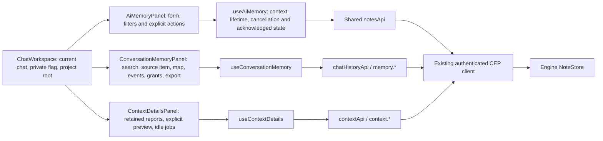

# Component: chat workspace, AI Memory, Conversation Memory, and Context Diagnostics

## Technical specification

- **Purpose:** existing chat conversations, streaming and workspace split view;
  the AI Memory dialog manages durable Engine facts/preferences (`notes.*`),
  the Conversation Memory dialog inspects per-chat recall, event log, tool grants,
  and export (`memory.*`), and the Context Diagnostics dialog inspects retained
  preflight reports, dry-run context previews, and idle indexer jobs (`context.*`).
- **Entry:** the right-click context menu (`GlobalChatContextMenu` — `CHAT OPTIONS`
  with `AI Memory`, `Conversation Memory`, `Context Diagnostics`, `Archive` /
  `Unarchive`, `Close chat`, and `Delete Chat`) in `ChatWorkspace`, plus the
  `Context` button inside `ConversationMemoryPanel` and the
  `Inspect full context & tools report` button inside `ContextWindowPopover`.
  In the top-right corner of `ChatWorkspace`, only `PrivateModeToggleButton` is
  rendered on the empty New Chat screen (`messages.length === 0`), with no
  floating memory buttons. The unused `ChatHeader` is not a second entry or state owner.
- **Platform:** web and desktop use the same React UI and shared API client.
  Packaged desktop acceptance is separate from browser/adapter evidence.

## Architectural flow

## Owners and lifecycle

- **ChatWorkspace.tsx:** keeps existing chat/message/history owners. Supplies real
  session id and active project root to the dialog. Private mode blocks durable
  notes reads/writes. Extension-bound chat surfaces do not expose this owner UI.
- **components/AiMemoryPanel.tsx:** theme-aware existing Dialog, Button, Input,
  Badge, AlertBanner and dropdown primitives; no notebook state or parallel store.
  Add in chat/workspace/global scope; list/search/filter; proposed confirmation;
  pin/unpin; explicit inactive confirmation; status/origin/time/source details.
  Search/filter typing is local, not polling. Escape closes; keyboard focus wraps
  and returns to the opener. Full note content renders as escaped text.
- **hooks/useAiMemory.ts:** read once on open and on chat/Engine/workspace change;
  explicit Refresh otherwise. Abort and context identity prevent late results
  replacing another scope. Closing releases visible note state. A busy reference
  serializes mutations, including rapid repeated submits.
- **api/engine/notes:** request/record validation has one owner. It retains
  supersession history and checks returned ids/scopes/statuses. The UI uses actual
  acknowledgment before showing saved state.

- **components/ConversationMemoryPanel.tsx & hooks/useConversationMemory.ts:**
  scoped to connection, chat id, and private flag. Reads `memory.index`,
  `memory.events`, and `memory.grants` on open/refresh; runs `memory.search` only
  on deliberate form submit and supplements chat-scoped results with `matchCardsForQuery`
  over loaded `index.cards` so single-word queries (such as a user's name) resolve
  even when Engine recall requires 2+ shared terms; displays indexed messages with
  their primary `card.keywords` on the default tab; inspects `memory.item` by `m:<pos>`
  without equating Engine message positions with local UI message ids; revokes tool
  grants via `memory.revoke_grants`; exports `cluaiz-chat-export` v1 JSON via `memory.export`.
- **hooks/useChatSend.ts & core/engine.ts:** saved (non-private) chats pass
  `history_mode: 'adaptive'` on `/v1/chat/completions` so the Engine retains recent
  turns in the prompt, recalls older turns from its index, and offers memory tools
  (`recall`, `open_memory`, `remember`).
- **components/ContextDetailsPanel.tsx & hooks/useContextDetails.ts:**
  reads `context.jobs` and (when a non-private chat id exists) `context.reports` /
  `context.report` on open/refresh. Explains that retained reports live in Engine
  RAM (newest 20 per chat) until restart. Runs `context.preview` only on explicit
  user click with disclosure that it may load the model for tokenization.

## Scope and failure behavior

- List applies only the current chat, actual returned Engine workspace and global
  records. An App project/Engine workspace mismatch disables writing; the panel
  never changes Engine workspace automatically. Without a chat id, chat notes are
  neither displayed nor offered as a creation scope.
- A pre-write read checks workspace and current record. Workspace creation is
  still owned by the Engine's current-workspace contract, not an atomic App scope
  transaction; there is no client-only guarantee against another client changing
  workspace between requests. Unexpected acknowledgments surface as errors.
- No optimistic Saved, auto retry or rollback promise. Failed/uncertain results
  require Refresh before another write. Closing stops observing; the Engine can
  still finish a submitted mutation. Only pre-execution auth retry belongs to the
  shared transport.
- A proposed note and a pinned note are distinct. Confirming can supersede a live
  note on the same subject. Mark inactive keeps history. Existing APIs expose no
  text-edit or physical-delete operation, so the UI does not invent them.

## Boundaries and evidence

Memory inspection cancels the previous search/source request when the user changes
operation, clearing the cancelled operation's loading flag. Local keyword matches
are labelled separately from Engine BM25 hits. Both use the original Engine
`m:<pos>` reference; no App message-id mapping is invented.

The explicit text preview reads current model, thinking effort and tool chips
from the mounted composer through `useChatPreviewOptions`. Send and Preview reuse
`chatComposerOptions` and `chatHistoryOptions`; saved chats use adaptive history.
Preview includes saved conversation media but excludes unsent attachments, as
disclosed in its UI. Reading composer options does not issue requests or persist
another settings copy. An empty preview sends no synthetic user prompt.

- Saved disk KV caches remain in `Settings -> Chats & History -> Model Memory (Engine)`
  via `chatMemoryApi`. External-mode memory import/events (`memory.import`) and
  model tool-use policy remain Phase D. Opening `AiMemoryPanel`,
  `ConversationMemoryPanel`, or `ContextDetailsPanel` loads no model automatically;
  only clicking `Run Preview` inside `ContextDetailsPanel` invokes `context.preview`.
- `test/cep_notes.test.cjs` and `test/cep_conversation_context.test.cjs` cover
  actual adapter contracts. Integration proof records controlled rendered-panel
  race/failure/private-mode checks and isolated release-Engine read/write journeys.
