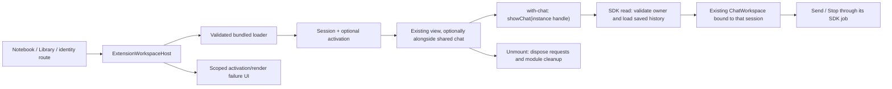
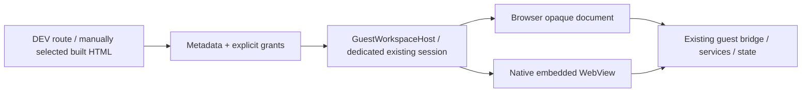
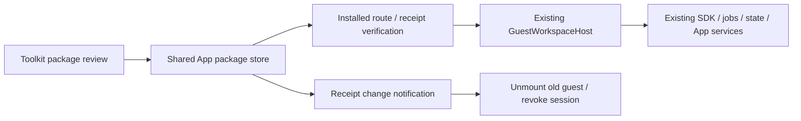
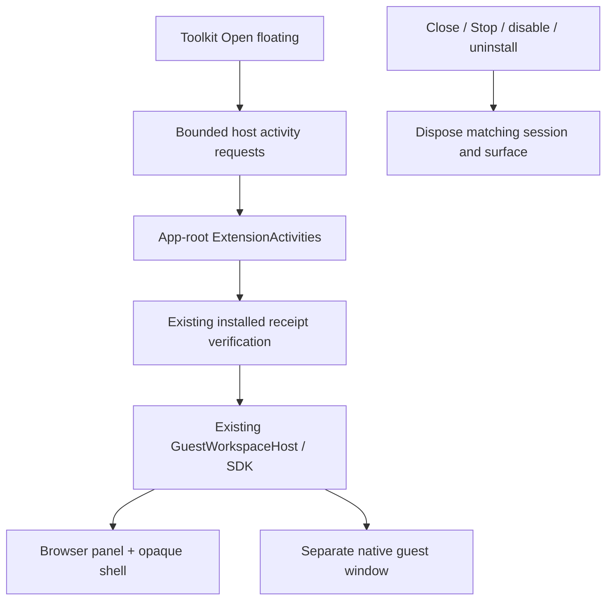

# Extension workspace view host

- **Purpose:** mount an App-owned bundled contribution inside the existing shell; optionally reuse the chat workspace alongside it.
- **Entry:** `ExtensionWorkspaceHost.tsx` accepts `extensionId`, `viewId` and an optional host registry for composition/tests.
- **Core owner:** [manifest, SDK and lifetime contract](../../extensions/README.md).
- **Design:** existing Button, theme variables, App shell and ChatWorkspace. No separate theme/chat implementation.

## Toolkit navigation

ToolkitWorkspace.tsx is the App's /toolkit home. It composes the existing
ToolsWorkspace for plugins/MCP/skills, the actual bundled workspace registry for
Extensions, and ComponentShowcase for UI components & SDK. Sections are recorded
in the URL and restored on browser history navigation. It does not maintain a
second installed-package list or call a new installer API. Opening Notebook or
Library uses the existing openExtensionWorkspace owner.

In DEV builds only, the Extensions tab can open the existing
DeveloperExtensionWorkspace built-HTML/grant/run flow. Production downloaded
extension registration stays disabled. The UI reference remains /components,
including direct/hash routes with unrelated API query parameters.

The registry supplies reviewed bundled code only. Error boundaries contain React render failures, not malicious JavaScript, CPU loops or native crashes. Downloaded executable packages are rejected by the core registry. Existing screen storage is unchanged.

`ExtensionChatWorkspace.tsx` owns the shared view binding. It mounts the extension
once in a stable workspace position, even before a chat is selected. The extension
creates/reopens its own SDK handle and calls `showChat`; mounting never creates a
chat or shows the main conversation. The existing `ChatWorkspace` scopes its
message actions and input to this handle. Binding changes/unmount cancel only the
UI-owned SDK job, and leave ordinary saved chats in the existing storage system.
Text is supported here; files/tools/microphone controls remain disconnected and
disabled. Notebook/Library retain their existing `full` layouts. No extra database,
theme or player is introduced for these bundled screens.

## Developer document path

In a development build, /extensions/developer.preview/main mounts
DeveloperExtensionWorkspace. It reads one manually selected devkit-built HTML
while inert, validates its embedded metadata and presents its requested grants.
It is for the author's own unsigned output; publisher identity is not verified.

GuestWorkspaceHost gives that document a dedicated existing ExtensionSession,
using the same state/service adapters. Browser execution uses an opaque script
sandbox and private port. Desktop execution uses the caller-bound native WebView
adapter. It handles late async opening, unmount and failures without starting a
global Engine stop. A missing required capability fails before surface creation.

The registry's downloaded React/native-loader rejection remains intact. Normal
local package execution uses a separate installed document host, described below.
Only full workspace/on-demand WebView documents are accepted; external with-chat,
background/floating/native-worker surfaces and publisher authentication remain separate.
See ../../extensions/surfaces/README.md for exact resource and trust boundaries.

## Installed UI packages in Toolkit

`ToolkitWorkspace` composes the existing bundled cards, `InstalledExtensions`,
ToolsWorkspace and the same component/SDK gallery. `ExtensionPackageImport` reads
a local devkit `.tgz` while inert and shows explicit approval with shared
`ExtensionPermissions`; developer preview reuses that permission control too.
Installed cards expose Open, Enable/Disable, Permissions and confirmed Uninstall.
Storage errors remain visible and do not become an empty successful catalog.

`InstalledExtensionWorkspace` re-reads the receipt and document before execution.
It refuses missing, disabled, incompatible or changed bytes, then mounts the same
GuestWorkspaceHost. Receipt changes invalidate the previous session; update,
permission changes and disable cannot keep its old SDK handles alive. Deep links
retain the existing extension route; `openInstalledExtensionWorkspace` checks
that the selected installed view is enabled before navigating.

Package receipts/content are App-owned; saved chat/preferences keep their existing
owners. Uninstall preserves them. No website catalogue or extra Tools installer is
introduced. See ../../extensions/packages/README.md for storage and trust limits.

## App-root floating activities

- **Owner:** ExtensionActivities is mounted beside MainAppContent under the same
  ThemeProvider, outside route selection. Only this owner keeps a floating session
  alive while the user changes the selected App screen.
- **Entry:** Toolkit's Open floating requests one installed package/view. The
  existing InstalledExtensionWorkspace still reads enabled receipts/digests/grants;
  no alternate downloaded loader is introduced.
- **Browser:** a themed drag/resize panel hosts the existing opaque document shell.
  The host owns its header/Close action; author code stays inside the iframe.
- **Desktop:** an offscreen host container owns the existing SDK/bridge and creates
  a separate native guest-only window. Closing the window removes that activity;
  late async opening after Stop closes the returned surface.
- **Controls:** at most three requests, one per package/view; Toolkit exposes Stop.
  Errors stop execution and stay visible until dismissed. Disable/uninstall revokes
  the matching session, and unrelated package changes leave other sessions alone.

This on-demand activity is not persisted/autostarted. Desktop main close hides
the same broker when Run in background is enabled and the tray is ready; otherwise
ordinary close applies. Explicit Quit ends the App. Durable jobs, after-quit execution, native workers,
screen capture and transparent/always-on-top pets remain separate work. Browser
tab throttling is still the browser's behavior. The same App/Engine services are
reused, but each additional view consumes resources; no memory benchmark is claimed.

The App's desktop_lifecycle native owner distinguishes main CloseRequested from
floating Close and full Quit. Hiding main does not destroy its session owner;
existing guests can continue using the same SDK. No extension gains permission
to inspect/change background policy, restore main or quit the platform. Existing
General Settings remains the user control; see ../../core/README.md.
