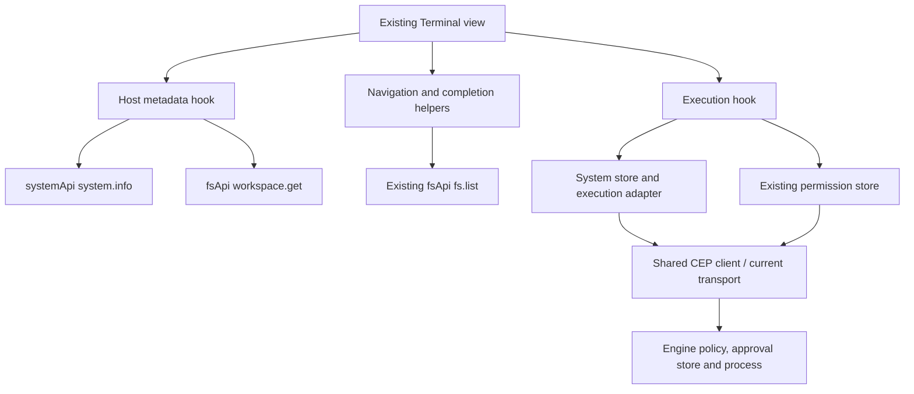

# Workspace Terminal hooks

These modules repair the existing Workspace Terminal's Engine boundary. The view
keeps xterm, sessions, command history, resizing, theme and clipboard controls;
it does not implement a persistent interactive shell or a second API client.

| Module | Responsibility |
|---|---|
| `useTerminalHost.ts` | Read actual Engine OS and workspace metadata; ignore obsolete reads |
| `useTerminalExecution.ts` | Observe one explicit command, request an owner decision and retry the exact payload once after acknowledgment |
| `terminalPaths.ts` | Filesystem-backed navigation/completion and cwd-to-shell representation |
| `../components/WorkspaceTerminal.tsx` | Existing xterm rendering/input, tabs, theme and decision row |

## Opening and navigating

Opening the panel reads Engine metadata. It does not run `echo`, `mkdir`, `dir`,
`find` or `ls`. A browser-cached home directory and browser OS are not evidence
of the remote Engine's paths/platform. Session origins include the connection and
workspace; a different Engine must not inherit the old session cwd.

`cd` verifies the target with the existing filesystem API and updates only the
local Terminal session. It does not change the Engine's global workspace or create
the requested folder. Lexical path normalization is a display convenience; Engine
canonicalization, symlink and root checks remain authoritative. Home expansion is
explicitly unavailable because the current read metadata does not supply a home
directory. Use an absolute Engine path instead of an invented home fallback.

Tab completion uses `fs.list`, respects Engine path case rules and retains
truncated/skipped metadata. It ignores a result if the displayed terminal/input
changed during the read. This is path completion, not a full shell grammar parser.

## Explicit commands and decisions

Only an explicit user command uses `system.exec`. The Engine chooses cmd on
Windows or sh on Unix; unsupported PowerShell/bash/zsh selections are not offered.
The adapter does not bypass disabled shell policy. The cwd is represented as shell
syntax: POSIX single-quote escaping or a quoted Windows path. Unsafe Windows
expansion/UNC forms are refused rather than silently interpreted as another path.

A real approval-required response displays its target in the existing panel. The
hook reuses permission-store approve/reject actions, waits for acknowledgment and
retries the same command once only if approved and still current. A failed decision
stays visible. A rejected command is not executed. There is no retry loop after
transport failure, malformed acknowledgment or a second approval response.

Closing, changing session/workspace or changing Engine invalidates observation and
pending decisions; late responses cannot print into a new panel or trigger a retry.
It does not cancel an already-running Engine process. Shell output is buffered by
the current Engine operation; the App does not claim interactive stdin, live output
streaming or Ctrl+C process termination.

## Validation and remaining acceptance

`test/cep_execution.test.cjs` covers command contracts, positive/nonzero/empty
results, preserved CEP failures, command serialization, stale history and portable
path helpers. Isolated browser acceptance mounts the actual xterm/view/hooks/stores
with controlled shared-client responses; it does not execute user commands.

Real Windows shell acceptance remains **PARTIAL** because of the current Engine's
cmd argument-escaping bug with quoted cwd. See [system execution](../../../api/engine/system/README.md)
for that boundary and the actual proof. Engine source and user configuration were
not changed. Native packaged acceptance and other OS runtimes remain separate.
