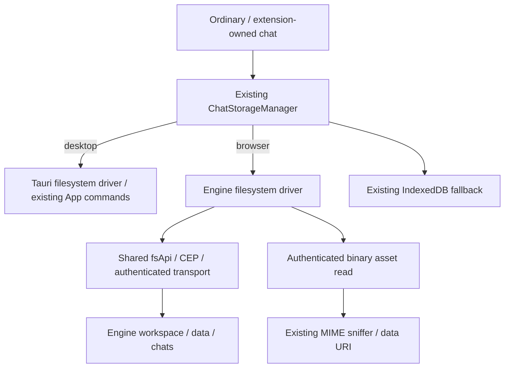

# Component: App chat storage

## Technical specification

- **Purpose:** preserve the existing saved-chat catalog, metadata, JSONL messages and binary attachments for ordinary and extension-owned chats.
- **Runtime selection:** ChatStorageManager chooses TauriFsChatStorageDriver on desktop and EngineFsChatStorageDriver in the browser. IndexedDbChatStorageDriver is the existing local fallback; it is not a new cloud service.
- **Browser disk location:** workspace-relative data/chats, as in the previous Engine file handler. It is not a fixed user-home path. Workspace selection changes what relative paths refer to; this repair does not migrate/rebase old files or redesign a global storage root.
- **Desktop location:** existing native App storage commands and platform data directory. Browser and desktop storage are separate implementations; identical physical directories are not promised.

## Architectural flow



## Stored contracts

| Relative file | Ownership and format |
|---|---|
| data/chats/sessions_index.json | Existing SessionsIndex catalog, including extension ownership metadata |
| data/chats/{sessionId}/meta.json | Existing SessionMetadata; id must match the requested session |
| data/chats/{sessionId}/messages.jsonl | One JSON ChatMessage per line, unchanged message serialization |
| data/chats/{sessionId}/assets/{assetId} | Existing binary attachment bytes and saved relative reference |

- **Session handles:** the extension SDK/store still owns session authorization. Driver path validation rejects separator/drive/traversal segments; it is not an extension identity or Engine permission system.
- **Read behavior:** an explicit CEP file_not_found error returns missing/empty data. Disconnection, permission failure, invalid response and invalid catalog/metadata propagate. A failed read cannot initiate EngineFs appendMessage's read/modify/write as if history were empty.
- **Interrupted JSONL:** a malformed trailing line after at least one valid message is skipped. Interior corruption, wholly invalid history and non-UTF-8 history are errors. This is bounded recovery of an interrupted write, not silent recovery of arbitrary corruption.
- **Write behavior:** existing JSON/JSONL encoding and locations remain. appendMessage updates an existing id or appends a new message after a successful read. It remains read/modify/write; concurrent independent clients are not an atomic append transaction.
- **Assets:** saveAsset retains the relative assets/ reference. resolveAssetUrl now reads bytes through fsApi/authentication and returns an existing MIME-sniffed data URI instead of a retired unauthenticated GET URL. No new blob URL cache or lifetime owner is introduced; base64/data URIs still consume memory and are not zero-copy streams.
- **Deletion:** one validated session directory is removed; missing is idempotent. Other errors propagate to the manager. Full Engine memory/events/grants deletion is a separate integration task from deleting App files or saved KV.

## File breakdown

- **ChatStorageManager.ts:** existing primary/fallback routing and dual-write behavior; its error/fallback policy is not redesigned here. A manager method can still finish through fallback after a primary failure. It does not certify durable primary disk persistence.
- **EngineFsChatStorageDriver.ts:** shared fsApi consumer; JSON/JSONL encoding, missing-file distinction and authenticated attachment resolution. No duplicate URL/auth/CEP implementation.
- **TauriFsChatStorageDriver.ts / IndexedDbChatStorageDriver.ts:** existing native/browser implementations, unchanged by the CEP filesystem repair.
- **types.ts:** shared driver and catalog/metadata interfaces. Method comments describe intended caller semantics; current Engine writes do not provide atomic file replacement or inter-client transactions.
- **chatRetention.ts / chatRetentionRunner.ts:** existing retention planning/application; no new pruning policy is introduced by migration.

## Verification and remaining work

```text
node --test test/cep_fs.test.cjs test/cep_history.test.cjs
```

The shared extension-chat regression also executes the actual manager/store/drivers against a controlled CEP transport and checks shared catalog, ownership, restoration and failed-history refusal. Separate release-Engine acceptance seeds legacy-format files in its own workspace and verifies restore/append/assets/deletion there.

Real user data is not used by the write/cleanup proof. Packaged desktop, other OSes, simultaneous-client writes, native storage commands and physical browser IndexedDB durability remain separate acceptance work. This repair does not claim that every App API or memory operation is migrated.
