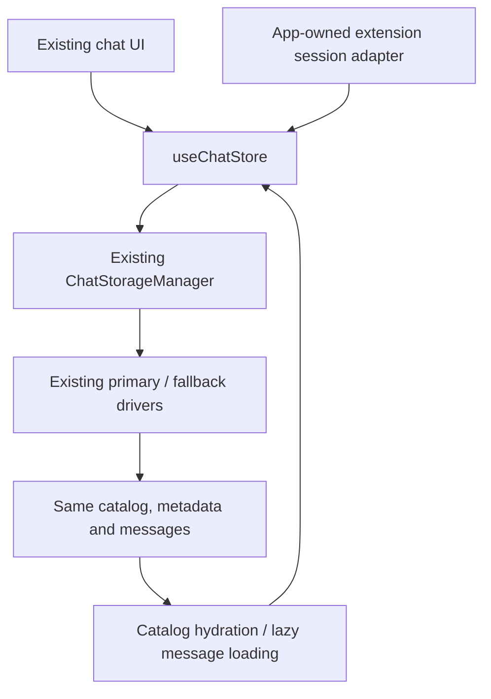

# Component: Chat state

## Technical specification

- **Purpose:** own the App's existing chat catalog, messages, selection and message mutations. Extension chats use this same owner.
- **Platform support:** shared TypeScript state. ChatStorageManager selects the existing desktop/browser driver; platform persistence acceptance is separate from module tests.
- **Reuse:** UI and trusted bundled extension adapters call the same actions. This directory creates no second database or Engine protocol.

## Architectural flow

## Interface and files

- **`types.ts`:** existing ChatMessage, ChatSession and ChatStore declarations, moved out of the oversized store without changing their import compatibility. `CreateChatSessionOptions` adds optional `activate` and package ownership.
- **`useChatStore.ts`:** actions, selection and existing save hooks. It re-exports ChatMessage/ChatSession so existing imports keep working. `createNewSession(title, options?)` retains default activation; `activate:false` keeps current selection and URL. Optional `extensionId` is copied into existing index/metadata and restored during hydration.
- **`loadMessages(id)`:** loads through the existing manager without selecting a chat. It refuses missing saved history when the index records messages. A delayed load cannot restore a deleted session or replace a newer in-memory message array. `switchSession` reuses this loader and still owns its loading indicator/route.
- **Existing preference/voice/highlight stores:** keep their existing responsibilities; this session slice does not redesign them or add a new audio player.

## Ownership and lifecycle

The global `activeSessionId` is the user's current selection. Creating a extension
chat does not change it. The existing single `streamingSessionId` continues to
represent the App's one active chat answer; independent saved sessions do not imply
parallel inference. The extension adapter checks grants/handles/package ownership
before actions and binds tokens to its own chat.

Main App UI access remains the user's access. `extensionId` is App metadata, not an
Engine authentication token or a sandbox. Existing chats without this field remain
ordinary chats. Metadata fields are optional and require no new storage format.

## Persistence and failure behavior

The same catalog and JSONL message paths, manager and fallback behavior remain.
Normal user/assistant save actions are reused. Incognito chats are excluded from
persistence. Existing asynchronous/best-effort writes do not become a transaction
or new durability guarantee. Disk-full, real native dialogs/filesystem and browser
DB acceptance require separate runs; fixture-backed tests prove module behavior.

SDK cancellation can finish before underlying cleanup. Partial/error turns stay
visible; existing history selection omits failed turns. Closing the extension ends
its request lifetime, not its saved chat. Background sessions, deletion ownership
and a session-bound shared chat UI are separate work.
