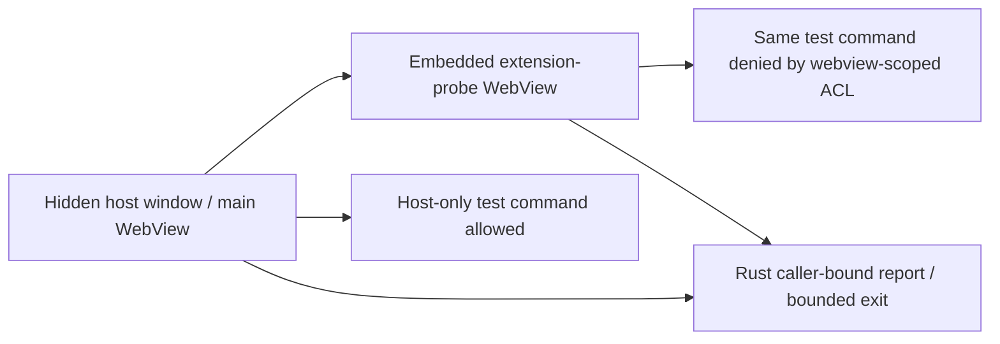

# Embedded extension surface prototype

- **Scope:** founder-authorized W5 experiment, not a production extension loader.
- **Runtime:** installed Tauri 2.11.2 with its experimental `unstable` feature.
- **Profile:** hidden test window, separate test-owned host/guest data directories.
- **Isolation limit:** real WebView command permissions for test commands only;
  this does not establish production asset, network, Engine or OS restrictions.



Create an empty owned evidence directory and set CLUAIZ_EXTENSION_PROTOTYPE_DATA
to its absolute path. Build/run offline using the existing App target cache:

```text
cargo run --offline --manifest-path test/extension-surface/Cargo.toml --target-dir app/src-tauri/target
```

The process prints EXTENSION_SURFACE_PROTOTYPE_RESULT and exits 0 only if both
actual renderer reports arrive, the child belongs to the expected native window,
its physical/logical bounds match, the host-only command runs once from the host
and its invocation from the child is denied. A 30-second runtime deadline exits
2. This fixture has no Engine credentials, user chats, installer or AI response.

main.rs owns native surfaces/report validation; build.rs registers both test
commands for ACL; capabilities distinguish WebView labels, not the shared window.
assets/probe.js invokes the same test command from both actual renderer contexts.
Generated gen/ and target/ are ignored build outputs. Cargo.lock starts from the
App's dependency lock to reuse its existing versions; evidence stays in the cache.
Main App Cargo/config/capabilities are deliberately unchanged by this prototype.
